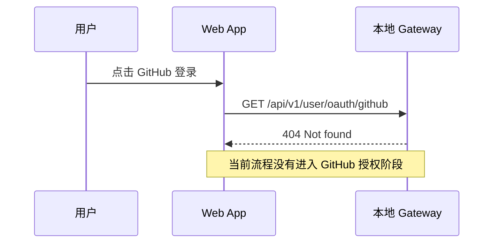

# GitHub 登录排查结果

## Intent：最终目标

解释 GitHub 登录 404 的根因，并约束后续修复范围。

## Data：可用证据

- 实际请求 http://127.0.0.1:17000/api/v1/user/oauth/github 返回 HTTP 404，响应为 {"code":1,"message":"Not found"}。
- App 的 src/app/core/services/auth.service.ts 中 loginWithGithub 直接 GET 旧接口，然后通过 storeLegacyAuth 保存 uuid/token；没有授权跳转及回调流程。
- Gateway 的 services/gateway/src/index.js 中 handleAilyAuthApi 注册了验证码、邮箱、微信移动端、会话查询、刷新及退出接口，没有 GitHub 登录路由。
- 后端 docs/API.md 的账户接口清单同样未提供 GitHub 登录接口。
- services/gateway/src/config.js 中 githubToken 是已登录用户反馈功能使用的上游令牌接口，不是 GitHub 登录接口。

## Edges：边界与限制

- 已确认当前仓库缺少完整接入；未确认 Aily 上游是否另有未记录的 GitHub OAuth 契约。
- 不能据此断言线上环境也完全不支持 GitHub 登录。
- 当前没有修改业务代码、认证配置或隐藏入口。

## Answer：结论与下一步

根因是前端遗留登录调用与现行 Gateway 认证能力不匹配，不是本地端口配置或 CORS 问题。

需要确认产品方向：保留 GitHub 登录并补齐上游授权/回调/令牌契约，或暂时隐藏尚未接入的入口。前者需要实际接口说明和回调配置，不能仅更换请求 URL。

## 自我复核

HTTP 复现和前后端代码相互印证 404 的原因；尚未执行 GitHub 授权，因此不宣称登录已修复。后续不得把消除报错或隐藏按钮等同于完成 GitHub 登录。
