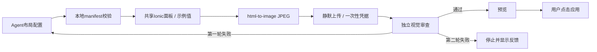
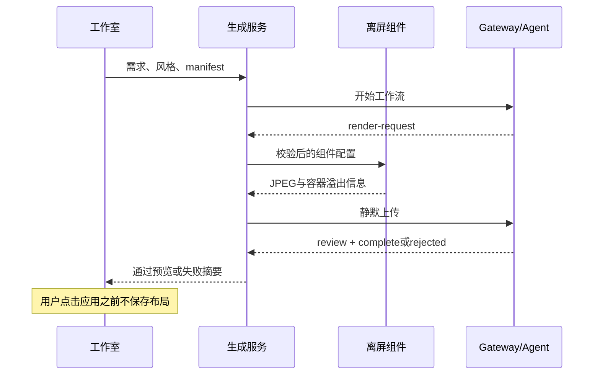

# 客户端静默补图与两轮视觉审查

## Intent：最终目标

为界面工作室增加字段匹配、布局设计、客户端静默生成审查图片、独立视觉审查，最多两轮。通过后展示同一张被审查的图片，由用户点击应用到设备。

## Data：可用证据

- `PageLayoutPanelComponent` 从真实设备页面提取，保留开关、按钮、滑块、输入、数值控件及主题。
- `InterfacePreviewService` 在离屏区域创建该面板，覆盖显示值为示例状态，通过 html-to-image 生成 JPEG。
- 生成流发送 `render-request` 后，客户端静默向 `/api/v1/interface/preview` 上传一次性 ticket、图片和溢出信息。
- 构建通过；范围限定的四个现有测试文件共 40 项通过。未新增测试用例。
- 完整测试入口被未改动的 BLE session.spec.ts 两个旧导出引用错误阻断；使用忽略目录 tmp 中的临时 tsconfig 限定现有测试范围后通过。
- 后端真实模型调用已到达补图事件；独立视觉模型实际识别双色图片成功。

## Edges：边界与限制

- 截图只覆盖离屏面板，不读取用户屏幕、其他页面、设备密钥或实时状态，不请求录屏权限。
- 取消或离开页面销毁临时组件，取消生成与上传；转图库的内部工作不可中途停止，但完成后不会继续上传。
- 使用当前浏览器系统字体，固定 390px 图片宽度，额外检查 768px 容器布局。容器查询和 cqw 使控件宽度跟随面板。
- DOM 转图与原生截图不是逐像素等价保证，实际 WebView 的复杂样式保真度仍需实机验证。
- 按用户约束未调用浏览器进行 UI 验收；没有声称完成端到端客户端图片验收。
- 上限为两轮（首次设计 + 一次修正），第二轮仍失败展示审查摘要；仅通过的完整配置可应用。

## Answer：交付与成功标准

代码包含严格的本地 manifest 校验、进度显示、取消清理、审查失败反馈和通过预览。最终返回的配置、图片及轮次必须对应客户端实际生成的最后一版，避免错配。现有“应用这个界面”是唯一保存入口。

## 自我审查

修正了上传响应和下一轮生成流之间的到达顺序竞态；最终响应绑定最后一次本地图片和配置。截图不再人为改变整页字体，只保留共享组件实际样式。浏览器截图、node-canvas、独立预览入口均未进入最终依赖和部署。

## 后续变更：结果展示真实 DOM

生成结果和可编辑草稿改为直接渲染共享 `PageLayoutPanelComponent`，与设备页使用相同 Ionic 控件和布局配置。图片只作为 AI 视觉审查的内部输入，不再显示为结果面板。DOM 预览显示当前字段值，仍不发送设备指令；AI 微调、反馈和用户手动应用保留。当前自动调整上限已更新为三轮。
