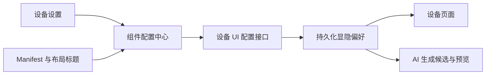
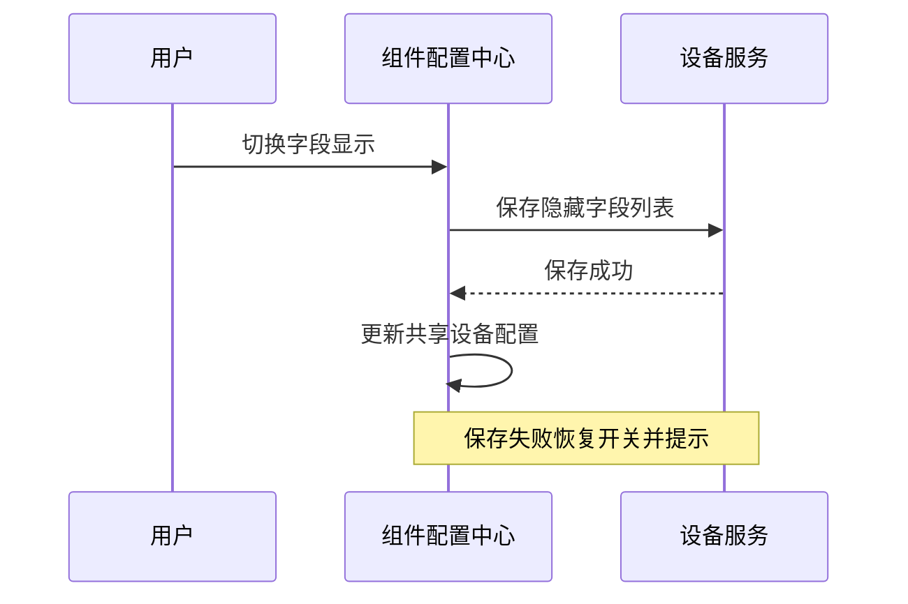

# 组件配置中心实施记录

## Intent：最终目标
在设备设置添加组件配置中心，左侧标题、右侧开关；按设备保存字段显隐。将当前 test 设备的 demoLabel 设置为隐藏，仍可恢复显示。

## Data：可用证据
- 设备 manifest 提供字段，PageLayout 保存组件标题与位置。
- 设备 UI 配置已有认证后的读取和部分更新接口；需核对服务端白名单与持久化。
- 设备页与 AI 生成共享组件渲染，必须统一处理隐藏字段。

## Edges：边界与限制
隐藏只控制显示，不删除固件能力、状态或命令权限。不得把 demoLabel 硬编码为全局默认隐藏。AI 重新生成和应用不能重置显隐偏好。遵守设备所有权与账户隔离。不开浏览器、不新增测试。

## Answer：交付格式与成功标准
独立组件配置页面、持久化通用字段配置、设备与 AI 预览一致；当前设备名称字段通过配置隐藏。前后端构建及必要已有检查通过。

## 执行记录与自我复核
- 复用 owner/tenant 隔离的 ui-config PATCH，新增 hiddenEndpointKeys 通用数组；最多 256 个唯一、非空、64 UTF-8 字节以内的字段 key，无数据库迁移。
- 设置新增“组件配置中心”，使用已有布局标题和 Manifest 可生成控件的字段显示开关，保存失败恢复。隐藏后仍在列表中，可重新显示。
- 实际控制页过滤隐藏字段并移除因此空出的整行。AI 候选也过滤隐藏字段，静默截图及预览自然保持一致。AI 应用只局部更新配置，不覆盖 hiddenEndpointKeys。
- AI 新布局若未包含已隐藏字段，重新开启时补入对应的默认组件再保存显示偏好，避免开关开启却无控件。
- 已将当前 test 的 demoLabel 写入设备配置，一次更新命中 1 条设备记录；没有字段名特判或固件修改。
- 返回页面闪烁：短暂未验证 Manifest 时保留最近已验证布局、字段和主题，但 stateFresh=false、manifestAccepted=false，不能下发命令；初次等待保存布局读取后再渲染，不先展示默认布局。
- 本地前端与 Gateway 构建通过；Gateway 容器已更新，健康检查正常。
- 已有工作流/布局测试 40 项通过；外层设备页 10 项通过；后端 interface-studio 22 项通过、1 项需要数据库的测试跳过。
- V2 页面已有测试 12 项中 10 项失败，其 mock 仍提供旧 connect/disconnect 而未实现当前 openConnection，出现 openConnection is not a function；此次未扩大范围修复测试替身。不能声称该套生命周期测试通过。

### 自我复核
配置属于设备所有者，未扩大共享用户权限；不是每位共享用户的独立偏好。没有删除真实能力，也不把视觉隐藏当权限隔离。没有浏览器复现闪烁，修复针对代码中确定的布局/主题过渡；连接恢复时按钮仍按真实状态禁用。

## 返回闪烁与实际服务版本复查（16:34）

### Intent
解决返回时旧页面短暂覆盖，以及设置中缺少新增入口的问题。

### Data
- 直接 GET 4200 的 main.js，确认旧进程返回的代码没有 components 路由，说明磁盘构建成功不代表开发服务器已更新。
- Ionic 在转场结束后立即 destroy 动画并清除 transform；Angular 下一 requestAnimationFrame 才清理离开页。返回时离开页 z-index 更高，间隙会恢复到原位并盖住进入页。

### Edges
不修改设备连接协议，不关闭路由动画。手势取消需要保留原页面。没有浏览器视觉复现，区分源码证据与现场效果。

### Answer
- 自定义动画 root onFinish 在完成时同步隐藏离开页，在手势取消时隐藏进入页，沿用 Ionic 的 ion-page-hidden 与 aria-hidden 状态，消除 transform 清除到 stack cleanup 之间的可见间隙。
- 重启当前 4200 开发服务。HTTP 返回的新 main.js 已包含组件路由与 inactivePage 隐藏逻辑；设置模块包含组件配置入口。
- 现有动画测试 6 项通过，开发服务编译通过，diff 空白检查通过。

### 自我复核
上次仅验证 build 和路由 HTTP 200 不足以确认功能上线：SPA 对未知路径也返回 200。今后本地部署验证应核对服务实际返回的关键模块或路由。旧服务未更新也意味着此前修复可能未在用户页面执行，不能把用户反馈归因于同一个已验证修复再次失效。
