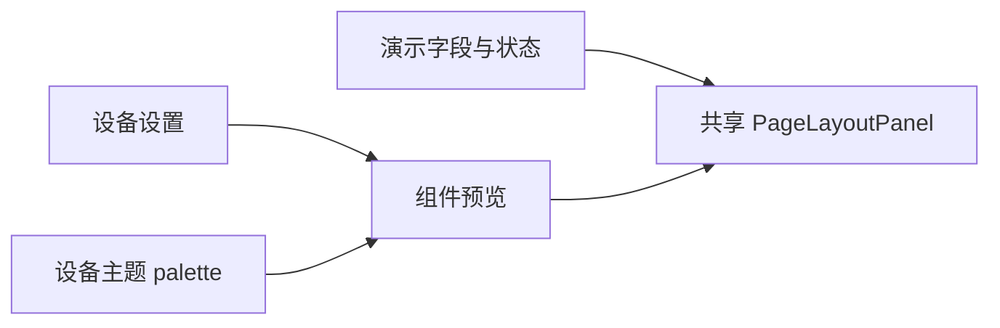
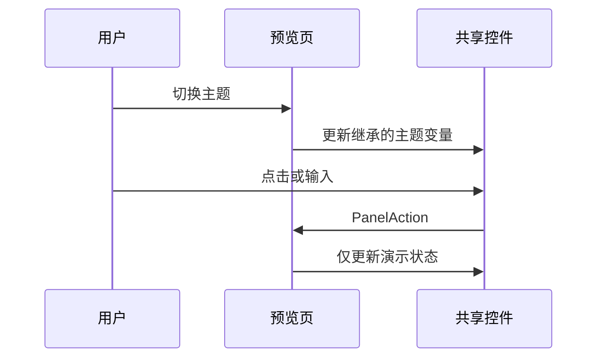

# 组件预览页面

## Intent：最终目标
设备设置新增组件预览页，顶部切换主题，集中展示当前 V2 控制页支持的组件。

## Data：可用证据
共享 PageLayoutPanel 支持 switch、button、slider、input、value 五种组件；input 根据字段类型呈现文本或数字输入。设备主题为清透蓝、暖砂、石墨。

## Edges：边界与限制
复用真实 Ionic 控件，不使用渲染图。组件使用明确的演示数据，操作只更新预览状态，不连接设备。主题只作用于当前预览，不覆盖设备主题或显隐偏好。没有新增测试或浏览器验证。

## Answer：交付与成功标准
设置新增“组件预览”入口，路由 component-preview。展示五类组件共六个示例，顶部三主题切换。前端构建通过，HTTP 返回的实际 main.js 已包含新路由，开发服务推送更新。

## 自我复核
“全部组件”的范围是当前 V2 页面支持的全部五类控件，未将旧版拖拽编辑器的独立控件混入。示例数据不对应真实设备字段，不构成针对用户硬件的特殊逻辑。构建验证不能替代浏览器视觉确认。
