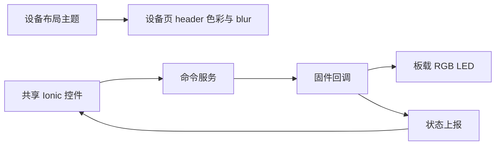
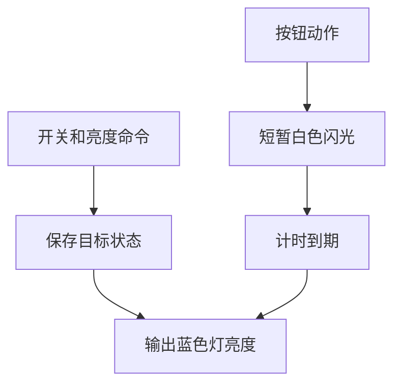

# 设备主题与板载灯控制修复

## Intent：最终目标
设备页使用透明模糊 header，隐藏协议版本栏，按钮不换行，开关、亮度和动作实际驱动板载灯。

## Data：可用证据
- header 的全局渐变读取应用主题；设备 technical 主题只作用于内部内容，无法传递到外层 header。
- 共享控件输入框占用按钮空间，按钮允许收缩造成中文换行。
- 固件回调只有状态上报，没有 GPIO 操作。用户确认控制板载 LED。
- Espressif WiFiduino32S3 定义 RGB_BUILTIN 使用 GPIO 48，与当前编译的 ESP32S3 引脚一致。

## Edges：边界与限制
保留既有 manifest 字段及设备身份；不改全局页面样式，不自动应用 AI 草稿。不新增测试、不使用浏览器确认。短闪用非阻塞计时，结束恢复开关与亮度。

## Answer：交付与成功标准
应用构建通过；固件编译、串口写入并恢复在线；如无法确认物理灯光，明确标注需现场观察。

## 执行记录与自我检查
- 删除 Manifest / Layout / State 栏；设备页覆盖全局渐变为透明 blur，读取子页面 layout.style，沿用现有 stateLabel 的动态组件读取方式，个人主题优先。
- 共享按钮禁止换行和 flex 收缩，输入框 min-width: 0 并分配剩余宽度，实际页面与生成预览一致。
- 固件通过 RGB_BUILTIN 驱动蓝灯，开关控制亮灭、亮度映射 0–255；动作白光短闪 250ms 后恢复目标状态，不阻塞通信。
- npm run build:local 通过，git diff --check 通过，本地 4200 返回 HTTP 200。
- 固件编译成功，应用区 0x10000 写入 1,015,584 字节并通过 hash 校验；没有重写 NVS 或分区表。
- 只读查询确认 mqtt_online=1，新启动状态 revision=3、uptimeSeconds=10。之前 pressButton、demoBrightness、demoLabel 命令均 acknowledged / 200，支持“传输正常但没有 GPIO 实现”的结论。
- 自我检查：构建和在线不等于肉眼确认灯光；未进行浏览器操作或拍摄硬件。尚需用户现场观察更新后的灯光与页面。亮度为 0 或开关关闭时蓝灯不亮，按钮短闪独立于这两个状态。
