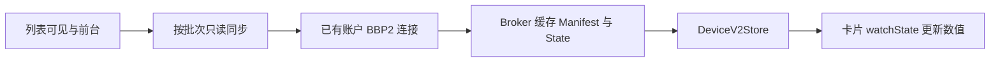
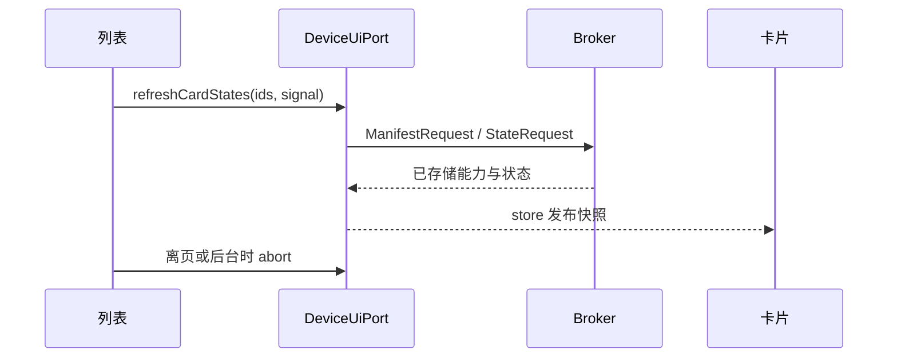

# 设备列表初始数值同步

## Intent：最终目标
设备列表卡片首次进入就能读取状态数值，不依赖先打开设备详情。

## Data：可用证据
Deviceblock 只 watchState；DeviceService.queryDevice 的 BBP2 分支也只绑定缓存观察。ManifestCache 只保留能力，不保存状态值。详情页的同步会首次发 ManifestRequest 与 StateRequest，导致卡片此前无值。

账户 BBP2 的只读同步从 Broker 缓存读取 Manifest/State，按账户 grant 鉴权；与 BLE 连接、网关唤醒和持续 StateInterest 租约分离。

## Edges：边界与限制
只读取云端 BBP2 设备，跳过禁用、体验和已确认离线设备。每批最多 4 台，共享已有账户连接；离页、后台、销毁时取消等待，账户切换停止后续批次。读取失败不伪造数值，不把缓存读取改成设备命令。不新增测试，不调用浏览器。

## Answer：交付与成功标准
列表在首次显示、设备目录更新、返回列表及恢复前台时发起只读同步。原卡片 watchState 自然收到数据；纯蓝牙设备维持原行为。

## 自我复核
实现是初始只读同步，不额外创建持续实时订阅；不会声称列表拥有高频实时遥测。前端构建通过；已有账户客户端 5 项与设备导航 1 项测试通过，未新增测试。开发服务已重编译并推送更新。取消只终止当前调用方等待及后续批次，不打断其他消费者共享的在途分页请求。
