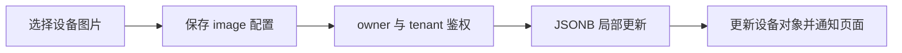
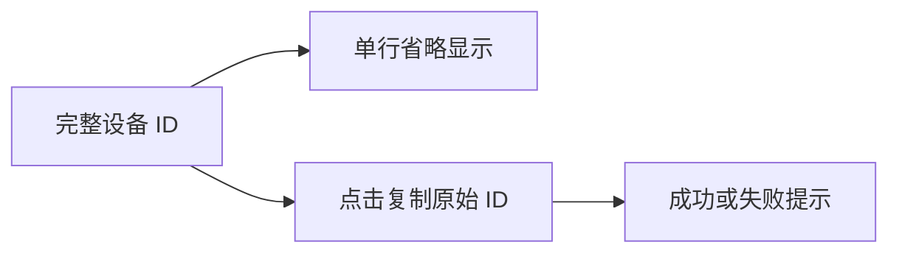

# 设备图片与信息卡修复

## Intent：最终目标
选择设备图片后立即更新且刷新后保留；标题行右端放置编辑按钮并垂直居中；ID 单行省略，点击复制完整值。

## Data：可用证据
前端 saveDeviceConfig 和后端 ui-config 均只允许 component、layouter、customName、hiddenEndpointKeys，没有 image。原 selectIcon 保存失败无提示，成功后也未通知设备订阅者。信息卡已有 class 但缺失标题行 flex 和 ID overflow 样式。

## Edges：边界与限制
保留设备 owner/tenant 鉴权。image 仅为图片引用，限制类型、长度和 NUL；不修改固件、设备 ID 或用户已选图片。未使用浏览器或新增测试。

## Answer：交付与验证
- 前后端允许持久化 image；选择流程检查账户上下文，成功发 image 更新通知，失败给出提示。
- 标题行 flex 对齐，编辑按钮固定点击区域；摘要 min-width:0 让完整 ID 在单行内省略，复制仍使用原始值。
- 前端、Gateway 构建通过，Gateway 已重建运行；服务实际 main.js 指向最新设置模块。
- 现有后端相关测试 22 项通过、1 项跳过；git diff --check 通过。

## 自我复核
修复的是保存白名单与 UI 更新链路，没有用替换图片或仅本地赋值掩盖保存失败。编译和既有测试不等于真实点击选图验证。实际图片选择仍由用户执行。

## 信息卡细节调整（16:43）
编辑按钮改为 28px 点击区域、13px 图标；移除相机按钮，保留点击图片选图。图片和摘要沿用父级 align-items:center，图片按钮清除默认 padding。图片壳使用 72% 白色背景；ID 上边距收紧到 2px，去掉上下额外 padding。前端构建通过，实际开发服务返回最新设置模块。

## 名称保存后界面更新修复（16:47）

- Intent：保存名称后立即更新设置卡片、列表卡片和详情标题，并提供保存结果反馈。
- Data：只读查询确认 ui_config.customName 已保存为 WIFIduino32 S3；弹窗 handler 未返回保存 Promise，列表卡片采用 OnPush 却没有订阅设备配置变化。
- Edges：不重命名为预设值，继续保存用户输入；账户切换后不把结果应用到新账户，失败保留弹窗输入。
- Answer：弹窗等待保存成功才关闭，成功/失败均提示；设置页显式刷新，列表监听设备配置事件，详情接收名称和图片更新。前端构建通过，HTTP 实际返回新版设置模块。

自我复核：数据库证据能确认用户此前保存成功；代码更新解决刷新与结果反馈，不把构建通过描述为浏览器点击验证。
