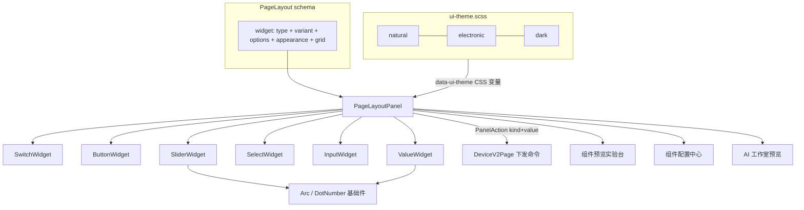
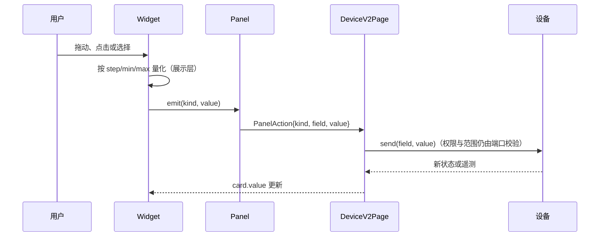
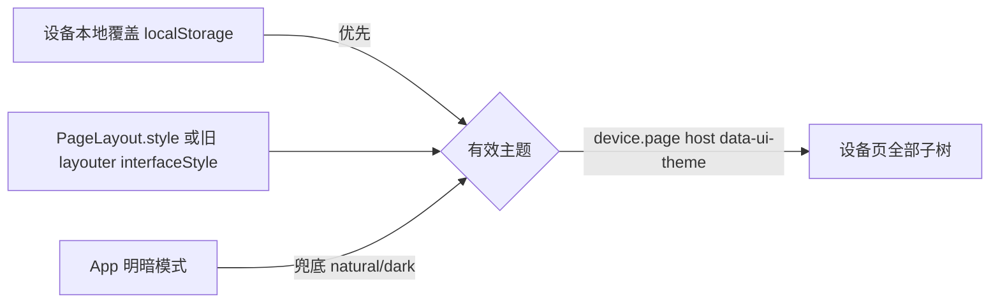

# 设备组件库与三主题重构计划

## Intent：最终目标

重做设备控制页的显示组件库：对标米家「控制中心」的卡片、磁贴、大面积填充滑块、温控表盘、模式选择等交互；每个组件都有细粒度、可保存的参数。旧的两套主题体系换成三套新主题：

| 主题 id | 名称 | 参考 |
| --- | --- | --- |
| `natural` | 自然 | 米家浅色：白卡片、大圆角、激活态蓝色实底磁贴 |
| `electronic` | 电子 | OLED 点阵：#070809 底、#111315 面、#FF3B30 红、等宽大写、点阵数字、虚点轨道 |
| `dark` | 暗夜 | 米家深色：纯黑底、#1C1C1E 卡片、激活态蓝色实底 |

真实设备页、组件预览页、组件配置中心和 AI 界面工作室共用同一套组件与主题。

## Data：可用证据

- 渲染入口是 `PageLayoutPanel`，只有 5 种控件（switch/button/slider/input/value），参数只有 `appearance`。
- `PageLayout` 在客户端 `page-layout.ts` 和服务端 `gateway/src/device-v2/page-layout.js` 都用 `exactKeys` 严格校验，并存到数据库 jsonb。
- 有两套主题体系：
  - 设备本地主题 `DeviceTheme`（clear/sand/graphite，存 localStorage）
  - 布局风格 `InterfaceStyle`（minimal/technical/warm，存在 PageLayout.style 里，AI 工作室也用它）
  - 选了本地主题时，会用 CSS 覆盖布局风格。
- Manifest 中只有 text(type 5) 字段可以带 `enumValues`；客户端已映射为 `choices`。
- AI 生成的 proposal 是 `{id,title,width,emphasized}`，客户端、服务端各校验一遍，由 `SKILL.md` 约束。
- Font Awesome 6 Light 已经全局可用（`fa-light fa-*`）。

## Edges：边界与限制

- **向后兼容**：新字段 `variant`、`options` 都是可选的，旧布局不用迁移数据库就能继续用。旧主题 id 读取时映射到新 id（minimal/warm/clear/sand → natural，technical → electronic，graphite → dark），保存时一律写新 id。
- **能力边界不变**：`type` 仍只表示数据语义和命令兼容性；`variant` 和 `options` 只影响展示。展示参数不能放宽命令权限、数值范围或步长。
- **新增 `select` 类型**：只绑定「可写 property、text、带非空 enumValues」的字段，前后端校验一致。已有布局里绑定到同一字段的 input 仍然兼容。
- **零依赖**：点阵数字用自建 5×7 字模 SVG，不引入字体或 UI 库；图标沿用 FA。
- **不做**：不改固件协议，不新增测试（遵循用户规则），不开浏览器做视觉确认，不改旧版 layouter2 内部控件，只接入主题 token。

## Answer：交付格式与成功标准

1. `src/app/device/v2/widgets/`：6 个类型组件、18 个变体，加点阵数字、仪表弧线等基础组件。
2. `src/theme/ui-theme.scss`：唯一主题 token 源；删掉 `interface-style.scss` 和 `_device-theme.scss`。
3. PageLayout schema 扩展 `variant`、`options`、`select`，前后端对齐。
4. 组件预览页改为组件库实验台：三主题切换，每个变体都能现场调参数。
5. 组件配置中心增加每个组件的样式编辑（变体 + 参数），保存到 PageLayout。
6. AI 工作室三主题替换，proposal 可选 `variant`、`icon`，SKILL 同步更新。
7. 客户端 `ng build` 通过；服务端语法检查和已有 page-layout / interface 测试通过。

---

## 组件目录

| type（数据语义） | variant | 说明（米家对标） | 读取的 options |
| --- | --- | --- | --- |
| switch | `toggle` 默认 | 行式开关 | icon caption onText offText accent |
| switch | `tile` | 控制中心方形磁贴，激活时整块实底 | icon caption onText offText accent |
| switch | `power` | 大圆形电源键，激活时发光 | icon onText offText accent |
| button | `pill` 默认 | 胶囊按钮 | icon caption actionText confirm accent |
| button | `tile` | 场景磁贴 | icon caption actionText confirm accent |
| button | `icon` | 圆形图标按钮 | icon actionText confirm accent |
| slider | `bar` 默认 | 细轨道加圆钮 | icon caption decimals ticks accent |
| slider | `fill` | 控制中心整块填充滑块（水平或竖直） | icon caption decimals orientation accent |
| slider | `dial` | 温控弧形表盘，两侧带 −/+ | icon caption decimals ticks accent |
| slider | `stepper` | − 数值 + | icon caption decimals accent |
| select | `segment` 默认 | 分段控制 | icon caption accent |
| select | `chips` | 模式磁贴网格 | icon caption accent |
| input | `field` 默认 | 输入框加发送 | icon caption actionText accent |
| value | `text` 默认 | 标题加数值行 | icon caption decimals warnBelow warnAbove |
| value | `metric` | 大数字传感卡 | icon caption decimals warnBelow warnAbove accent |
| value | `gauge` | 环形仪表 | icon caption decimals min max ticks warnBelow warnAbove accent |
| value | `level` | 电量或进度条 | icon caption decimals min max ticks warnBelow warnAbove accent |
| value | `status` | 状态点加文字 | icon caption onText offText accent |
| value | `trend` | 实时趋势折线 | icon caption decimals points warnBelow warnAbove accent |

### options 字段（平铺、全部可选）

| key | 类型 | 约束 |
| --- | --- | --- |
| icon | string | `^[a-z0-9-]{1,40}$`，FA 图标名 |
| accent | enum | blue / teal / green / amber / orange / red / violet |
| caption | string | ≤ 64 UTF-8 字节 |
| onText / offText / actionText | string | ≤ 24 UTF-8 字节 |
| confirm | boolean | 需要二次点击确认 |
| decimals | integer | 0–4 |
| min / max | number | 有限数，同时出现时 min < max |
| warnBelow / warnAbove | number | 有限数，越界时显示告警色 |
| orientation | enum | horizontal / vertical |
| ticks | integer | 0–24 |
| points | integer | 8–120 |

## 主题合并

旧值映射 `normalizeUiTheme`：只有一张表，三处读取（localStorage、PageLayout、旧 layouter）共用；服务端解析时做同样的映射。

## 执行步骤

1. 主题：新建 `ui-theme.ts` 和 `ui-theme.scss`，替换全部 `data-interface-style` 和 `data-device-theme` 引用。
2. schema：客户端 `page-layout.ts`、服务端 `page-layout.js` 扩展，加入 select 兼容规则。
3. 组件库：先写基础件（DotNumber、Arc），再写 6 个类型组件，最后写 Panel 编排。
4. DeviceV2Page：PanelAction 改为直接携带 value，去掉对 Ionic CustomEvent 的依赖。
5. 组件预览实验台和组件配置中心的样式编辑。
6. AI 工作室：主题选项、proposal 的 variant/icon、SKILL.md、服务端校验。
7. 构建验证与自我复核，结果追加到本文末尾。

---

## 执行记录（2026-10-10 晚）

### 范围变化
- 组件从 6 类 19 个变体扩到 **7 类 59 个变体**，并按「Blinker 控件库」设计稿（`设备组件库设计稿.html`，与已发布 artifact 一致）对齐 token、字体、图标和 57 个参数。
- 视觉以米家为准；Mushroom / Hemma / HA 只参考组件种类（实体行、胶囊标签、窗帘、定时、状态时间条等）。
- 新增图表能力：trend / bars / wave / line（lightweight-charts）/ timeline / stat / log；历史数据来自本机记录器 `EndpointHistory`（每字段最多 240 点、48 小时，存于 localStorage）。
- 主题背景：自然主题用 home-demo.jpg，暗夜主题用 bedroom-demo-night.jpg（均缩到 960px），模糊后加遮罩；电子主题用纯黑加点阵底纹。
- 复合卡片（多键面板、多值汇总）按决定放到下一步。

### 结构
- `core/device-v2/page-widget.ts` ↔ `gateway/src/device-v2/page-widget.js`：变体表与参数规则，已用脚本核对两侧一致。
- `device/v2/widgets/`：10 个家族组件（switch / button / slider / dial / select / input / value / meter / chart / color），基类 `WidgetBase`、`RangeWidgetBase`、`ReadingWidgetBase`，以及 `UiIcon`（31 个虚点描边图标）和 `DotText`（5×7 点阵字）。
- `sections/device/widget-inspector/`：参数检查器，组件库实验台和组件配置中心共用。
- AI：`device-ui-agent/src/layout-guide.ts` 排版指南；proposal 可选 variant / icon / tone / height，宽度可取 2、4、6、8。

### 验证
- `ng build --configuration development` 通过，无警告。
- device-ui-agent `tsc --noEmit` 通过；gateway 改动文件 `node --check` 通过。
- 前端单测：HEAD 上 `ble-direct/session.spec.ts` 本身就引用了不存在的导出，导致 `ng test` 整体无法编译，与本次改动无关；相关 spec 已同步主题 id 和 API，但尚未跑通，需另行处理。
- 未做真机或浏览器视觉验收；页面需要登录才能访问。

### 自我复核
- 电子主题沿用设计稿的选择，把所有色调统一为红色，因此 timeline 的多状态在电子主题下只能靠图例区分。
- 字体 Outfit / Geist Mono 尚未打包，目前回退到系统字体；点阵数字由 DotText 实现，不依赖 Doto。
- 新设备的默认布局尺寸改为按类型给定（磁贴 4×2 等），已保存的布局不受影响。
