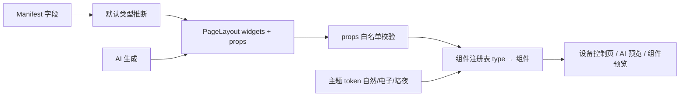
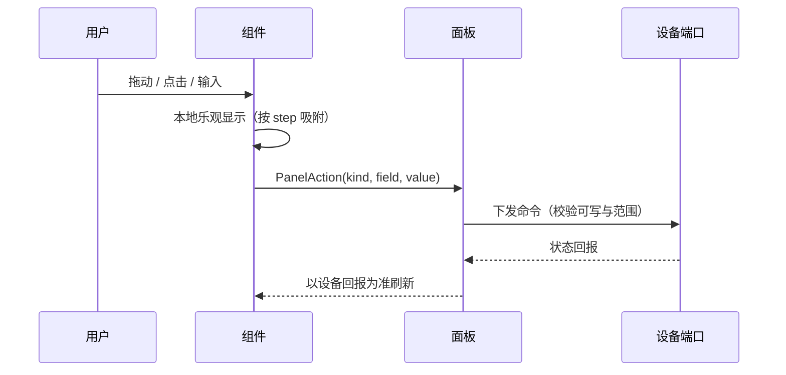

# 设备组件库重设计方案

## Intent：最终目标
重做 V2 设备控制页的组件库：组件足够丰富、参数足够细、视觉对标米家“控制中心”。提供三套主题：自然（米家浅色）、电子（点阵 OLED）、暗夜（米家深色）。本阶段先交付可交互 HTML 设计稿评审，确认后再落 Angular 实现。

## Data：可用证据
- 现有 `PageLayoutPanel` 只有 switch / button / slider / input / value 五类，全部是 Ionic 原生控件，参数只有 `appearance`（default / compact / emphasized）。
- `PageLayout` 协议：8 栏栅格，widget 字段经 `exactKeys` 严格校验，新增字段必须同步解析、AI 生成提示与后端白名单。
- `DeviceUiEndpoint` 已带 `minimum / maximum / step / unit / choices / maxLength`，可直接驱动大部分组件参数。
- 用户给出电子风格参考：黑底 #070809、卡片 #111315、红 #FF3B30、点阵数字、点状描边、等宽字体、ASCII 质感（code.storage）。

## Edges：边界与限制
- 设计稿阶段不改动任何业务代码，只交付 HTML 原型与本方案。
- 主题只是视觉皮肤，三套共享同一组 token 名与同一套组件结构，不为单一主题分叉组件。
- 组件只做显示与交互，不承担权限、命令校验；可写性仍以 Manifest 为准。
- 以下属于协议层待决问题，设计稿中已标注，需要你拍板：
  1. **多字段绑定**：多键面板、多值汇总需要一个 widget 绑定多个 endpoint。现有协议是单 `endpointKey`。
  2. **颜色值约定**：色盘写回 `text #RRGGBB` 还是 `integer 0xRRGGBB`。
  3. **定时语义**：倒计时写回剩余秒数，还是固件自行计时只下发时长。
  4. **旧类型兼容**：旧五类映射为新类型（switch→toggle、button→action、slider→level、input→stepper/text、value→number），解析期自动迁移。

## Answer：交付格式与成功标准
- 交付：`docs/2026-10-10/设备组件库设计稿.html`，发布为可分享页面。
- 成功标准：18 个组件全部可操作；三主题即时切换；每个组件的通用参数（标题、图标、色调、宽高）与专属参数都能在右侧检查器调整，并实时输出对应的 PageLayout widget 片段。

## 主题 Token

| Token | 自然 | 电子 | 暗夜 |
|---|---|---|---|
| 背景 | #F2F3F5 | #070809 + 点阵底纹 | #0C0D0F |
| 卡片 | #FFFFFF 无描边 | #0F1113 + 1px #2A2D31 | #1B1C20 |
| 强调 | 按组件色调（蓝/橙/绿/紫/青/红） | 统一 #FF3B30 | 色调提亮一档 |
| 圆角 | 22 | 14 | 22 |
| 数字字体 | Outfit Light | Doto 点阵 | Outfit Light |
| 正文字体 | 系统中文 | Geist Mono 大写 | 系统中文 |
| 弧线/轨道 | 实线 | 圆点虚线（dash = 线宽 × 1.8） | 实线 |

## 组件清单（18）

| 分类 | type | 名称 | 绑定字段 | 专属参数 |
|---|---|---|---|---|
| 开关 | tile | 图标开关卡 | boolean 可写 | 开启样式（填充/浅色/描边）、状态文案、角标 |
| 开关 | toggle | 胶囊开关行 | boolean 可写 | 说明文字、图标底、开关尺寸 |
| 开关 | action | 场景按钮 | action null/boolean | 形状（圆/胶囊/整块）、长按确认、完成文案、执行次数 |
| 开关 | keys | 多键面板 | boolean × N（待决 1） | 按键名称、连体面板、指示灯、按键图标、排布 |
| 开关 | mode | 模式宫格 | choices 枚举 | 选项与图标、样式（宫格/分段/胶囊）、显示图标 |
| 调节 | level | 大块亮度滑块 | 有范围数值 | 方向、填充（纯色/渐变）、分段刻度、范围、单位 |
| 调节 | gradient | 色温/色彩滑块 | 有范围数值 | 轨道预设（色温/色相/亮度）、粗细、滑块形状、刻度 |
| 调节 | dial | 环形温度旋钮 | 有范围数值 | 弧度、线宽、刻度、步长、副标题、加减按钮 |
| 调节 | levels | 档位选择 | integer 档位 | 档位数、样式（柱/点/分段）、档位名、允许关闭、加减 |
| 调节 | color | 色盘 | 颜色（待决 2） | 模式（色环/色板/两者）、色环宽度、色板、显示色值 |
| 显示 | number | 大数字读数 | number 只读 | 小数位、字号、单位位置、附注、变化量、告警阈值 |
| 显示 | trend | 趋势曲线 | number 遥测 | 图形（线/面/柱/阶梯）、点数、平滑、极值、坐标 |
| 显示 | ring | 环形进度 | 有范围只读 | 形状（整环/半环/分段）、线宽、范围、低值告警 |
| 显示 | status | 状态徽章 | 枚举/boolean 只读 | 形态（圆点/胶囊/横幅）、状态语义映射、脉冲、附注 |
| 显示 | summary | 多值汇总 | number × N（待决 1） | 数据项、列数、分隔线、首项强调 |
| 输入 | stepper | 数值步进器 | 有范围数值 | 布局、范围步长、小数位、长按连续、显示范围 |
| 输入 | text | 文本输入 | text 可写 | 占位、最大长度、按钮文案、计数、多行 |
| 输入 | timer | 定时/倒计时 | integer 秒（待决 3） | 预设分钟、动作文案、显示（环/条/文字） |

通用参数（全部组件）：`title`、`showTitle`、`icon`、`tone`、`grid.width`（2/4/8 栏）、`grid.height`（行）。

## 协议扩展草案

```ts
interface PageLayoutWidget {
  widgetId: string;
  type: WidgetType;               // 18 种
  endpointKey: string;
  endpointKeys?: string[];        // 待决 1：仅 keys / summary 使用
  title?: string;
  grid: PageWidgetGrid;
  props?: Record<string, string | number | boolean>; // 按 type 白名单校验
}
```

每个 type 维护一份 props 白名单与取值范围，解析期逐项校验，未知键直接拒绝，与现有 `exactKeys` 风格一致。





## 下一步（设计稿通过后）
1. 拍板四个待决问题。
2. 扩展 `page-layout.ts`：type 枚举、props 白名单、旧类型迁移。
3. 新建 `src/app/device/v2/panel/widgets/`，每个组件一个独立 standalone 组件，面板按 type 分发。
4. 主题 token 并入 `_device-theme.scss`，三主题替换现有清透蓝/暖砂/石墨（需确认是否保留旧三套）。
5. 同步 AI 生成提示词与后端白名单；组件预览页改用新组件库。

## 自我复核
- 设计稿中的交互只更新本地演示状态，不代表最终下发时机（拖动中是否节流下发需在实现阶段定）。
- 电子主题把六种色调统一为红色，牺牲了色调区分度，换来参考图的单色气质；若需保留区分，可改为红/白两级。
- 待决 1 若选择不支持多字段，keys 与 summary 需退化为多个单字段组件并排，设计稿中的连体效果需另行实现。
