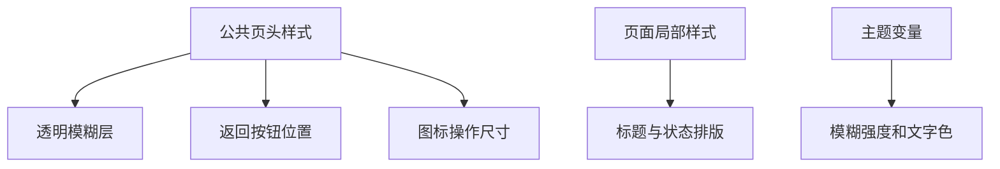
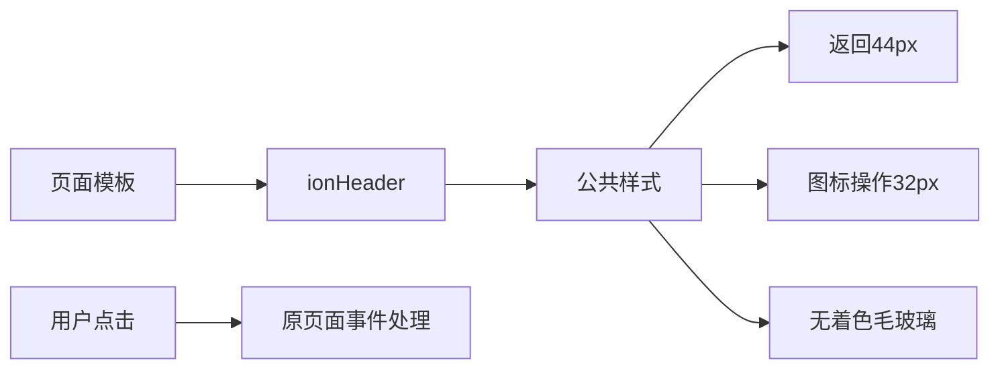

# 全局页头样式统一计划

## Intent：最终目标

所有页面页头使用透明底色的毛玻璃。返回箭头与用户图二的设备页对齐；图标操作按钮更紧凑，取消内部 padding。

## Data：可用证据

- 公共页头伪元素叠加 58% 背景色，主题 mixin 又单独叠加主题底色。
- 设备页的返回按钮单独使用 6px 工具栏边距、44px 按钮槽位、24px 图标，其他页面仍走 Ionic 默认位置。
- 设备页操作按钮为 44px，主页为 38px，BLE 工具为 34px；部分页面还有独立图标尺寸。
- 首页顶部另有渐变色遮罩；仅清理页头背景仍会留下着色。

## Edges：边界与限制

- 保留 backdrop-filter 模糊；“无背景”指没有额外着色层。
- 保留安全区、页头高度和正文避让；主页标签与二级页面的高度不同。
- 纯图标按钮为 32×32px，图标 16px；文字操作如保存、取消不强制方形。
- 返回槽位保持 44px，中心距左侧 28px（另加安全区）；只缩小操作按钮。
- 编辑器和消息详情的自定义返回行为保留，不绕过未保存提醒。
- 不新增测试用例、不调用浏览器做 UI 确认。

## Answer：交付格式与成功标准

1. 公共样式统一透明毛玻璃与返回位置，清除冲突的页面覆盖。
2. 图标按钮的 host padding 和 Ionic 四向 padding 都归零。
3. 切换为 loading spinner 时尺寸不跳变；设备页标题同步收回多余避让空间。
4. 构建通过，记录实际验证与未验证边界。

## 架构图

## 数据流图

