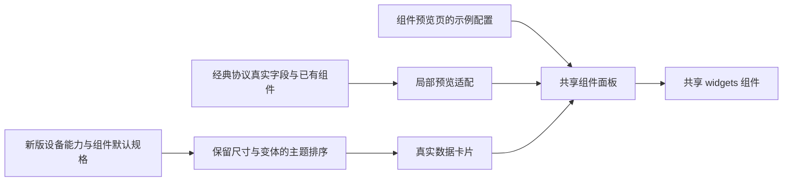
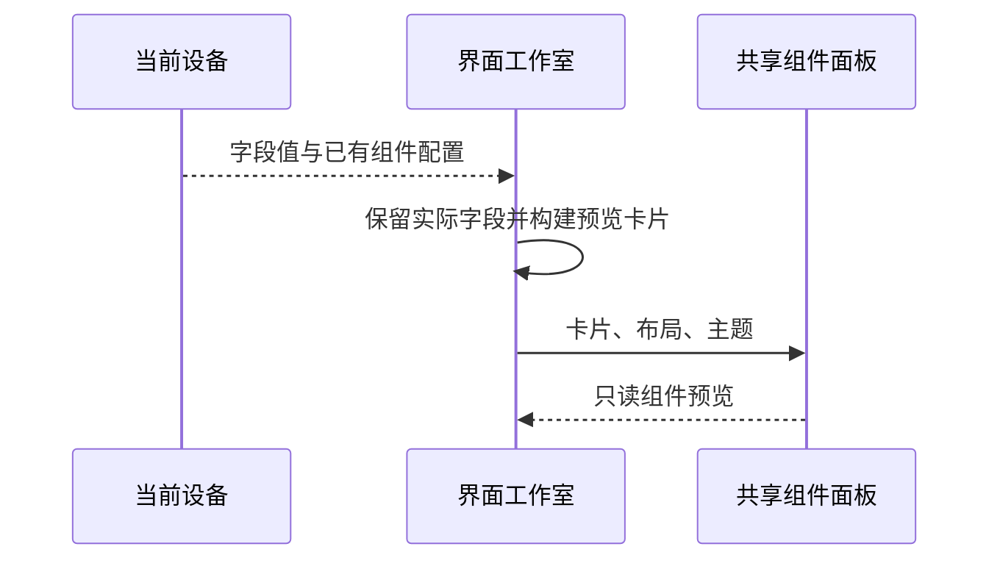

# 布局预览组件统一计划

## Intent：最终目标

让界面工作室的布局预览使用组件预览页中的同一组共享组件，避免不同协议设备走不同的组件外观实现。

## Data：可用证据

- 组件预览页通过 PageLayoutPanelComponent 渲染共享 widgets；示例目录只提供演示数据和配置。
- 工作室在新版设备且设备能力已确认时使用该共享面板，经典协议设备则使用 tile-switch、tile-range、tile-value 等手写简化模板。
- 经典协议的 InterfaceTile 已保留真实字段键、标题、类型、单位和原始组件配置，可在预览边界转换为共享面板输入。
- 新版预览已保留 AI 选择的组件变体，但未将附属读数传给实际渲染卡片。
- 用户后续截图显示共享组件已经加载，但开关、按钮和读数被排成整行大卡片。4200 服务确实来自当前目录，返回的最新模块已经没有旧简化模板。
- 第二个根因：capabilityTiles 丢掉默认布局的宽高和变体，arrangeTiles 再次把读数改为宽 4、其他组件改为宽 8；窄屏下这些组件继续被放大为整行。

## Edges：边界与限制

- 只统一布局预览的渲染，不修改设备协议、指令发送、AI 请求或应用布局的保存流程。
- 使用真实设备值与已有组件配置，不引入组件预览页的 demo 字段或示例数值，不伪造已确认的设备能力。
- 共享面板保持只读；保留 440px 内容高度上限、内部滚动和 12px 外层内边距。
- 经典编辑器一瞥的示意画布、风格选择卡片不属于本次布局预览替换范围。
- 保留工作区现有变更；不新增测试用例，不调用浏览器验证 UI。
- 初始预览保留共享组件规格给出的尺寸与变体；不按 demoPower 等具体字段名称硬编码图标或组件类型，不注入示例历史数据和阈值。

## Answer：交付格式与成功标准

1. 经典协议的真实组件数据经过局部适配后使用 PageLayoutPanelComponent；删除替代它的简化卡片模板和专用样式。
2. 新版布局预览保留组件变体、主题、标题和附属读数，维持原有布局校验。
3. 通过 Angular 构建、样式编译及适用的现有检查；记录验证结果和未覆盖边界。
4. 交付代码与《布局预览组件统一记录》，说明根因、实现、验证和自我复核。
5. 修正初始预览覆盖组件规格的问题：主题排序只改变顺序与强调状态，已有宽高和变体继续传到渲染层；同步相关现有断言并检查实际服务返回的新模块。

## 架构图

## 数据流图

