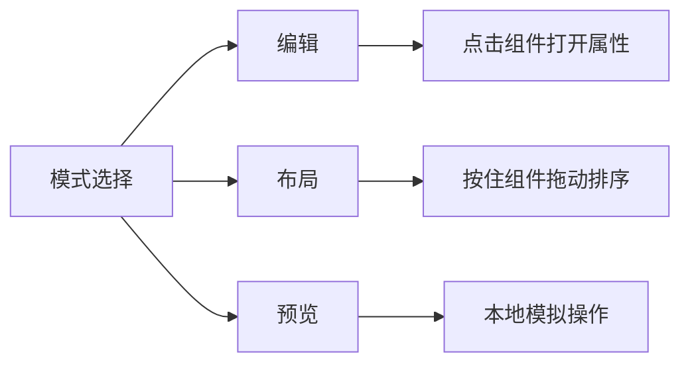
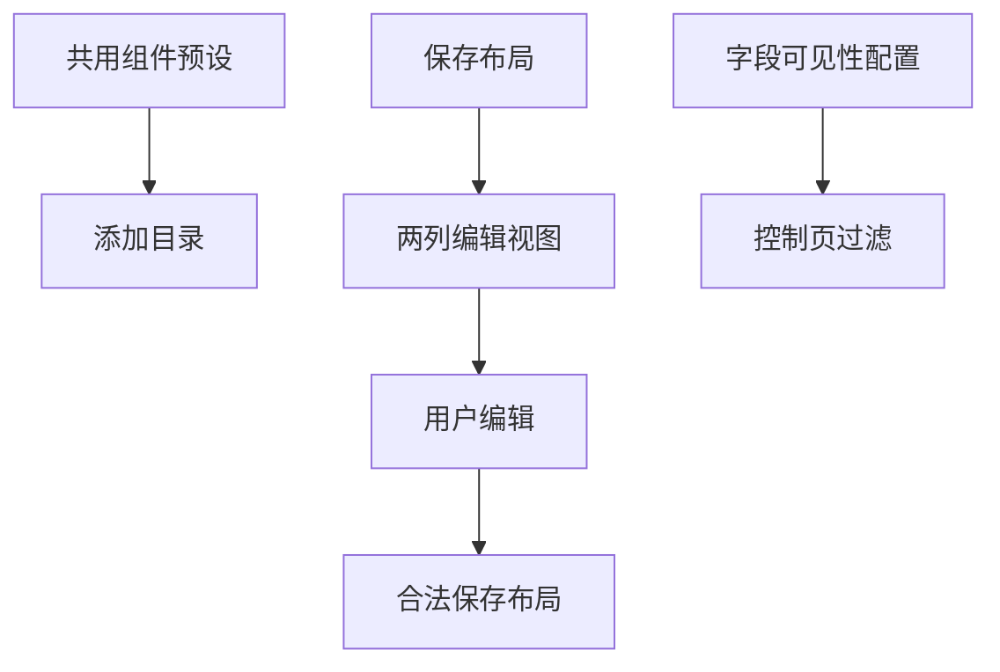
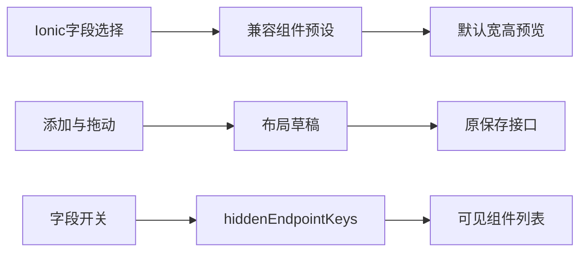

# 手动编辑尺寸与字段可见性修正计划

## Intent：最终目标

手动编辑画布与添加目录按照半宽／整宽显示组件，保留各组件预设高度；字段选择使用 Ionic 组件。组件配置中心关闭字段后，设备控制页可靠隐藏相应组件。

## Data：可用证据

- 组件预览在手机把保存宽度 2 映射成半宽，4／8 映射成整宽；编辑器却直接把 8 栏压进手机宽度。
- 添加目录忽略预设宽高，固定 176px 高，手机强制单列。
- 预设配置本身已共用 WIDGET_PRESETS，无需创建另一套默认值。
- 用户明确表示只需要半宽／整宽两种视觉宽度。
- 原字段选择为浏览器 select；项目已安装 Ionic 并导入 IonicModule。
- 用户反馈组件配置中心已关闭字段，控制页仍显示绑定组件；需要核对保存与渲染链路，不按具体字段名处理。

## Edges：边界与限制

- 保存协议与固件不变；编辑视图的两列坐标不能直接覆盖保存文档的八栏坐标。
- 进入编辑器、切换预览不自动修改布局；只有用户拖动、增删或改属性才产生草稿变更。
- 组件高度与外观继续来自已有预设。
- 不新增测试用例，不调用浏览器；复用已有检查并明确验证限制。

## Answer：交付格式与成功标准

1. 编辑画布与添加目录显示半宽／整宽，不再出现手机四列瘦高卡片。
2. 添加目录按每个预设高度显示，绑定字段使用 Ionic popover select。
3. 字段关闭状态贯穿控制页渲染，不被无关的布局保存覆盖。
4. 数值卡趋势箭头右边距 4px。
5. 构建及相关已有检查通过，补充执行记录与自我批判。

后续补充：核对“强调”设置是否影响预置外观，移除无效设置入口；处理组件库长按关闭后滚动异常，清理指针捕获与已关闭浮层。

## 编辑模式拆分

- Intent：编辑、布局和预览各自只承担一种交互，避免点按与拖动冲突。
- Data：用户要求移除画布尺寸 badge 和拖拽图标，新增专门的布局模式。
- Edges：布局模式按住整个组件拖动；编辑模式只点击打开属性；预览仍不发送真实设备指令。沿用已有拖动引擎，不增加新手势系统。
- Answer：移除两种标记和旧的点击／拖拽判别指令；三种模式分别开启对应交互，构建验证通过。

## 拖动交换修正

- Intent：交换 from／over 两个组件时，不改动未参与组件的位置。
- Data：Gridster 开启 pushItems，且落下后对整份布局执行 reflow，两层重排会改变末尾元素；库自身支持关闭 push 后校验两件组件交换。
- Edges：只提交本次拖动快照中实际交换的两件组件；尺寸冲突、越界或会改变其他组件展示位置时回滚，不再整页重新排版。隐藏部件也保持原坐标。
- Answer：关闭连带推挤，按 drag start 快照核对最终变化，原位置交换通过验证后才写入草稿；现有保存、撤销流程保留。

## 架构图

## 数据流图

