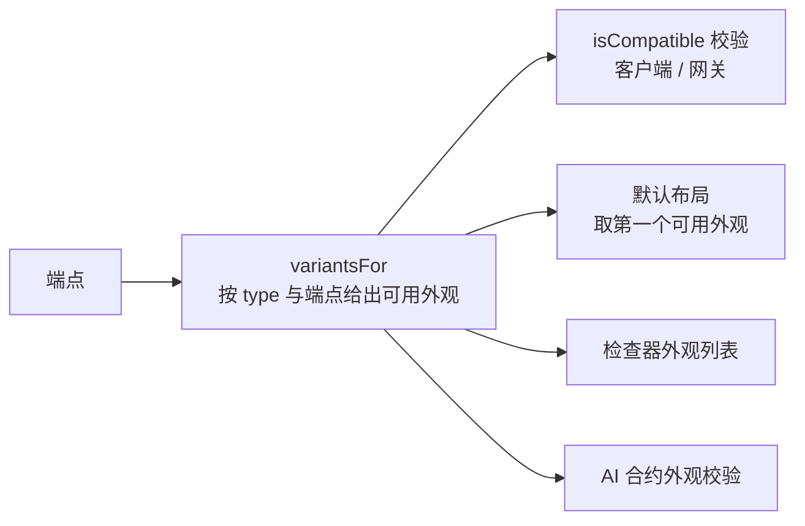
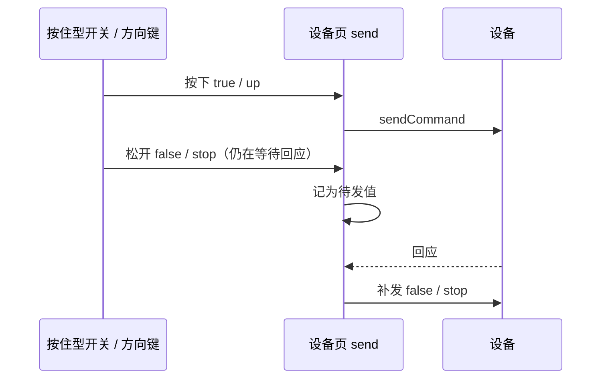

# 指令键盘、方向键、数值动作、按住型开关、事件显示：执行计划

依据 [组件缺口分析](组件缺口分析.md)。用户确认的决定：

- 做 A1–A4 和方向键；
- 数值动作（A2）只允许用步进器；
- 事件（A3）不新增外观，而是让现有显示卡正确显示事件。

## Intent：最终目标

让设备端用 `BLINKER_TYPED_ACTION`、`BLINKER_EVENT` 声明的端点，以及「按住才动」的开关，都有合适的组件，不再退化成文本输入框或日志列表。

## Data：可用证据

- 绑定规则只按 `type` 判定（`page-layout.ts` 的 `isCompatible`），外观不参与。
  - 本次新增的外观只适用于部分端点：指令键盘只配带可选值的动作，按钮只配 Boolean 或 Null 动作。所以外观也必须参与校验。
- 设备页 `send()` 在同一字段的指令还没回应时，会直接丢弃新指令（`device-v2.page.ts` 中的 `pending.has`）。
  - 按住型开关和方向键的「松开发送停止」会因此丢失，存在安全隐患。
- 事件只写入 `lastEvent`，不进卡片的值，也不进 `EndpointHistory`。现有显示卡无法显示事件。
- 「外观缺省时取该类型的第一个外观」这条约定散布在多处：`widgetVariant`、检查器、AI 草稿。

## Edges：边界与限制

- 外观缺省时取类型第一个外观，这条约定不变。只有当端点不适用默认外观时，才显式写入外观：默认布局生成、AI 草稿、检查器三处都要这样做。
- 方向键的映射按「可选值顺序」约定：上、下、左、右，第 5 个是中心键。
  - 只有 4 或 5 个可选值的动作才能用方向键。
  - 不新增映射选项，因为 AI 不产出 options，按约定才能直接用。
- 「松开发送中心键」由新选项 `momentary` 控制，默认关闭。
  - 原因：中心键也可能是「确认」，例如 OLED 菜单，不能默认在松开时发送。
- 指令队列的规则：同一字段在等待回应时，只保留最后一个待发值，回应后立即补发。这条规则对所有组件生效，旧行为本来就会丢指令，属于修复。
- 存量布局：外观缺省、绑定 Boolean 动作的按钮不受影响。带可选值的动作原本绑在 `input` 上，仍然合法。

## Answer：交付与成功标准

| 内容 | 词表 | 绑定 |
| --- | --- | --- |
| 指令键盘 | `button` / `keys`，宽 4/8，高 1–3 | 可写、带可选值的 Text 动作 |
| 方向键 | `button` / `dpad`，宽 4/8，高 3/4，选项 `momentary` | 同上，且可选值为 4–5 个 |
| 数值动作 | `slider` / `stepper` | 可写、有 min/max 的数值动作（只能用步进器） |
| 按住型开关 | `switch` / `hold`，宽 2/4，高 1/2 | 可写 Boolean 属性 |
| 事件显示 | `value` / `status`（事件端点的默认外观） | 事件；显示最近触发时间和今日次数 |

需要同步的位置：

- 客户端：`page-widget.ts`、`page-layout.ts`（新增 `variantsFor`）；
- 网关：`page-widget.js`、`page-layout.js`；
- AI：`workflow-contract.ts` 的候选类型与外观校验、排版指南；
- 客户端 AI：`interface-workflow.ts`、`interface-draft.ts`；
- 检查器（外观列表按端点过滤）与组件库演示。

成功标准：前端构建通过，网关测试通过，AI 包类型检查通过。

## 执行步骤

1. 词表：新增外观、尺寸、选项 `momentary`，以及各外观可用的选项。
2. 客户端协议：`variantsFor`、`isCompatible` 加入外观判定、默认类型和外观、默认尺寸用 `fitSize`。
3. 网关同步，并跑测试。
4. AI 合约：候选类型、外观按字段校验、排版指南；客户端 AI 同步。
5. 组件：
   - `hold`、`keys`、`dpad` 为新建；
   - 步进器支持动作；
   - 状态卡支持事件。
6. 设备页：指令队列只保留最新值；事件写入卡片的值与历史。
7. 检查器、标签、演示数据。
8. 构建、测试，把执行记录和自我复核追加到本文末尾。

---

## 执行记录

| 步骤 | 位置 | 结果 |
| --- | --- | --- |
| 词表 | `page-widget.ts`：外观 `hold`、`keys`、`dpad`，尺寸、选项 `momentary`，各外观可用的选项 | 完成 |
| 客户端协议 | `page-layout.ts`：导出 `variantsFor`；`isCompatible` 改为按外观判定；默认布局用 `defaultBinding` 取第一个可用外观，尺寸用 `fitSize` | 完成 |
| 网关 | `page-widget.js`、`page-layout.js` 同步 `variantsFor` 和 `compatible(widget, field)`；临时脚本验证 10 个用例（4 个非法），原有两个测试通过 | 完成 |
| AI | `workflow-contract.ts`：`candidates` 改由 `variantsFor` 推出；`parseProposal` 增加 manifest 参数，按字段校验外观，缺省时补写字段默认外观；设计阶段给每个组件附上 `variants`；排版指南与文档副本同步 | 完成 |
| 客户端 AI | `toPageLayout` 在未选外观时取字段默认外观 | 完成 |
| 组件 | 新增 `hold`、`keys`、`dpad`；`stepper` 支持动作（−/+ 只选值，发送键执行）；`status` 支持事件（payload 或「已触发」、时间、今日次数，新事件闪烁） | 完成 |
| 设备页 | `send()` 在等待回应时只保留最新值，回应后补发；事件写入卡片的值与历史 | 完成 |
| 检查器 | 新增 `field` 输入，外观列表按字段过滤；外观缺省时与类型默认外观比较；布尔选项可显示说明；`arrow` 归入控件图标 | 完成 |
| 演示 | 电机点动、蜂鸣曲目、红外遥控、小车方向、舵机转到、人体感应、BOOT 按键（事件随机触发） | 完成 |
| 验证 | 前端开发构建通过；AI 包类型检查通过；网关测试通过；客户端默认布局用临时脚本核对 | 完成 |

## 自我复核

- **一致性**：`variantsFor` 在客户端、网关、AI 三处规则相同。外观缺省仍表示类型的第一个外观；只有字段不适用默认外观时才写出外观，存量布局不受影响。
- **安全**：
  - 按住型开关、方向键在按住期间不会被禁用。它们同时监听 `pointerup`、`pointercancel`、`lostpointercapture`、失焦和组件销毁，任一触发都会发出松开指令。
  - 设备页的指令队列保证松开指令排在按下之后发出，不会被丢弃。
- **长按冲突**：组件库工作台用长按打开设置，标记了 `data-press` 的按键（按住开关、方向键、长按执行的动作按钮）会跳过长按。这些组件改从卡片其余区域长按或右键打开设置。按住开关整张卡都是按键，在触屏上只能通过右键菜单打开设置。
- **取舍**：方向键默认不启用「松开即停」，因为中心键也可能是「确认」。这个选项只能在检查器里开启，AI 不产出 options。
- **未验证**：没有在浏览器里实际操作手势。需要重点确认 Android 上长按触发的 `contextmenu` 与按住手势是否冲突，以及电子主题下的新组件样式。
