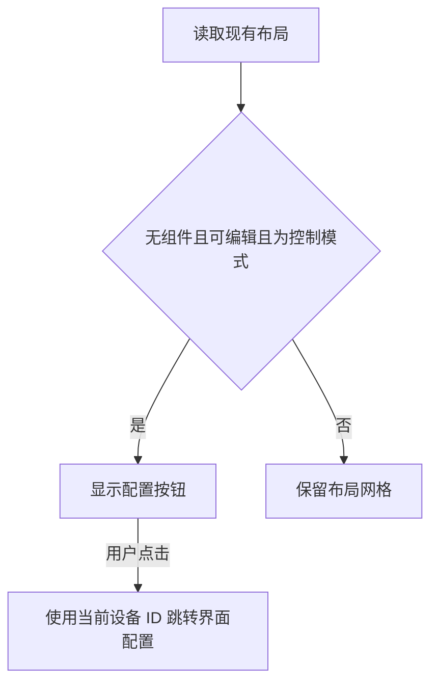

# 控制界面空状态调整计划

## Intent：最终目标

设备没有控制组件时，不再自动弹出旧版使用向导。在控制页内容区域水平、垂直居中显示“控制中心配置”按钮，点击进入当前设备的“界面配置”页面。

## Data：可用证据

- 用户截图对应 `Layouter2GuidePage`，包含“开始使用”“载入示例”和编辑提示。
- `Layouter2Component.loadLayouterData()` 在 dashboard 为空时自动调用 `showGuide()`。
- 现有界面配置路由为 `/device-manager/:id/uic`。
- 设备页已经为布局器提供扣除顶部导航后的全高容器，可用于空状态居中。

## Edges：边界与限制

- 仅修改截图对应的旧版布局器，不修改 V2 能力获取、默认布局生成或已有设备数据。
- 仅在加载完成、没有组件、普通控制模式且有编辑权限时显示按钮。
- 编辑模式仍显示布局网格和组件工具栏；共享设备沿用无编辑权限的规则。
- 不新增测试，不调用浏览器确认 UI。

## Answer：交付与成功标准

1. 移除加载空布局时自动显示向导的调用。
2. 使用现有 RouterLink 和 Ionic 按钮跳转，保持当前设备 ID。
3. 空状态在实际内容容器内居中，不使用浏览器窗口高度硬编码。
4. 验证开发服务重新编译成功，并复核变更范围。

## 架构图

## 数据流图

