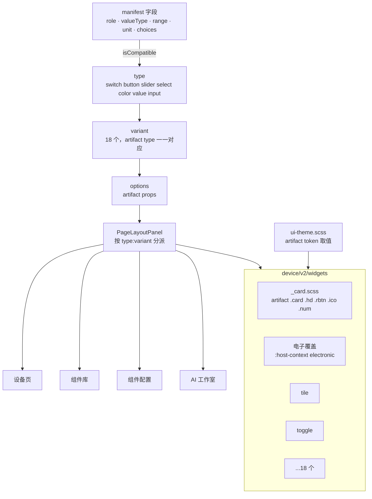
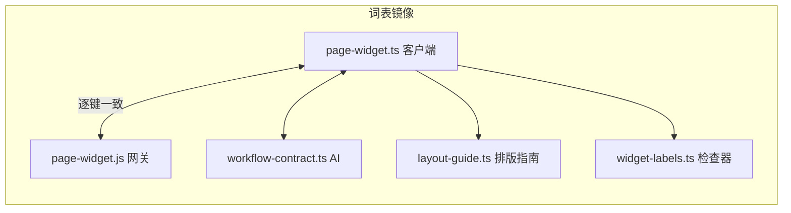

# 板卡组件库重构计划

## Intent：最终目标

把设备组件库从「米家家居场景」改为面向**开发板 / 板卡数据项**（GPIO、继电器、PWM、舵机、ADC、传感器、内存、RSSI、事件、串口文本等），并把视觉质量提升到「Blinker 控件库」artifact（`docs/2026-10-10/设备组件库设计稿.html`）的标准：

- 组件按 **manifest 数据形态** 组织，不按家电品类组织。
- artifact 里已有的组件，**按它的 DOM 结构和 CSS 移植**，保证像素一致；artifact 没有的组件，用同一套 token 新做。
- 用 Chrome（用户已登录的 `localhost:4200`）逐个组件、三套主题、手机与桌面两种宽度截图，与 artifact 并排比对后再交付。

## Data：可用证据

- manifest 字段（`DeviceUiEndpoint`）：`role`（property / action / event）、`valueType`（boolean / integer / number / text / null）、`readable`、`writable`、`minimum`、`maximum`、`step`、`unit`、`maxLength`、`choices`。
- 绑定规则（`page-layout.ts` 中的 `isCompatible`）：
  - switch：可写布尔属性
  - button：动作
  - slider：可写、有范围的数值
  - select：带 choices 的可写文本
  - color：0–0xFFFFFF 的可写整数
  - input：可写的数值或文本
  - value：只读
- artifact：18 个组件，每个都有 `render(props, value)`、属性 `schema` 和三皮肤 CSS（`html[data-skin=electro] …` 覆盖）。电子主题的数字使用 Doto 点阵字体。
- 现状：55 个变体都是在看不到界面的情况下写的，瑕疵逐个暴露；变体按「家族组件 + 混合比例 token」实现，与 artifact 的结构差异很大。

## Edges：边界与限制

- **类型语义不变**：`type` 仍只决定绑定和命令；`variant` 和 `options` 只影响展示。
- **复合卡下一步再做**：多键面板、多值汇总仍需要多字段绑定，本次不做。
- **字体**：artifact 用到 Outfit、Geist Mono 和 Doto。打包需要从 npm 下载 `@fontsource`，必须先征得用户同意。
- **旧布局**：本分支期间保存的布局可能带有旧变体名，需要用户决定是映射还是报错。
- **主题选择器**：`:host-context([data-ui-theme='electronic'])` 匹配任意祖先，同一棵树里嵌套不同主题时以外层是否为电子为准。目前只有 AI 工作室的风格示意存在嵌套，而它不渲染组件。
- **测试**：遵循用户规则，不新增测试。

## Answer：交付格式与成功标准

1. 18 个单字段变体，见下文「组件目录」。每个变体一个 Angular 组件，结构和 CSS 来自 artifact。
2. 主题 token 改为 artifact 的取值；删除混合比例 token，电子主题改用显式覆盖（与 artifact 一致）。
3. 组件库演示数据换成一块 ESP32 开发板的数据项。
4. 客户端、服务端、AI 合约、排版指南、检查器的词表一致。
5. 用 Chrome 截图比对验收（3 主题 × 手机 / 桌面），问题清零后交付。

---

## 组件目录

| type | variant | 来源（artifact） | 板卡示例 | 主要 options |
| --- | --- | --- | --- | --- |
| switch | `tile` 默认 | 图标开关卡（1 行时为横条） | 板载 LED · GPIO2、继电器 1 | activeStyle、showState、onText、offText、corner |
| switch | `toggle` | 胶囊开关行 | 低功耗模式、调试输出 | caption、iconStyle、size |
| switch | `slide` | 新做（同一套 token） | 水泵继电器（防误触） | onText、offText |
| button | `action` 默认 | 场景按钮 | 重启（长按）、校准、拍照 | shape、hold、doneText、showCount |
| select | `mode` 默认 | 模式宫格 | 工作模式、采样精度 | style、showIcons、choiceIcons |
| slider | `level` 默认 | 大块滑块 | PWM 占空比、风扇转速 | orientation、fill、showValue、ticks |
| slider | `gradient` | 色温 / 色彩滑块 | WS2812 色相、色温 | track、trackSize、knob、showTicks |
| slider | `dial` | 环形旋钮 | 舵机角度 0–180° | sweep、thickness、showTicks、caption、showButtons |
| slider | `levels` | 档位选择 | 电机档位 | style、labels、allowOff、showButtons |
| slider | `stepper` | 数值步进器 | 采样间隔、上报周期 | layout、longPress、showRange |
| slider | `timer` | 定时 / 倒计时 | 定时关闭继电器（秒） | presets、actionText、style |
| color | `picker` 默认 | 色盘 | RGB 灯环 | mode、thickness、palette、showHex |
| value | `number` 默认 | 大数字读数 | 芯片温度、ADC 电压、空闲内存、RSSI | decimals、size、unitPosition、caption、showDelta、warnBelow、warnAbove、scale、format |
| value | `trend` | 趋势曲线 | DHT22 温度、光照 | chart、points、smooth、showRange、showAxis |
| value | `ring` | 环形进度 | 电池电量、CPU 占用 | shape、thickness、min、max、caption、warnBelow、warnAbove |
| value | `status` | 状态徽章 | WiFi 连接、GPIO0 输入电平 | style、states、pulse、caption |
| value | `log` | 新做 | 按键事件、运动检测事件流 | points |
| input | `text` 默认 | 文本输入 | OLED 显示文字、串口发送 | placeholder、actionText、showCounter、multiline |

删除：entity、power、chip、lock、pill、tile（按钮）、hold、scene、fill、bar、knob、steps、curtain、ruler、tiles、segment、pills、list、wheel、menu、field、keypad、note、metric、text（显示）、countdown、matrix、gauge、level（显示）、battery、signal、compass、thermo、bars、wave、line、timeline、stat、swatches、spectrum。它们的能力已并入上表各组件的 options（例如 bars 是 trend 的 `chart=bars`，half 仪表是 ring 的 `shape=half`）。

## 架构

## 执行步骤

1. **主题 token**：改为 artifact 的取值（surface、surface-2、track、faint、focus、font-mono、num-weight、radius-s）；删除混合比例 token。
2. **卡片基座**：`_card.scss` 移植 `.card`、`.hd`、`.rbtn`、`.ico`、`.num`，并提供电子覆盖 mixin。
3. **组件移植**：18 个组件，每个都把 artifact 的 `render()` 转成模板，CSS 原样移植并替换 token 名；交互（拖动、长按、步进连发）复用现有的 `range-base`。
4. **词表**：`page-widget.ts`、网关 `page-widget.js`、AI 合约、检查器标签、排版指南同步修改。
5. **演示数据**：换成 ESP32 开发板的数据项，按 artifact 的四个分区（开关与按钮、调节、显示、输入）排列。
6. **截图比对**：在 Chrome 中按组件 × 主题 × 宽度逐项比对，记录问题并修复。
7. **自我复核**：结论追加到本文末尾。
