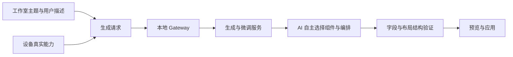
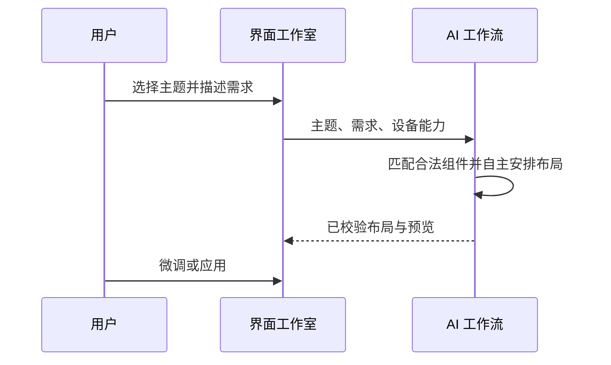

# 界面工作室自主布局计划

## Intent：最终目标

移除界面工作室的“布局节奏”选项和“可用组件”列表，由 AI 根据用户需求、视觉主题和设备能力决定组件选择与布局，不再传入固定密度预设。

## Data：可用证据

- 页面提供 balanced、compact、focus 三种布局节奏，切换主题还会自动选择预设密度。
- 生成与微调请求都传入 density；工作流后端将其作为必填项并传给设计模型。
- 旧版生成接口也强制 density，运行提示词包含各主题的默认密度及固定排布规则。
- “可用组件”列表只是 sourceTiles 的展示；实际设备能力和合法组件候选还承担生成与应用时的绑定验证。

## Edges：边界与限制

- 移除的是密度预设和组件列表展示，保留设备真实字段、权限、支持的组件尺寸和输出结构校验。
- 保留主题、用户描述、预览、微调、应用配置及无设备能力时的必要提示。
- 旧客户端提交的合法 density 可继续被接口接受，但不再传给模型；新客户端不发送该字段，不设置隐藏默认值。
- 修改当前工作区已有文件时保留其他未提交变更，不新增测试用例，不使用浏览器 UI 验证。
- 同步必要的现有测试调用与断言，运行相关现有检查，更新本地服务镜像以使契约生效。

## Answer：交付与成功标准

1. 页面不再显示布局节奏选项和可用组件列表，相关状态、事件和样式被清理。
2. AI 生成与微调请求无 density，切换主题不再设置密度；程序内自动预览不改写 AI 返回的布局。
3. 新旧生成链路均不向模型附加密度预设，设备能力仍用于合法组件匹配。
4. 相关构建和现有检查通过，本地前后端服务使用新契约。

## 架构图

## 数据流图

