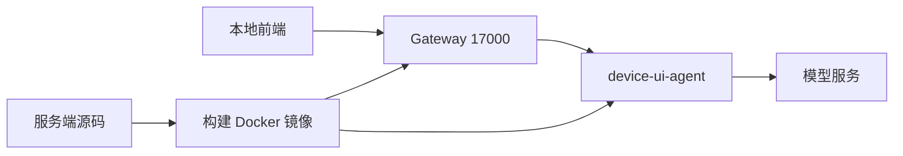
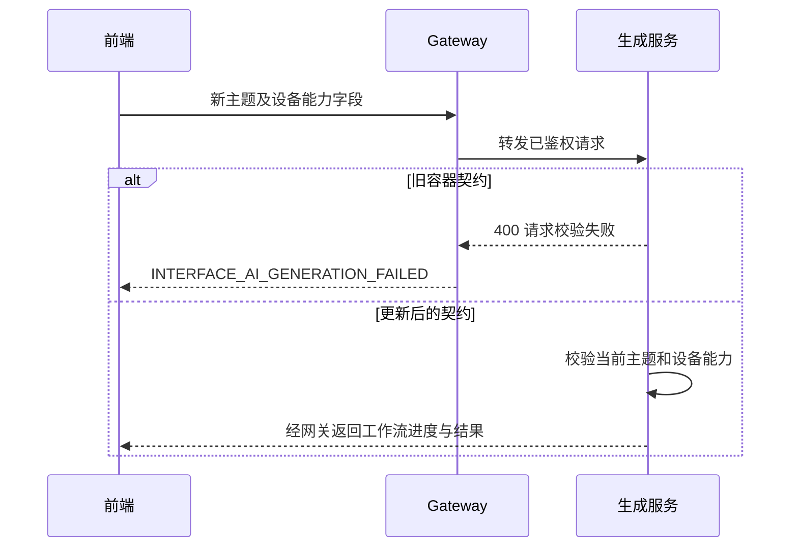

# 界面生成请求 400 排查计划

## Intent：最终目标

修复本地界面配置页点击 AI 生成时 `/api/v1/interface/workflow` 返回 HTTP 400 的问题，让当前客户端与本地生成服务使用一致的请求和布局契约。

## Data：可用证据

- 用户提供响应：`status: 400`、`errorCode: INTERFACE_AI_GENERATION_FAILED`、`data: null`。
- 网关会把生成服务返回的 HTTP 400 改写成该错误码；模型执行错误则在已开始的 NDJSON 流内返回。
- 客户端发送的主题为 `natural`、`electronic`、`dark`，manifest 可包含 `choices`。
- 实际运行容器的编译产物仍接受旧主题 `minimal`、`technical`、`warm`，字段校验不接受 `choices`。
- 相邻服务端仓库源码已支持当前主题和 `choices`，容器没有挂载这些源码，因此编辑源码没有自动更新运行服务。

## Edges：边界与限制

- 最小修复是更新本地 Gateway 与 device-ui-agent 镜像，不放宽字段校验，不硬编码请求中的设备或主题。
- 仅重建这两个应用容器，保留现有监听端口、环境配置和持久化数据卷，不重建数据库和 Broker。
- 不输出密钥或认证令牌，不新增测试文件，不使用浏览器 UI 验证。
- 构建、服务健康和请求契约验证不等同于真实模型完成布局和视觉审查。

## Answer：交付与成功标准

1. 确认 Compose 解析后的前端网关端口仍为 17000。
2. 从当前源码构建并更新本地 Gateway 与生成服务。
3. 检查运行产物中的主题和 manifest 字段契约已同步，确认两个服务健康。
4. 记录验证结果，明确真实用户生成流程是否完成验证。

## 架构图

## 数据流图

