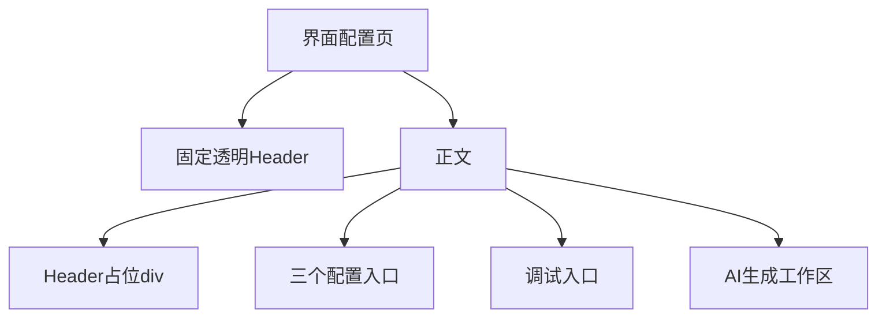
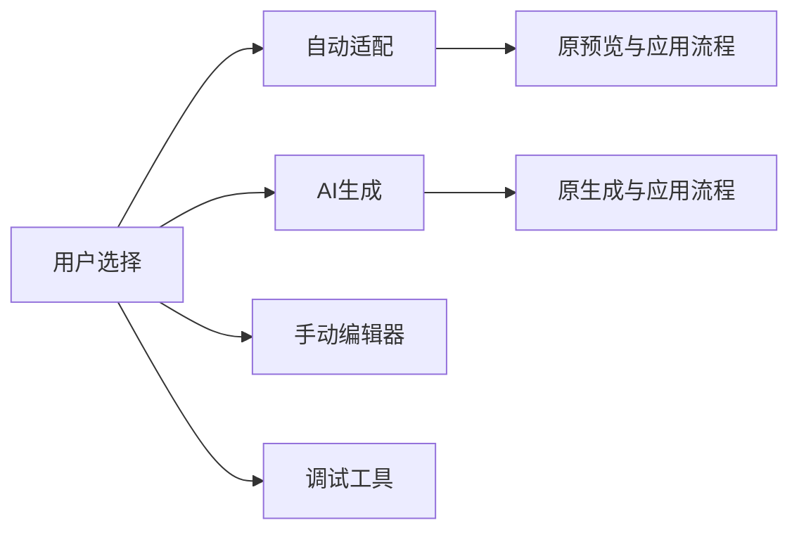

# 界面配置入口精简计划

## Intent：最终目标

界面配置页直接提供可理解的操作入口，减少大卡片与宣传文案。入口页和 AI 页都不被透明 Header 遮挡。

后续范围：AI 页改为紧凑风格选择、需求输入和预览；自动适配页只保留能力状态、刷新、预览与应用。页头返回必须符合实际进入步骤。

## Data：可用证据

- 用户连续要求移除入口介绍区、AI 介绍区，并明确不满意带编号、标签和底部说明的大卡片。
- 用户截图显示移除介绍区后，第一项内容被 Header 遮挡。
- 页面 Header 绝对定位，公共样式依赖首个子元素的伪元素占位，页面自身 padding 与公共规则存在重叠职责。
- 用户明确建议占位 div 与 Header 同高，并设 12px 下边距。

## Edges：边界与限制

- 只调整界面配置页及 AI 分支，不改变生成、应用、手动编辑和调试入口的行为。
- 使用现有字体、颜色变量、Font Awesome 图标与主题，不引入图片或依赖。
- 占位包含安全区；标记 content-under-header 以退出旧伪元素占位，避免双倍留白。
- 不新增测试用例，不调用浏览器；依据用户截图与源代码验证。
- AI／自动适配属于界面配置的内部步骤，返回先退出内部步骤；手动编辑使用真实 Ionic 导航历史，保留 canDeactivate 的未保存保护。

## Answer：交付格式与成功标准

- 三个主入口变为同一组紧凑列表，图标、标题、说明与箭头组成单行结构。
- 调试工具保持独立区域，右侧使用反映实际模式的 switch；去除编号、装饰标签、重复说明和底部口号。
- 入口与 AI 正文前均为显式占位 div，高度为 Header 加安全区，下方 12px。
- 删除不再使用的介绍区样式与状态文案 getter，完成构建和已有回归检查。

## 架构图

## 数据流图

