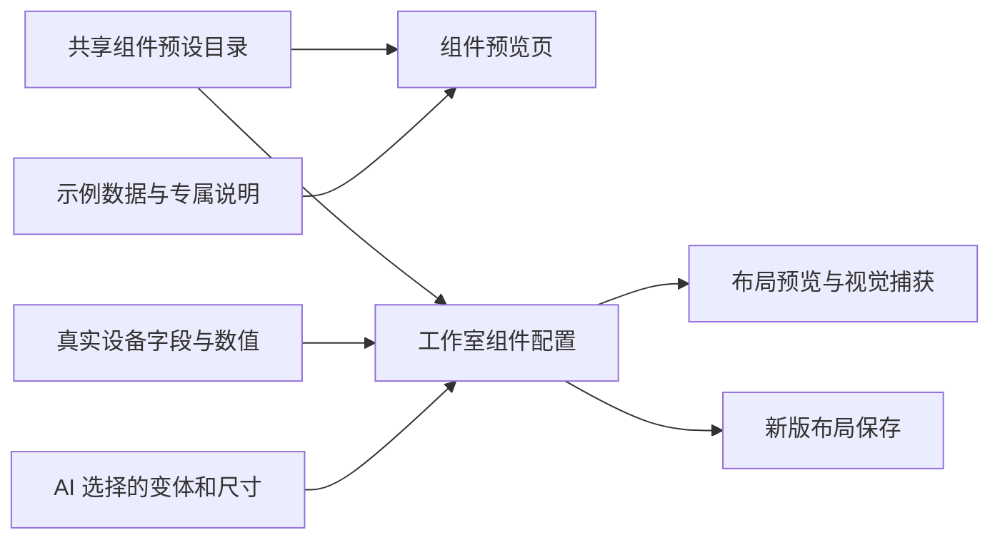
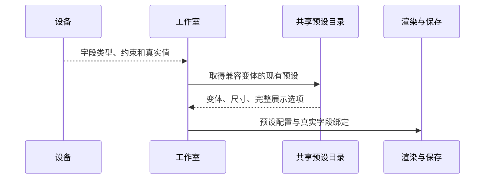

# 真实字段套用组件预设计划

## Intent：最终目标

界面工作室始终显示真实设备字段，并直接套用“组件预览”页已有组件的完整可复用预设。统一的是组件变体、尺寸、图标、配色和展示选项，而不只是共用渲染器或调整卡片宽度。

## Data：可用证据

- 用户明确选择“始终展示真实设备字段，套用完整组件预设”。
- 组件预览页在 46 个示例中声明变体、尺寸和 options；工作室仅沿用类型默认值，最多传递图标和色调，缺少这些预置配置。
- PageLayout 已支持完整 options；预览、AI 视觉捕获和保存均经过 toPageLayout，可在现有转换处一致应用预设，无需扩展后端协议。
- 组件预览示例还包含 GPIO 说明、告警阈值、选项文案、模拟值和历史，这些内容属于示例设备，不能复制为真实设备事实。

## Edges：边界与限制

- 抽取现有示例的可复用预设，不另造一套简化默认样式，不按用户截图中的字段名硬编码。
- 预设保留组件形态、图标、色调、可见元素、交互方式等配置；示例专属文案、阈值、数据格式、选项映射和模拟数据留在示例数据中。
- 初始匹配依据真实字段支持的组件类型和变体，每种变体明确选用一个现有预设；AI 显式选择的变体与布局尺寸继续生效。
- 真实字段键、值、单位、范围、步长和权限继续由设备提供；不增加协议指令和数据权限。
- 保持现有主题、440px 内滚动区域、12px 内边距及已移除说明文案。
- 不新增测试用例，不调用浏览器 UI 验证，保留其他未提交改动。

## Answer：交付格式与成功标准

1. 共享预设目录是组件预览页与工作室外观配置的单一来源，组件预览页保持原有示例外观。
2. 工作室的默认预览、AI 生成后的预览、视觉捕获和新版布局保存都带有对应预设的完整可复用 options。
3. 经典协议预览同样应用共享预设；其设备保存与协议流程不扩展。
4. 完整构建及适用的现有检查通过，并直接核对 4200 服务返回的当前模块。
5. 执行记录包含配置共享的证据、验证范围和对前两次误判的自我复核。

## 架构图

## 数据流图

