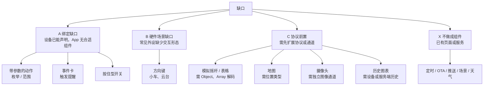

# 组件缺口分析：对照 App 功能与支持的硬件

## Intent：最终目标

找出板卡场景下还缺哪些组件，并区分三类：
- 能直接补的组件；
- 需要先改协议的组件；
- 根本不该做成组件的需求。

结论按优先级排序，供决策用。

## Data：可用证据

### 设备端能声明什么

来源：`blinker-library/src/BlinkerV2/model/Endpoint.h`、`api/Interactions.h`。

- 端点角色：Property、Action、Event。
- 值类型：Boolean、SignedInteger、UnsignedInteger、Float32、Float64、Text、Bytes、Object、Array、Null。
- 约束：min、max、step、maxLength、unit、可选文本值（最多 16 个）、telemetry 最小间隔。
- 常用宏：
  - `BLINKER_PROPERTY`；
  - `BLINKER_ACTION` / `BLINKER_TYPED_ACTION`，后者是带参数的动作；
  - `BLINKER_EVENT` / `BLINKER_VOID_EVENT`。
- Object、Array 只能通过高级 API 写入原始 CBOR，没有类型化的 helper。
- 设备端没有以下类型：颜色、位置（GPS）、图像、时间戳。颜色只是网关约定：整数，范围 0 – 0xFFFFFF。

### 支持的硬件

- v2 库支持三类板子：
  - ESP32 系列；
  - UNO R4 WiFi；
  - Wio Terminal。
- 生态里常见的外设，来自 Blockly 库和 v1 例程：
  - 传感器：DHT、BMP180、PIR、空气质量（SEN5x / SPS30）、IMU；
  - 执行器：舵机、步进电机、WS2812 灯带、蜂鸣器、红外收发；
  - 显示：OLED；
  - 输入：Qwiic 摇杆；
  - 定位与影像：I2C GPS、摄像头（ESP32-CAM、S3 摄像头板）。

### App 现有组件的绑定矩阵

规则见 `page-layout.ts:306` 的 `isCompatible`，网关同构。

| 端点 | 可用组件 |
| --- | --- |
| 可写 Boolean 属性 | tile / toggle / slide |
| Boolean / Null 动作 | action |
| 可写数值属性（有 min/max） | level / gradient / dial / levels / stepper / timer |
| 可写 Text 属性（有可选值） | mode |
| 整数 0 – 0xFFFFFF | picker |
| 其他可写 int / float / text | text |
| 任意可读字段或事件 | number / trend / ring / status / log |

### v1 有、v2 没有的组件

v1 组件位于 `src/app/device/layouter2/widgets`，v1 固件库还提供 Functions。v2 里没有对应的有：

- joystick（摇杆）、map（地图 / GPS）、image、video（摄像头）；
- tab（多态按钮）、table（表格）；
- weather、air（天气、空气质量）；
- 定时器、OTA、Notify / Vibrate（推送、振动）。

### 关键的协议事实

- 客户端解码 Object、Array 时直接丢弃数值，见 `codec.ts:1039-1046` 的 `value = undefined`。所以任何结构化数据目前都无法显示。
- BBP2 声明了 `HistoryRequest/HistoryBatch`，但设备端没有实现。趋势图只能用本机缓存的 `EndpointHistory`。

## Edges：边界与限制

- 沿用已定规则：一个组件只绑定一个主字段，另外最多 3 个附属读数，避免 AI 生成时多一层抉择。设计稿里的「多键面板」「多值汇总」两种多字段组件，此前已决定不做。
- 推送、定时、OTA、场景、语音助手已经是 App 的独立页面或服务（`device-timer`、`device-update`、`scene`、`message`），不应再做成面板组件。
- 天气、空气质量来自云端接口，不是设备数据，不属于设备组件库。

## 缺口与归类

### A. 绑定缺口：设备今天就能声明，App 接不住（优先补）

| # | 设备端声明 | 现状 | 建议组件 | 典型硬件 |
| --- | --- | --- | --- | --- |
| A1 | 带可选值的 `BLINKER_TYPED_ACTION`，例如曲目 A/B/C、红外按键 | `select` 只接受属性，动作只能退化成文本输入框 | **指令键盘**：每个可选值一个键，点击即发送。动作没有状态，所以不显示「当前选中」 | 红外遥控、蜂鸣器曲目、预设动作 |
| A2 | 带 min/max 的数值动作，例如「转到 90°」「响 3 次」 | `slider` 只接受属性，同样退化成输入框 | 让 stepper / level 也能绑定**数值动作**，松手或确认时发送一次，不回显状态 | 舵机定位、步进走 N 步、蜂鸣次数 |
| A3 | 事件，例如 PIR 触发、按键按下、门铃 | 只能用 log 列表或 number 显示 | **事件卡**：最近触发时间、今日次数，触发时闪烁或高亮 | PIR、按键、限位开关、门磁 |
| A4 | 可写 Boolean 属性，语义是「按住才动」 | 开关是切换型，松手不会自动回 false | 在 switch 下加 **hold** 外观：按下写 true，松开写 false | 电机点动、喇叭、对讲 |

### B. 硬件场景缺口

| # | 场景 | 建议 | 是否需要改协议 |
| --- | --- | --- | --- |
| B1 | 小车、云台、机械臂的方向控制 | **方向键**：作为 A1 指令键盘的十字布局，绑定可选值为 up/down/left/right/stop 的动作 | 不需要 |
| B2 | 只读枚举状态，例如 idle/running/error | status 需要手动配置 `states`。可改为未配置时按 `choices` 自动着色 | 不需要，属于小改进 |

### C. 需要协议先行（暂不做组件）

| # | 需求 | 前置条件 |
| --- | --- | --- |
| C1 | 模拟摇杆（双轴）、表格、多点数据 | 客户端 codec 要解码 Object、Array，并在 manifest 里描述结构；设备端补类型化 helper |
| C2 | GPS 地图 | 需要位置类型，或者 C1 的结构化对象；另外要接入地图服务 |
| C3 | 摄像头画面或快照（ESP32-CAM、S3 摄像头板） | BBP2 帧不适合传图像，需要局域网 MJPEG 或云端快照这类独立通道 |
| C4 | 长时间历史曲线 | 设备端实现 `HistoryRequest`，或者服务端提供时序存储；现有 trend 改用这个数据源即可，不需要新组件 |
| C5 | Bytes 查看，例如红外原始码 | 需求小，可以给 log / number 加一个 `hex` 格式，不必新建组件 |

### X. 不做成组件

| 需求 | 归属 |
| --- | --- |
| 定时、倒计时任务 | `device-timer` 页面（面板上的 timer 外观只负责设备自身的倒计时属性） |
| OTA | `device-update` 页面 |
| 推送、振动、短信、微信 | 消息服务（`message`） |
| 天气、空气质量（云端） | 不属于设备组件 |
| 场景联动、语音助手 | `scene` 与第三方服务 |

## Answer：建议与成功标准

**建议先做 A 类，加上 B1。** 理由如下：

- 不需要改协议，设备端今天就能声明这些端点；
- 都符合「一个组件一个主字段」的规则，AI 生成时没有歧义；
- 覆盖红外、舵机、步进、PIR、小车等最常见的板卡外设。

新增内容在词表里的位置如下，客户端、网关、AI 合约、检查器四处同步：

| 内容 | 挂在哪个 type 下 | 绑定 |
| --- | --- | --- |
| 指令键盘（含十字布局） | `button`，新外观 `keys` | 带可选值的动作 |
| 数值动作 | `slider` 的兼容规则放宽 | 带 min/max 的动作 |
| 事件卡 | `value`，新外观 `event` | 事件 |
| 按住型开关 | `switch`，新外观 `hold` | 可写 Boolean 属性 |

成功标准：
1. 用 `BLINKER_TYPED_ACTION`、`BLINKER_EVENT` 声明的端点，默认布局能生成合适的组件，不再退化成文本输入框或日志列表。
2. 网关和客户端的校验一致，网关测试通过。
3. AI 排版指南补充这些外观的使用场景。

另外有一个组件库之外的缺口：Blockly 目前没有 v2 端点声明积木（`BLINKER_PROPERTY` 等），图形化用户无法声明 v2 端点。这一点不在组件库范围内，单独列出。

## 自我复核

- **证据**：绑定矩阵读自 `isCompatible` 和网关的 `compatible()`；Object、Array 被丢弃的结论读自 `codec.ts`；设备端能力来自 blinker-library 源码，没有凭空推断。
- **取舍**：v1 的 tab、table、weather、map、video 没有原样搬回来，而是按现在的协议能力重新归类，避免做出空有外观、拿不到数据的组件。
- **不确定**：
  - A2 数值动作需要决定是复用 slider 的外观，还是只允许 stepper；
  - A3 事件卡和现有 status、log 有部分重叠，需要确认是否值得单独成为一种外观。
