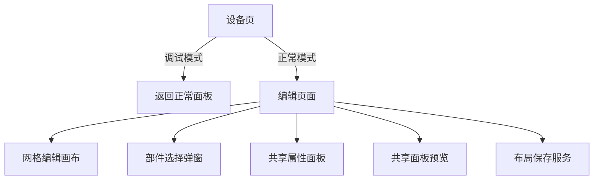
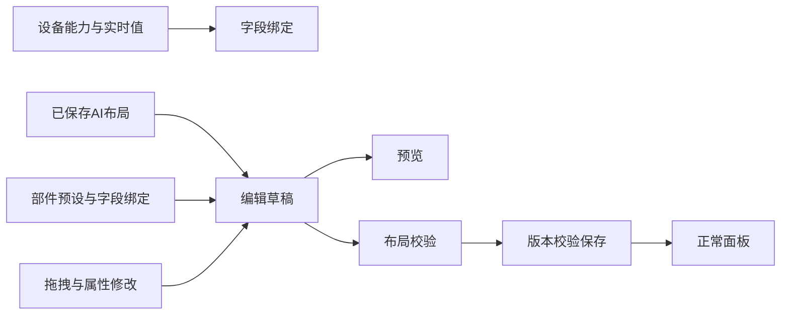

# 组件面板手动编辑计划

## Intent：最终目标

设备页右侧第二个按钮随模式切换：调试工具模式返回正常面板，正常模式进入编辑页面。重做组件面板编辑器，直接编辑 AI 生成的布局，支持编辑与预览切换、弹窗添加部件、网格拖拽和属性编辑。

## Data：可用证据

- 当前组件面板使用八列 `PageLayout`，布局中包含字段绑定、部件预设、尺寸、位置与主题。
- `DeviceV2PageLayoutService` 已提供布局读取、校验与带版本号的保存。
- 组件库已有统一渲染器、部件预设与属性编辑面板。
- 现有页面存在调试工具、正常面板与旧编辑入口，具体连接方式在实现前核对。

## Edges：边界与限制

- 固件通信协议保持不变；组件描述、布局和保存协议可调整。复用真实设备字段、部件渲染和属性面板。
- 编辑操作只修改草稿，保存后才更新设备布局；防止版本冲突覆盖他人更新。
- 网格不允许重叠或越界；编辑操作不能意外发送设备指令。
- 不新建测试用例，不调用浏览器做 UI 验证；执行构建和相关已有检查。
- 不影响与本任务无关的未提交修改。旧编辑器的清理范围根据真实依赖确定。
- 用户确认 MQTT／BLE 也替换编辑器。旧视频、天气保留代码及配置，暂不显示，等待后续重新设计；其他不受新组件库支持的旧部件不显示。
- 服务端项目为 `/Users/xiewendao/Documents/aily/aily-blinker-services`。BBP2 保留 Manifest 校验；旧设备新增账户域组件配置存储，不伪造 Manifest，也不恢复旧固件服务端链路。

## Answer：交付格式与成功标准

1. 两种设备模式的 header 按钮行为符合要求。
2. 编辑器能读取已有 AI 布局，新增、删除、拖动、编辑属性并保存。
3. 添加部件采用 modal；属性面板复用组件库实现。
4. 预览显示当前草稿，编辑状态不触发设备指令。
5. 构建通过，记录实际验证、限制和自我批判。

## 架构图

## 数据流图

## 执行顺序

1. 分析模式切换、路由、旧编辑器和共享组件的依赖。
2. 接入统一 PageLayout 编辑页面及部件添加和属性编辑。
3. 实现网格拖拽、预览、保存和离开草稿处理。
4. 替换入口并清理被取代的编辑路径，运行验证并复查范围。
