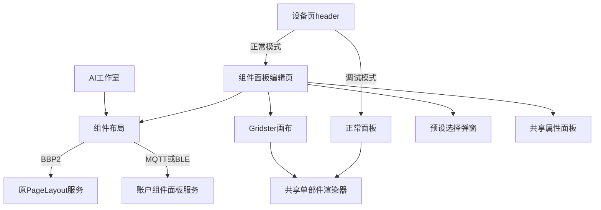
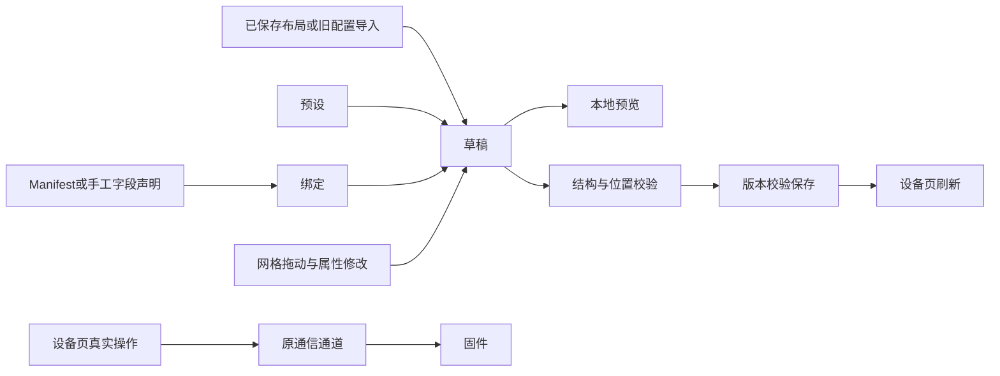

# 组件面板手动编辑记录

## Intent：最终目标

用一个新的组件面板编辑页面替换旧编辑入口，支持直接编辑 AI 布局，并让正常面板、编辑画布和预览共用部件。只调整组件配置协议，不修改固件通信协议。

## Data：可用证据

- 截图中的调试工具是 `TestDashboard` 独立渲染器，header 原第二个按钮为设备设置入口。
- AI 的 BBP2 面板使用 `PageLayout`，旧拖拽编辑器使用 `layouter.dashboard`，无法直接互相编辑。
- 现有属性面板 `WidgetInspectorComponent` 已支持外观、合法尺寸、标题、图标、色调、附属读数与专属选项。
- 现有组件库有 46 个共享预设。新增部件直接引用这些预设并绑定真实字段。
- 当前 Gridster 的固定行高模式是 `VerticalFixed`；移动端必须禁用其默认单列断点才能拖拽。
- 普通面板原有窄屏响应式重排用于保证卡片可读性，应继续保留；固定八列和 84 像素行高仅用于编辑器画布。
- 服务端原 PageLayout 表外键绑定 V2 设备，因此不能给旧设备填假 Manifest。新账户域资源用于旧设备的组件文档与字段声明。

## Edges：边界与限制

- 所有编辑先进入本地草稿；只有保存才更新布局。离开有未保存修改时提供继续编辑或放弃。
- 编辑态控件内容为 inert；拖拽／选择层独立。预览只模拟本地值，不发送设备指令。
- 两种模式共用同一 Gridster 画布；尺寸只选择组件允许的档位，位置校验拒绝越界或重叠。
- 正常面板和工作室布局预览保持原响应式排版：窄屏的小卡片占半行，宽卡片占整行。编辑器规则不覆盖正常展示规则。
- MQTT／BLE 保留已有通信通道和 on/off、tap、自定义文本、数值、RGB 数组编码。部件协议独立于这些传输细节。
- 不支持的旧部件不显示，原配置保留。视频、天气代码保留，等待用户后续重新设计。
- BBP2 的既有布局资源、真实 Manifest、服务端权限与版本控制不放宽。
- 新旧设备面板资源是账户私有配置，不提供设备发现、设备所有权或控制权限。旧设备仍须通过既有设备来源获得连接信息。
- 未新增测试用例；只调整已有检查对被替代入口和合法组件尺寸的断言。未调用浏览器做 UI 确认。

## Answer：实际交付

1. 调试模式下，header 主题按钮后显示返回正常面板的图标；正常模式显示编辑图标。设备设置入口顺延。
2. 新页面 `/device/:id/edit` 支持编辑／预览切换、modal 添加部件、拖拽、属性编辑、删除、撤销和保存。
3. BBP2 从设备声明的字段中选择；MQTT／BLE 可以导入既有绑定或手工声明 key、范围、步进、选项和按钮指令。
4. 提取共享单部件渲染器，普通面板、编辑器和部件目录共用原组件。
5. 手动保存不执行重新排版；拖拽后同步被推移的所有部件，而不是只保存被拖动的一个。
6. 保存后通过已有 component 事件刷新设备页，避免 Ionic 缓存显示旧布局。
7. 旧编辑器不再注册为设备渲染器；旧路由参数 `?edit=1` 转入新编辑页。保留的旧部件源码不被删除。
8. MQTT／BLE 新面板保存到 `/api/v2/device-panels/:panelId`，使用账户隔离、预期版本和事务保存。旧 layouter 仅作首次导入和内存缓存，不是新服务端的主存储。

## 架构图

## 数据流图

## 验证与自我批判

- 前端本地构建通过。
- 52 个已有前端检查通过，覆盖布局校验、版本保存、模式入口和 AI 工作室既有流程。
- Gateway 构建、现有 PageLayout 检查通过。该脚本的专用 PostgreSQL 检查因未设置 `TEST_DATABASE_URL` 跳过，没有拿运行中的设备数据库代替测试库。
- 本地 gateway 已重新构建并启动；健康检查返回 200，数据库健康。
- 迁移 040 已应用，`account_device_panels` 表存在；新增接口未登录请求返回 401，确认实际运行服务已加载路由与身份校验。
- 新拖拽、modal 布局及手机触摸手感未通过浏览器实测；编译通过不能代替交互验收。
- 新账户面板接口未执行真实账户的读写回环，以免把开发验证内容写进用户配置。版本与字段校验代码已复查，但不把静态核对描述为端到端验证。
- 自我复查时修正了保存后不刷新、窄屏自动重排丢位置、旧按钮自定义指令丢失、BLE 在线判断和旧布局自动覆盖未知部件的问题。
- 服务端路由装配文件的自动格式变化已清理，只保留本任务的实际接入差异。

## 后续回归修正：展示排版与调试页

- 最初将固定八列扩展到了普通面板和工作室预览，导致窄屏卡片变成四列，标题和控件被挤压。这是实现范围判断错误，已撤回共享面板的严格网格参数及相关调用；保留编辑器内部网格。
- 调试页数据由磁贴改为两列表格，长字段值以普通等宽字号完整换行。
- 调试页背景异常来自父级 content-under-header 的通用实色／渐变背景，且容器只高一屏，形成上下断层。调试模式下将这层背景变量设为透明，让设备主题背景贯穿。
- Header 毛玻璃消失来自之前按“正常控制中心不要遮罩”设置的通用 ::before 隐藏规则。现按 debug-header 区分：调试页使用共享主题毛玻璃，正常控制面板继续透明。
