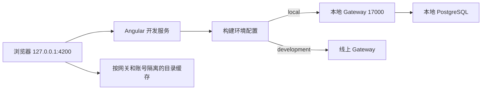
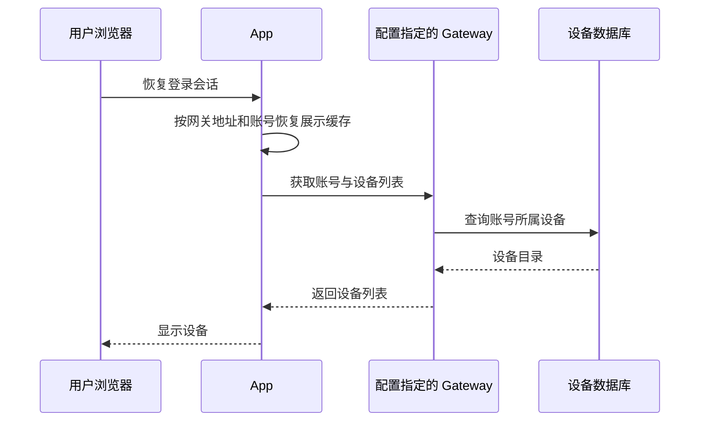

# 设备列表恢复排查计划

## Intent：最终目标

恢复本地开发环境中登录账号后添加的真实设备列表，先确认前端访问地址、网关环境和账号读取路径，避免把环境不一致误判为数据删除。

## Data：可用证据

- 用户确认缺失的是登录账号后添加的真实设备。
- 本次最初执行 `npm start`，默认使用 development 配置；其网关是 `https://iot.yiyu.pro`。
- 只增加 `--host 127.0.0.1` 会修改前端监听地址，不会替换网关环境。
- `environment.local.ts` 指向 `http://127.0.0.1:17000`。
- 10 月 10 日的登录排查和真实设备控制记录使用本地网关及 local 构建。
- 本地 Gateway 和 PostgreSQL 容器正在运行。
- 设备目录由 `UserService.getAllInfo()` 请求 `/api/v2/devices`；本地展示缓存同时按网关地址和账号隔离。

## Edges：边界与限制

- 只调整当前开发服务的启动参数，不修改默认线上配置或设备业务逻辑。
- 不删除、迁移、重建设备，不修改数据库，不清空浏览器存储。
- 不新增测试，不使用浏览器确认 UI，不读取或输出认证令牌。
- 如需检查数据库，仅执行只读的结构和设备摘要查询。
- HTTP 可达和构建成功不能证明当前浏览器的账号设备已经恢复。

## Answer：交付格式与成功标准

1. 核实本地设备数据是否仍存在。
2. 使用 local 配置在 `127.0.0.1:4200` 启动开发服务。
3. 验证编译产物连接本地网关、前端 HTTP 可访问。
4. 记录已验证事实、未验证边界和必要的用户刷新或登录步骤。

## 架构图

## 数据流图

