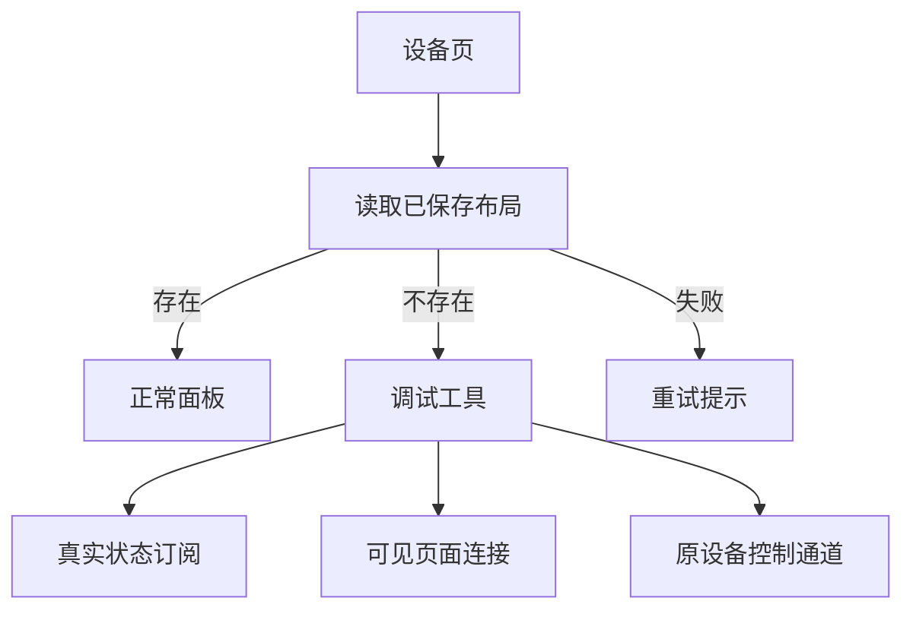
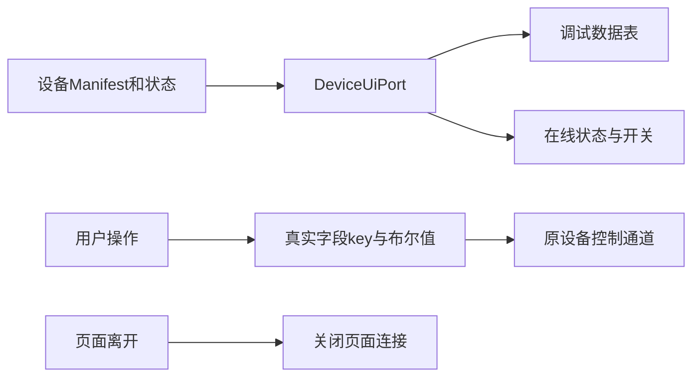

# 调试模式数据与入口修正计划

## Intent：最终目标

没有已保存布局的新设备默认显示调试工具。调试工具持续同步真实状态，控制真实可写字段；设备头卡改为用户选定的紧凑横排。界面配置卡片取消多余最小高度。

## Data：可用证据

- 新设备 config 没有 component 时，DevicePage 直接选择正常面板。
- DeviceV2Page 无布局时还会自动生成并保存，导致“未配置”被隐式改变。
- 调试组件读取旧字符串 switch 与 enable，不订阅 BBP2 真实字段，也没有持续持有页面连接。
- 正常 BBP2 页已通过 DeviceUiPort 的 watchState／watchConnection／openConnection 获得真实状态与可取消连接。
- 用户选择设备头卡紧凑横排：图片、名称和状态、轻量开关。

## Edges：边界与限制

- 固件协议不改，不按 demoPower 或名称猜测主电源。
- 多个布尔字段没有明确主开关配置时，不擅自将其中一个称为设备电源；数据表按用户最新要求只展示值，不添加控制按钮。
- 布局资源读取失败不等于没有布局；提供重试，避免错误切换模式。
- 用户主动保存的空布局仍是已保存布局。
- 页面隐藏、设备改变或应用进入后台时释放调试连接。
- 不新建测试用例，不调用浏览器验证 UI。

## Answer：交付与成功标准

1. 首次进入无布局设备显示调试模式，读取过程不闪现正常面板。
2. 在线、待同步、离线和开关值来自真实连接及快照；命令调用现有控制通道。
3. Header 与头卡状态使用同一来源。
4. 头卡名称可完整换行，右侧开关轻量且不虚构未知状态。
5. 构建与受影响的已有检查通过，记录验证限制。

## 架构图

## 数据流图

