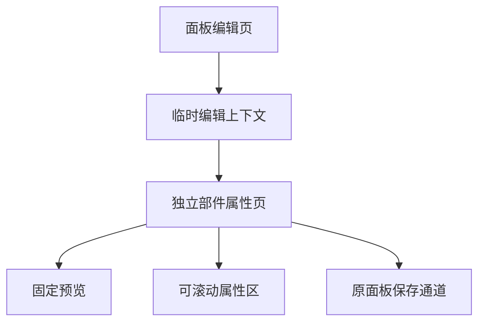
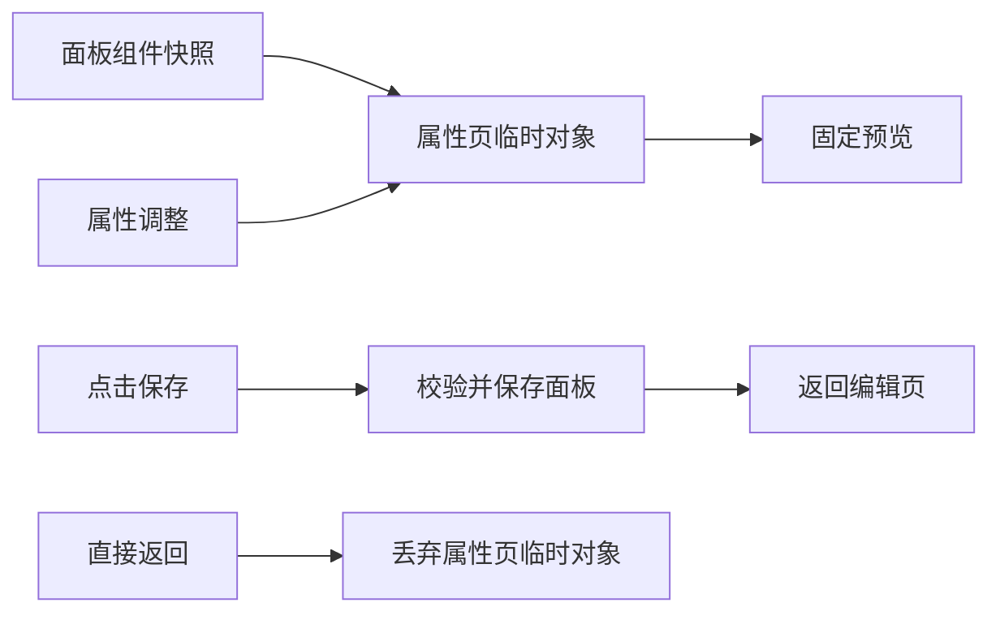

# 部件属性独立页面计划

## Intent：最终目标

手动编辑的部件属性使用独立页面。标题栏和组件预览固定在上方，属性区独立滚动；修改实时反映在预览，点击保存才提交，直接返回放弃本次属性修改。

## Data：可用证据

- 当前属性编辑使用 inspector-modal，预览与属性共用滚动容器，向下修改时预览离开视野。
- 用户先要求全屏与 sticky，随后明确改用独立页面，并确认“返回时如未点击保存则放弃”。
- 应用使用根 IonRouterOutlet，会缓存前一页；面板编辑器已有完整的校验、保存与未保存保护。
- 属性组件通过 widgetChange 输出新对象，适合维护仅属于属性页的临时预览。

## Edges：边界与限制

- 不新增持久化协议。属性保存使用现有面板保存通道，成功后回到编辑页。
- 不在属性变化时改父面板；只有保存或明确移除时更新。
- 面板页前往本设备属性页不误触发丢弃布局确认；属性页直接离开整个编辑流程时仍保护进入前已有的面板修改。
- 页面刷新丢失临时上下文时回编辑页，不伪装恢复未保存修改。
- 不新增测试用例，不调用浏览器。

## Answer：交付格式与成功标准

1. 新增独立属性路由，移除手动编辑页属性 modal。
2. 固定标题和预览，下方设置区单独滚动。
3. 未保存返回丢弃属性页修改；保存成功持久化并返回，失败留在属性页显示错误。
4. 保留已有主题、属性组件、半宽／整宽配置和版本冲突处理。
5. 构建和相关已有检查通过，记录验证边界。

## 架构图

## 数据流图

