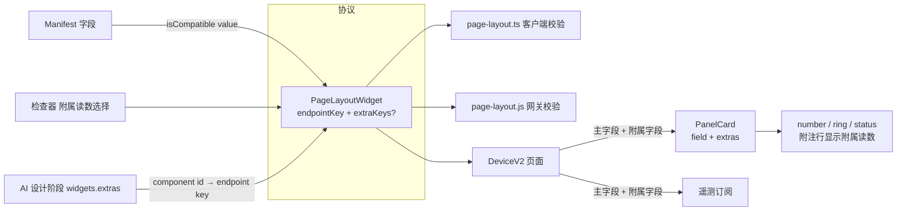
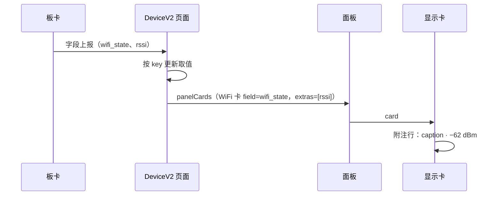

# 附属读数：多字段绑定计划

## Intent：最终目标

让一张显示卡在主读数之外，同时显示同一外设的 1–3 个相关读数，例如 WiFi 状态卡显示「已连接 · −62 dBm」。

- 只做「附属读数」：显示卡（number、ring、status）可以再绑定只读字段，读数显示在附注行。
- 多键面板、多值汇总不做，避免 AI 在生成时多一层抉择。
- 手动配置（组件配置页）和 AI 生成都可以创建。
- 每个组件最多绑定 4 个字段：主字段 1 个，附属字段最多 3 个。

## Data：可用证据

- 布局协议：组件只有一个 `endpointKey`。客户端 `page-layout.ts` 和网关 `page-layout.js` 都用 `exactKeys` 严格校验，未知字段会被拒绝。
- 绑定规则：`isCompatible('value', endpoint)`（网关是 `compatible('value', field)`），可读、可通知或事件字段都可以作为显示卡的数据源。附属字段沿用同一条规则。
- 协议不禁止同一个字段被多个组件绑定。所以附属字段也可以同时拥有自己的卡片。
- 设备页 `device-v2.page.ts`：
  - `panelCards` 每张卡只取一个字段；
  - `telemetryConfiguration` 只收集主字段，附属字段也要参与遥测订阅。
- AI 流程：
  1. 匹配阶段产出 components（一个字段对应一个组件）；
  2. 设计阶段产出 widgets，要求与 components 一一对应。
  合并以后的规则改为：每个 component 恰好出现一次，要么作为一个 widget，要么作为某个 widget 的附属读数。

## Edges：边界与限制

- **向后兼容**：`extraKeys` 是可选字段，旧布局不受影响，单字段组件的行为完全不变。
- **只读**：附属字段只用于显示，不下发命令，不影响 `disabled` 和 `pending` 状态。
- **格式**：附属读数按字段自身的格式显示（数值、单位、文本），不套用主字段的 `decimals`、`scale` 和 `format`，因为这些选项属于主字段。
- **能力变化**：
  - 字段消失或变得不兼容时，迁移会剔除对应的附属字段，组件本身保留。
  - 差异检查不把附属字段的变化算作「需要调整的控件」。
  - 被附属绑定的字段视为已绑定，迁移时不会再为它生成一张单独的卡。
- **校验**：
  - 只有 `type = value` 且外观为 number、ring、status 时，才允许 `extraKeys`；
  - 附属字段数量 1–3 个，不能重复，也不能等于主字段。

## Answer：交付格式与成功标准

1. 布局协议新增 `extraKeys?: string[]`，客户端与网关校验一致。
2. `PanelCard` 新增 `extras`，附属读数显示在 number、ring、status 的附注行；1 行高的 status 显示在标题行右侧。
3. 设备页：附属字段的取值和遥测订阅都打通。
4. 检查器新增「附属读数」选择（最多 3 个），组件配置页提供候选字段；组件库演示中 WiFi 卡附带 RSSI。
5. AI：
   - 合约 widgets 新增 `extras`（附属的 component id）；
   - 覆盖规则改为「恰好出现一次」；
   - 客户端二次校验与 `toPageLayout` 同步；
   - 排版指南说明何时合并。
6. 前端构建、网关测试、AI 包类型检查全部通过。

## 架构

## 数据流

## 执行步骤

1. 词表 `page-widget.ts`：`MAX_EXTRA_KEYS = 3`、`EXTRA_VARIANTS = ['number','ring','status']`。
2. 客户端 `page-layout.ts`：解析与校验 `extraKeys`，并更新 `migratePageLayout`、`diffPageLayout` 的处理。
3. 网关 `page-layout.js` / `page-widget.js`：同步校验（按用户规则不新增测试用例，改用临时脚本验证）。
4. `PanelCard.extras`，在 `reading-base` 中提供 `extraText`；三种显示卡渲染。
5. 设备页、界面预览服务、组件配置页、组件库演示：构建 `extras`。
6. 检查器：`@Input() candidates`，提供附属读数选择。
7. AI：合约、`workflow.ts` 初始映射、提示词、排版指南；客户端 `interface-workflow.ts`、`interface-draft.ts`。
8. 构建与测试，自我复核追加到文末。

---

## 执行记录

| 步骤 | 位置 | 结果 |
| --- | --- | --- |
| 词表 | `page-widget.ts`：`MAX_EXTRA_KEYS`、`EXTRA_READING_VARIANTS`、`acceptsExtras` | 完成 |
| 客户端协议 | `page-layout.ts`：`extraKeys` 解析（1–3 个、不重复、不等于主字段、仅 number/ring/status）、绑定校验、`diffPageLayout` 计入已绑定、`migratePageLayout` 剔除失效附属字段、导出 `isExtraReading` | 完成 |
| 网关协议 | `page-widget.js`、`page-layout.js` 同步；临时脚本验证 9 种输入（2 个合法、7 个非法）均符合预期；原有两个测试脚本通过 | 完成 |
| 渲染 | `PanelCard.extras`；`reading-base` 的 `extras` / `withExtras` 按附属字段自身格式显示；number、ring 附注行，status 附注行（1 行高时显示在标题右侧） | 完成 |
| 数据通路 | 设备页 `panelCards` 与遥测订阅、界面预览服务（示例值）、组件配置页预览、组件库演示（WiFi 卡附带演示 RSSI，随其漂移） | 完成 |
| 检查器 | `extraCandidates` 输入；「附属读数」多选（最多 3 个，按选择顺序）；切换到不支持的外观时清空 | 完成 |
| AI | 合约 `extras` 与「恰好出现一次」规则、`draftedComponents` 统一初始映射、提示词、排版指南（含文档副本）；客户端二次校验、`toPageLayout`、`draftProposal` | 完成 |
| 验证 | 前端构建通过；AI 包类型检查通过；网关测试通过 | 完成 |

## 自我复核

- **一致性**：附属字段的绑定规则在客户端、网关两侧都复用「显示卡数据源」的同一条判定（`isCompatible('value')` / `compatible('value')`），没有另立规则。上限 3、允许的外观在四处（客户端词表、网关、AI 合约、客户端 AI 校验）取值一致。
- **向后兼容**：`extraKeys` 可选，旧布局解析结果不变；单字段组件的渲染路径没有改动（没有附属读数时，`withExtras` 原样返回附注）。
- **格式取舍**：附属读数不套用主字段的 `decimals`、`scale`、`format`。主字段若设置了缩放，附属读数仍按原始值显示，这是有意为之，因为这些选项描述的是主字段。
- **已知局限**：
  1. 用户在组件配置中隐藏某个字段（`hiddenEndpointKeys`）时，只会隐藏它的卡片；如果它同时是别的卡的附属读数，仍会显示。
  2. 附属读数没有告警着色，排版指南已提示「可能告警的读数应独立成卡」。
  3. 前端单元测试因既有的 `ble-direct/session.spec.ts` 编译错误无法运行，本次改动未经单测覆盖。
