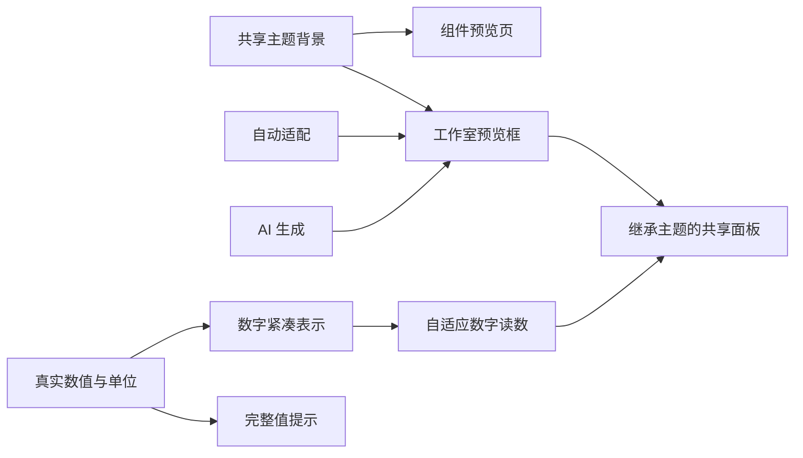
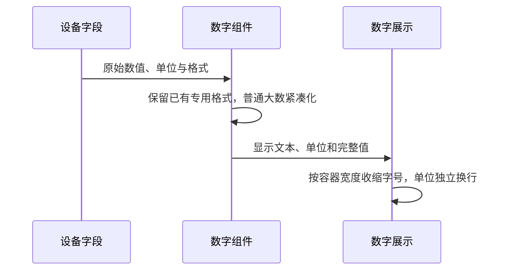

# 预览留白与数字防溢出计划

## Intent：最终目标

减少布局预览的重复留白，使用与组件预览页一致的主题背景和毛玻璃效果，并为共享数字读数组件提供自动紧凑表示与防裁切排版。

用户追加要求：自动适配与 AI 生成共用同一套布局预览，包含一致的主题和组件配置。

## Data：可用证据

- 用户截图显示预览外框、内部主题面板的 padding 叠加，设备标题与卡片间留白较大。
- 工作室外框 padding 为 12px，内部传入 theme 后共享面板额外增加 12px；设备标题下方另有 24px 间距。
- 数字卡片使用固定 34/48/66px 字号、不换行，外层卡片裁切溢出；普通整数直接转为原始字符串。
- 组件预览页使用共享 ui-backdrop，包括主题背景图片或点阵、模糊和颜色遮罩；工作室当前仅使用纯色背景。
- 自动适配和 AI 生成原本已共用模板，但 previewStyle、主题排序和保存主题只对 AI 启用，造成自动适配的预览外观分叉。

## Edges：边界与限制

- 保留共享组件原有内部留白，只收紧工作室容器的重复留白，保持组件预览与实际布局组件一致。
- 数字紧凑显示只应用到数字读数组件；不修改滑块精度、命令值、已有 bytes/duration/clock/percent 的格式规则。
- 不按 uptimeSec 或 freeHeapB 等字段名推断单位；未知单位的大数使用通用 K/M/B/T 表示，极端量级使用科学计数法。
- 原始完整值保留在提示和无障碍标签中；数值简写不修改设备数据或保存配置。
- 预览背景复用同一主题背景 mixin，并限定在预览框内部；保留 440px 内滚动高度。
- 不新增测试用例、不调用浏览器 UI 验证；保留其他工作区改动。

## Answer：交付格式与成功标准

1. 预览框外层改为 8px，内部取消重复主题面板 padding，标题间距收紧。
2. 预览框与组件预览页使用相同背景资源、模糊和主题遮罩，切换主题同步变化。
3. 大数自动简写，数字字号随可用宽度与文本长度收缩，单位可独立换行，避免依赖裁切或省略号隐藏数值。
4. 构建及适用的现有检查通过，核对开发服务实际返回的样式和组件模块，记录未进行视觉验收的限制。
5. 自动适配与 AI 生成共用当前预览主题、初始排序、组件面板和外框；新版布局保存沿用预览主题，不新增重复组件。

## 架构图

## 数据流图

