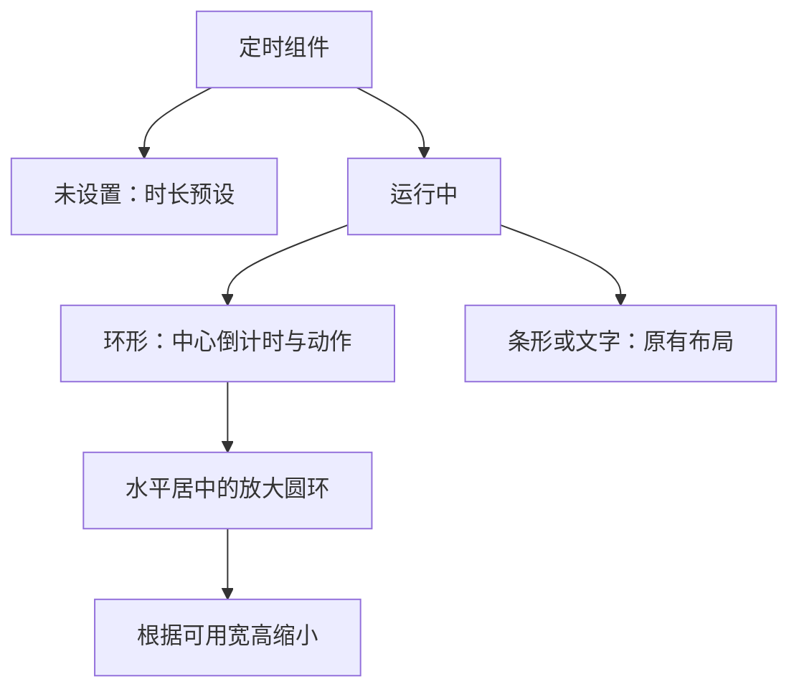
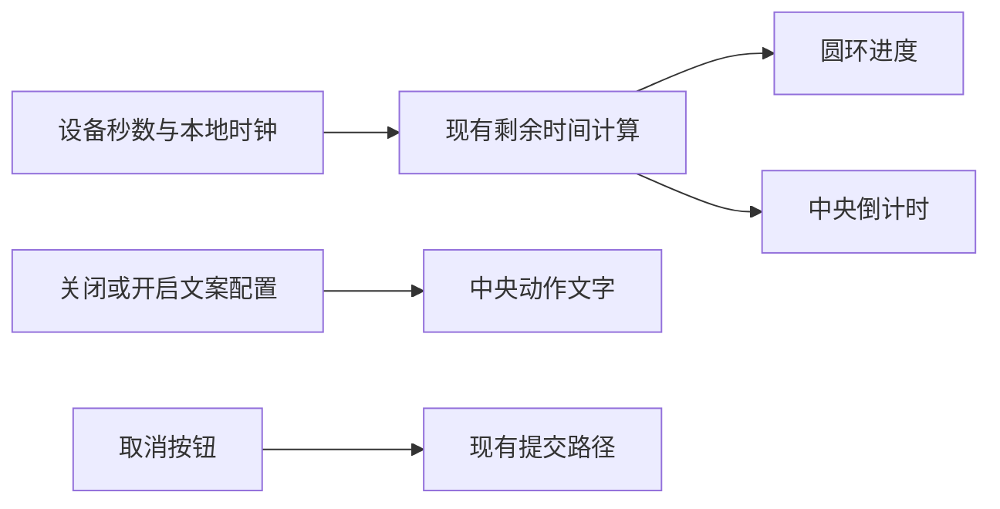

# 定时组件圆环重设计计划

## Intent：最终目标

用户明确选择“保留圆环，把倒计时放在圆环中央”，随后要求删除预计执行区域、圆环水平居中并继续放大，同时让显示动作可选关闭或开启。将进度与剩余时间合为卡片的单一视觉中心。

## Data：可用证据

- 用户截图中，空心圆环在左，剩余时间在右，动作和执行时间混在同一行。
- `timer-widget.html` 的 `ring` 分支负责该视图；`bar` 和 `text` 是独立样式。
- 定时组件已有预设、取消、设备读数与本地秒级倒计时逻辑。
- 卡片既会全宽显示，也会出现在较窄的面板网格中，需要随容器宽度安排信息。

## Edges：边界与限制

- 仅调整环形模式模板和局部样式；保留其他样式及设备命令语义。
- 延续现有主题颜色、字体、卡片与数值淡入行为。
- 不新增依赖、测试用例，不调用浏览器进行 UI 验收。
- 长动作文本受圆环内部宽度限制，使用省略显示；小时格式采用较小字号。
- 开启／关闭使用已有 `actionText` 显示配置；定时命令只发送秒数，不能通过修改文案改变固件行为。

## Answer：交付格式与成功标准

1. 圆环内部显示剩余时间和动作，原本空白的中心承担核心信息。
2. 删除环形模式的预计执行区域；圆环水平居中，最大直径 220px，并受实际可用宽高约束。
3. 保持标题、取消按钮和未设置状态的时长预设。
4. Angular 构建通过，补丁无空白检查错误；记录未进行视觉验收的限制。
5. 属性面板提供关闭／开启两项，保存后分别显示后关闭／后开启，并说明其显示语义。

### 架构图

### 数据流图

