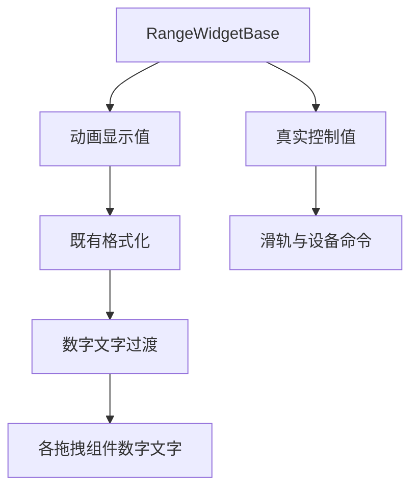
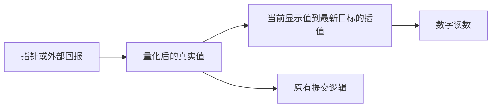

# 拖拽控件数字动画计划

## Intent：最终目标

拖拽型数字控件的读数随目标值平滑过渡。色温／色彩滑块、大块滑块、拨盘共用同一规则；同一基类的数字步进器也沿用此显示过程。

## Data：可用证据

- 数字拖拽组件继承 RangeWidgetBase，reading 直接格式化真实 value，所以每次指针事件都会立刻替换文字。
- 用户再次提供亮度滑块截图：整数 59 → 60 的插值仍只能格式化成两个整数，缺少文字层面的可见过渡；旧实现还会在每个新目标到来时取消并重新排帧。
- value 同时用于步长量化、滑轨位置、ARIA 和设备命令；直接给它加插值会引入错误的中间控制值。
- 滑动开关没有数字读数，色盘显示的是颜色编码，均不应按十进制数字插值。

## Edges：边界与限制

- 只为数字读数增加显示值；真实控制值、指针跟随和设备提交时机不变。
- 第一次显示直接使用当前值，不从零滚动。拖动只更新目标，保持单个连续帧循环，最后一次目标变化后 180ms 写入精确值并停止。
- 数字文字增加 160ms 淡入，使整数单步变化也可见；动画进行中不反复从零重启，单位不参与动画。
- 沿用现有小数位、单位、比例和格式化规则，尊重系统减少动态效果设置，销毁时取消动画帧。
- 不新增测试用例，不调用浏览器确认。

## Answer：交付与成功标准

共享范围控件基类提供 180ms 数字过渡，拖动、按钮、键盘与设备回报保持同一显示行为。构建与现有回归检查通过，执行记录明确实测边界。

## 架构图

## 数据流图

