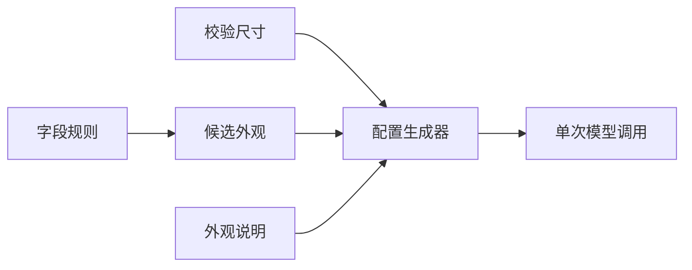
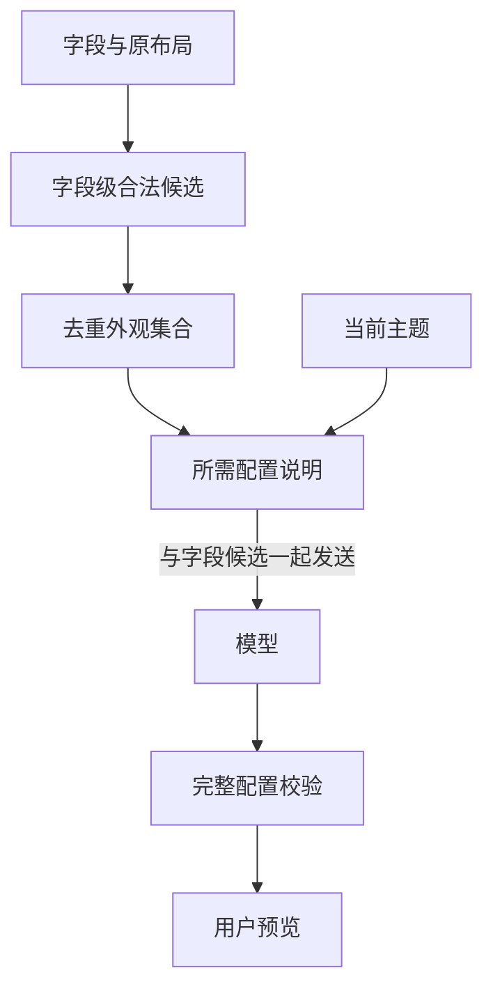

# 按设备字段裁剪组件配置

## Intent：最终目标

减少模型输入，按设备字段提供所需组件配置，保持一次模型调用。

## Data：可用证据

- 原排版指南固定发送所有组件与主题，约 2627 字符、5565 UTF-8 字节；其中组件外观段约 1246 字符。
- `variantsFor` 已能根据字段权限和类型返回可用外观；微调进一步限制为原组件类型。
- 用户明确选择程序筛选 schema，不使用额外模型工具往返。

## Edges：边界与限制

- 不新增模型工具调用或自动重试，不改变 180 秒 Agent 超时。
- 不按关键词猜测组件；候选依据正式字段权限与类型规则。
- 宽高范围复用后端校验常量，保留字段级候选，避免扩大可用范围。
- 不新增测试用例、不调用浏览器；输入体积减少不等于已证明端到端加速。

## Answer：交付格式与成功标准

移除固定全量指南，按当前候选外观集合生成紧凑配置说明，只提供所选主题。类型检查和构建通过，本地 Agent 更新生效。

### 架构图

### 数据流图

## 执行与自我复核

- 组件指南改为 `buildLayoutGuide(style, variants)`；外观集合取当前字段合法候选的并集，微调继续受原组件类型约束。
- 宽高范围直接读取校验器导出的 `VARIANT_SIZES`，只维护一份数值限制。
- 每种外观的用途说明集中存放，仅输出当前候选涉及的说明；只输出选定主题，相关外观不存在时省略 extras 规则。
- Agent 类型检查、差异空白检查通过。
- 使用实际指南函数测量文本体积：旧版 5565 UTF-8 字节；仅遥测外观为 1603 字节；布尔控制及可读状态候选为 1886 字节；全部21个外观为 2735 字节。该测量只统计指南，不含字段、需求及其他提示词，不是模型 token 数或延迟基准。
- 没有新增测试用例、调用浏览器或发起真实模型请求。
- 自我复核：这是程序按需提供 schema，不是模型工具调用。保留字段级候选及正式校验，不按用户示例硬编码筛选。精简可能减少输入处理开销，但没有真实模型前后对比，不能宣称已证明速度提高。

- 本地 Agent 构建并重启成功；首次镜像源 TLS 超时，重试成功。运行产物已包含动态指南和共享尺寸表，健康接口返回 HTTP 200、status=ok。
