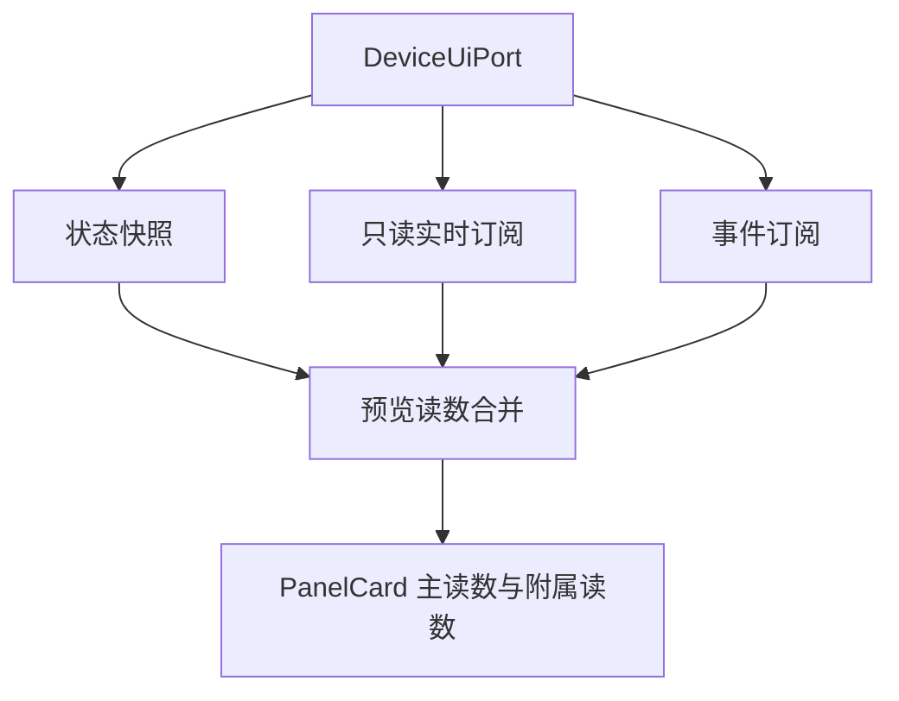
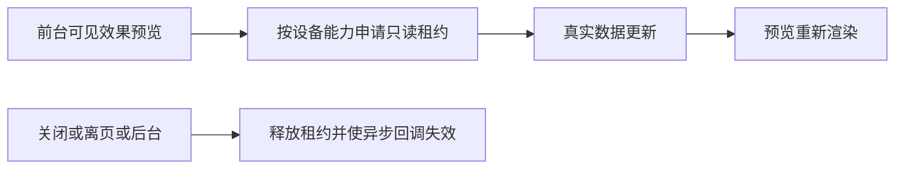

# 效果预览实时读数修复计划

## Intent：最终目标

让自动适配与 AI 界面的“效果预览”接收真实设备实时读数，仍然禁止通过预览发送控制命令。

## Data：可用证据

- 用户截图中的按键计数、RSSI 显示横线。
- `DeviceUicPage.panelCards` 直接读取状态快照字段，没有格式化丢值或把零值当成缺失。
- 正常 `DeviceV2Page` 对声明 `telemetryMinimumIntervalMs` 的只读属性单独调用 `openTelemetry`，并合并事件值和状态值。
- `DeviceUicPage` 目前仅订阅 `watchState`，缺少实时读数租约及事件值。
- AI 截图服务的示例数值与用户看到的效果预览不是同一条渲染链路。

## Edges：边界与限制

- 仅修复本次截图对应的 V2 界面配置预览，不修改固件、网关协议或其他编辑页面。
- 复用现有只读订阅 API，依据设备字段能力筛选，不针对截图字段名写特殊值。
- 预览关闭、离页、应用后台、设备切换和销毁时释放租约，拒绝迟到回调。
- 未收到真实数据时保留缺失态，不使用模拟值掩盖断线。
- 不新增测试用例，不调用浏览器。

## Answer：交付格式与成功标准

- 真实遥测值与事件值覆盖到主读数和附属读数。
- 正常状态字段继续沿用原状态快照。
- 订阅失败有可见提示，不影响编辑布局。
- 构建和相关现有测试通过；如有既有或并行改动导致的失败，明确记录。

### 架构图

### 数据流图

