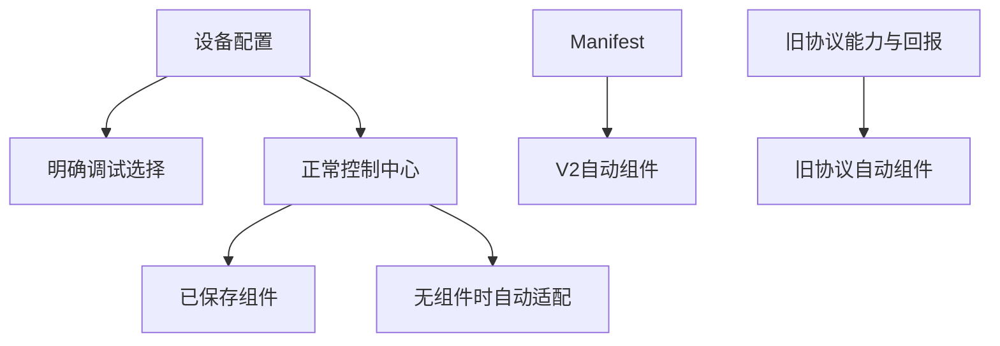
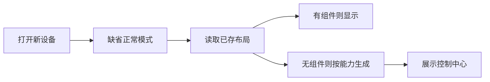

# 新设备默认自动适配计划

## Intent：最终目标

新设备没有组件配置时直接显示自动适配控制中心，不因缺少布局进入调试模式；明确选择的调试模式继续有效。

## Data：可用证据

- DevicePage 将无保存记录推断为 TestDashboard，UIC 又用 revision=0 或无旧布局推断调试开启。
- V2 正常页无保存记录时 layout 为 undefined，已有 generateDefaultPageLayout 可以依据已接受的 Manifest 生成组件。
- 旧设备 readLegacyPanel 可从 showSwitch 和已上报数值生成基础面板，但初次为空时后续数据只刷新已有卡片，不能自动补出组件。

## Edges：边界与限制

- 自动适配是运行时展示，不在进入页面时隐式保存布局。
- 保留明确 TestDashboard 和旧协议 panel.view=debug 的选择。
- 保存过的空布局也允许自动适配展示，但保留记录与 revision，后续编辑仍按现有保存协议处理。
- 旧协议只用现有明确能力和回报，不能猜测可写命令。
- 调试模式关闭后直接回正常控制中心，不因无记录跳转编辑器。
- 不新增测试用例，不使用浏览器；必要时修正已有测试中旧默认行为的断言。

## Answer：交付与成功标准

V2 能力就绪后显示自动组件，旧协议首次数据到达后补出基础组件，明确调试选择及既有布局保留。构建与相关已有回归通过。

## 架构图

## 数据流图

