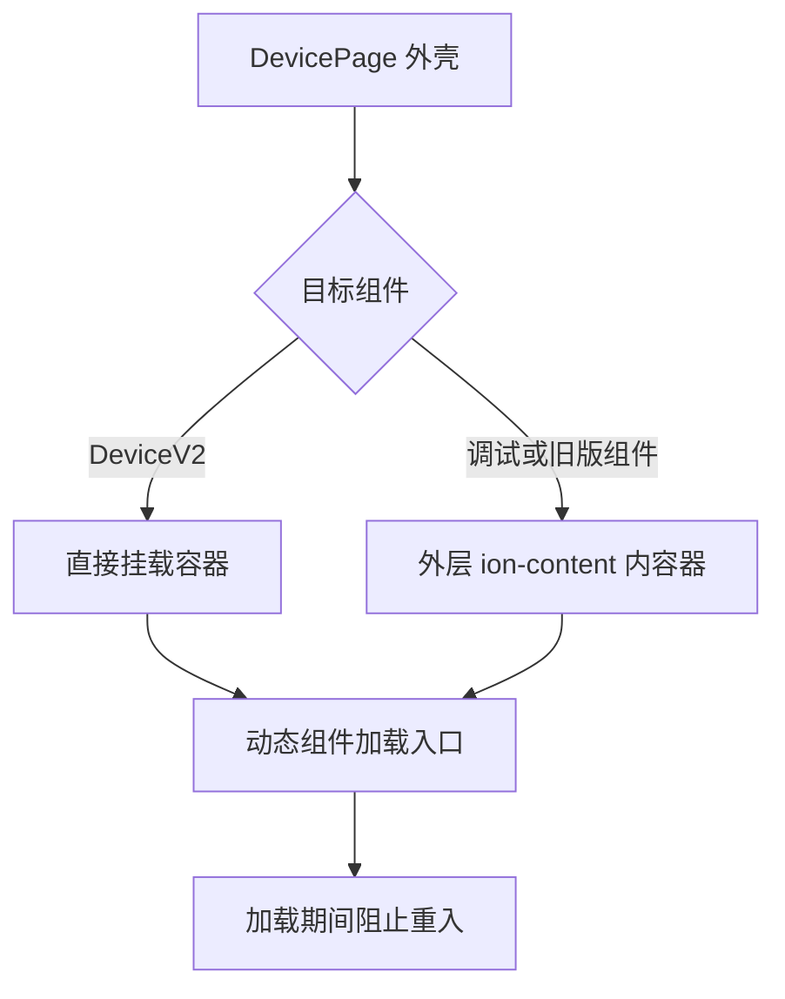
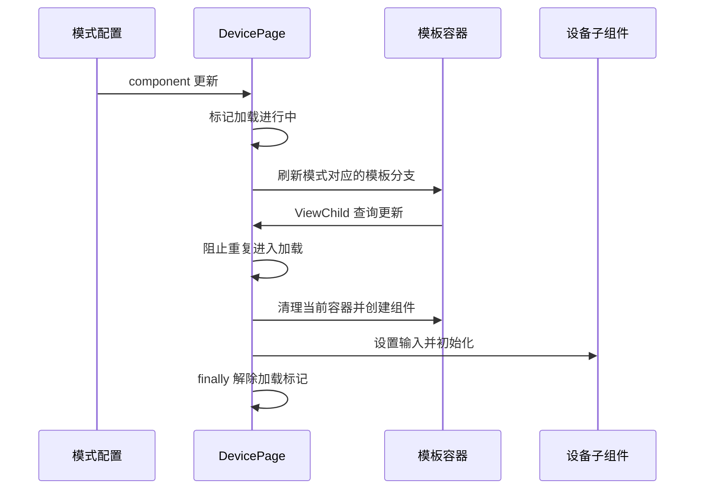

# 模式切换重复组件修复计划

## Intent：最终目标

修复设备从调试模式返回组件模式后，同一组组件重复显示的问题。

## Data：可用证据

- 用户截图中 Power、ButtonPresses、Button 整组重复，两组之间存在明显间隔。
- `device.page.html` 根据 `usesV2DevicePage` 选择不同的动态组件容器；调试页由外层 ion-content 包裹，DeviceV2 自带 ion-content。
- `loadDevice()` 在容器清理后直接读取可变的 `deviceViewContainer` 并创建组件。
- `deviceView` 查询更新会再次调用 `loadDevice()`；设备状态通知也会同步调用父页变更检测。
- 调试组件销毁时关闭设备连接，形成状态通知、父页刷新、容器更新的重入入口。

## Edges：边界与限制

- 仅调整设备外壳的动态组件加载顺序和重入控制。
- 保留工作区已有改动，不修改设备数据、面板生成、卡片样式或通信协议。
- 不新增测试用例，不调用浏览器进行 UI 验证。

## Answer：交付格式与成功标准

1. 加载组件前先刷新模板分支，使当前容器与目标模式一致。
2. 同步加载期间阻止查询回调再次进入创建流程，并用 finally 恢复状态。
3. 运行已有设备页切换测试与 Angular 编译检查。
4. 记录验证结果及尚未验证的实机行为。

### 架构图

### 数据流图

