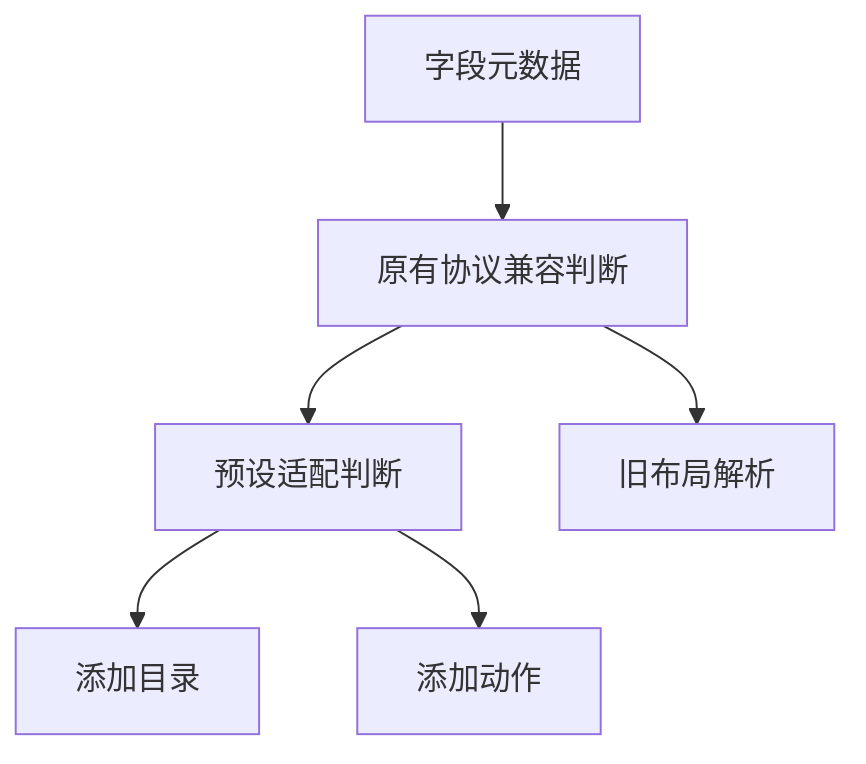

# 添加部件筛选与样式修正计划

## Intent：最终目标

添加面板只保留全宽字段选择器与适用的组件预览，修正选择器高度，移除查找框和卡片说明行。用户补充要求弹层统一样式、不要三角箭头，因此使用以选择按钮为锚点的 Ionic popover 和主题化单选列表。

## Data：可用证据

- ion-select 外层 padding 与内部最小高度叠加；无标签时内部容器没有铺满，箭头紧跟文字。
- 目录使用 variantsFor，现有 value 分支只检查可读取能力，就允许全部展示变体。
- variantsFor 同时承担旧布局校验，直接收紧会使以前保存的布局失效。
- 字段提供 role、valueType、读写能力、范围、步长、单位和 choices，可据此筛选，不需要猜字段名称。

## Edges：边界与限制

- 添加目录及添加动作共用预设适配判断；旧文档解析与持久化规则不变。
- 布尔属性仅使用开关和状态；数值展示按数值类型与范围选择；文本和事件按其实际内容展示。
- 特殊控件仍满足现有读写与类型要求，档位不能截断数值范围，倒计时必须明确以秒表示且允许写入零；RGB 沿用既有颜色声明规则。
- 新建旧协议字段仍由用户所选部件定义类型；没有既有字段时不推测其设备语义。
- 不新增测试用例，不使用浏览器做 UI 确认。

## Answer：交付与成功标准

字段选择器全宽、最小高度 44px；下拉菜单与按钮等宽，没有三角箭头或背景遮罩，列表可滚动；组件卡片没有下方说明行。布尔字段不再出现数字、曲线、环形进度或日志。构建与已有回归通过，并记录兼容性边界。

## 架构图

## 数据流图

