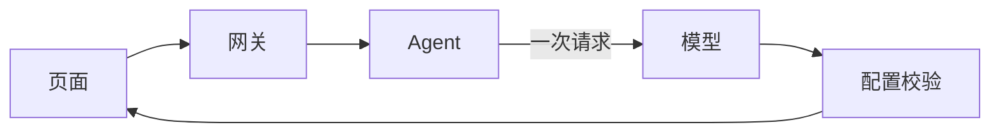
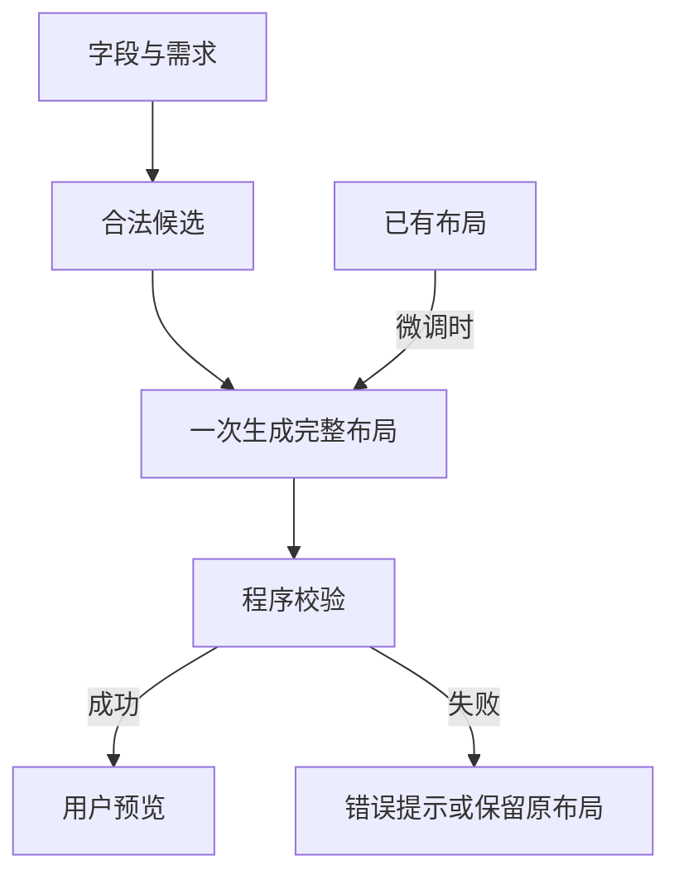

# 界面生成合并为单次调用

## Intent：最终目标

字段匹配、布局与样式由一次模型调用完成，取消自动多轮重试，缩短用户等待。

## Data：可用证据

- 当前首次生成先调用模型匹配组件，再调用模型生成布局，配置不合法时最多再调用两次。
- Agent 总超时为 400 秒、网关 410 秒、前端 420 秒，沿用了已移除的多阶段流程预算。
- 用户反馈停留在“正在设计布局和样式”，要求一步完成。

## Edges：边界与限制

- 一次生成或微调只调用一次模型，不删除字段权限、组件覆盖和尺寸校验。
- 不新增测试、不调用浏览器；保留工作区其他修改。
- 更新本地开发 Agent 与网关，避免协议不同步。
- 单次调用仍受模型服务速度影响，不能承诺即时完成。

## Answer：交付格式与成功标准

一次请求传入需求、字段及合法组件候选；模型直接返回完整布局。程序校验后交付预览，无匹配阶段及重试循环。Agent/网关/前端时限改为 40/45/55 秒。

### 架构图

### 数据流图

## 执行与自我复核

- 已删除匹配模型调用和最多三轮的设计重试；生成与微调均仅调用一次 `model.generate`。
- 合法组件及外观候选由程序随字段一次提供。首次生成根据返回配置提取映射，再校验完整覆盖、权限和类型；微调继续约束原组件绑定。
- 前端统一显示“正在生成界面…”，移除旧匹配事件和多轮进度。
- Agent/网关/前端总时限调整为 40/45/55 秒。
- 前端、Agent、Gateway 类型检查通过；现有生成服务 6 个测试通过；差异空白检查通过。
- 已重建本地 Agent 与 Gateway；构建成功。
- 自我复核：取消多轮调用减少串行等待，但单次模型推理仍可能较慢，40 秒是截止时限而非性能承诺。一次生成不合法会直接失败，不会再悄悄多次重试。没有通过减少权限和结构校验换取速度。
- 按用户要求未新增测试或调用浏览器，尚未测量真实设备生成耗时。

## 超时调整

- Intent：按用户要求，将 Agent 等待上限调整为 3 分钟。
- Data：Agent 与模型 SDK 原为 40 秒，网关 45 秒，前端 55 秒。
- Edges：仅修改新生成与微调流程，旧单轮接口保持原有时限；仍只调用一次模型。
- Answer：Agent 与模型调用为 180 秒，网关 190 秒，前端 200 秒，外层留出错误回传时间。

- 验证：前端、Agent、Gateway 类型检查通过，本地 Agent 与 Gateway 已重新构建并启动。同步调整了模型 SDK 的调用超时，避免仅改外层计时器而仍在 40 秒中断。
