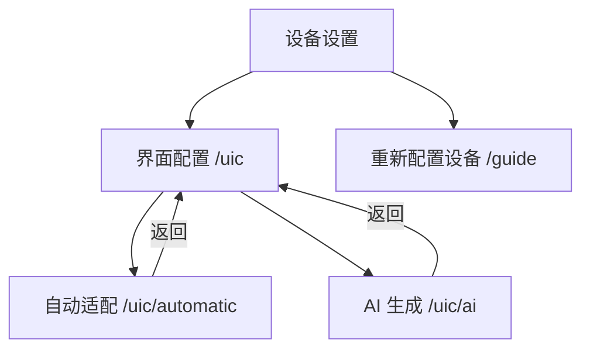
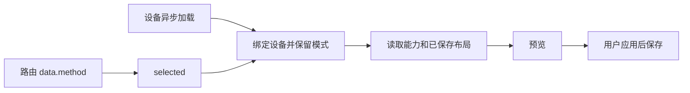

# 界面配置路由与返回修复

## Intent：最终目标

为自动适配、AI 生成提供独立 URL，使直接访问、刷新与返回导航能够定位页面；排查用户反馈的“重新配置设备”返回异常。

## Data：可用证据

- 原界面配置仅注册 `device-manager/:id/uic`，入口修改 `selected`，没有导航历史。
- 原编辑返回按钮仅清空 `selected`。
- 设备异步绑定会清空 `selected`，会覆盖从路由初始化的模式。
- “重新配置设备”对应 `/guide?mode=reconfigure&deviceId=...`，由设备设置页进入；原默认返回地址为设备控制页。

## Edges：边界与限制

- 复用现有组件和生成流程，不拆分重复页面，不增加草稿持久化。
- 保留现有未提交改动，仅处理路由及相关初始化。
- 不新增测试用例，不调用浏览器；调整已有测试夹具以适应入口导航变化。
- 新 URL 恢复页面模式，不恢复刷新前未保存的 AI 生成结果。

## Answer：交付格式与成功标准

### 执行计划

1. 注册两个明确路由，通过路由 data 设置模式。
2. 入口执行向前导航，返回使用 Ionic 返回栈及默认父页面。
3. 保留路由模式，设备异步加载后启动对应能力读取。
4. 确认“重新配置设备”返回的具体异常并处理。
5. 执行已有工作流测试和编译检查，复核改动边界。

### 路由结构

### 数据流

### 执行记录

- 已新增自动适配与 AI 生成路由，复用 DeviceUicPage。
- 已替换组件内切换和伪返回，使用 Ionic 页面导航。
- 已避免设备绑定清空路由模式，并补充直达页面的能力初始化。
- “重新配置设备”默认返回地址改为设备设置页，并编码设备 ID；有历史记录时继续使用 Ionic 返回栈。用户尚未说明点击后的实际表现，不能据此确认无响应等其他问题已解决。
- 应用开发构建通过，TypeScript 检查通过；已有界面工作流 22 个测试全部通过。
- 默认测试命令被无关的蓝牙测试导入错误阻断，随后用临时 TypeScript 配置仅编译目标测试并通过；临时配置已删除。
- 未新增测试用例，未进行浏览器 UI 验证。

### 自我复核

路由初始化须覆盖设备尚未加载及 Ionic 页面缓存两种情况；原生命周期负责离开后的连接和生成取消。不得将新增 URL 等同于草稿持久化，也不能仅凭默认返回地址问题断言已复现用户的点击异常。
