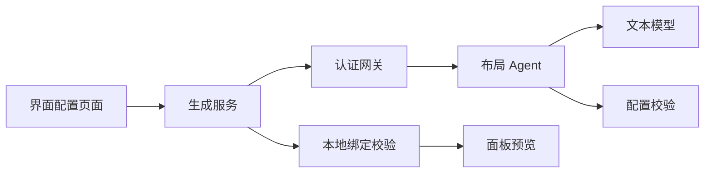
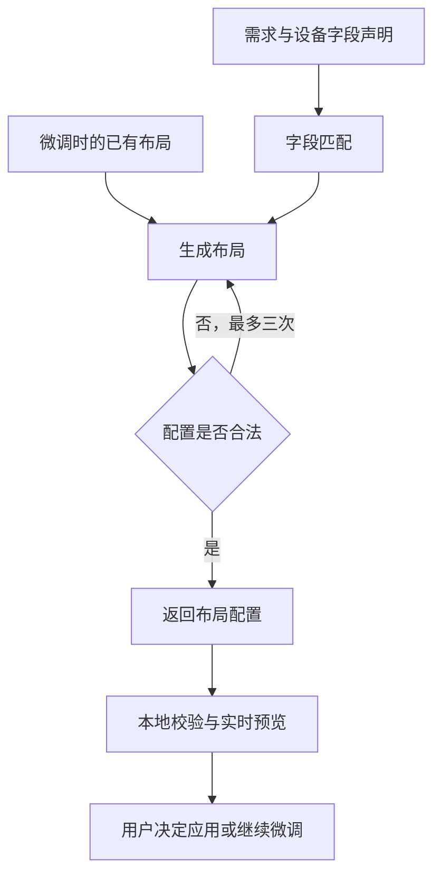

# 移除视觉确认与精简提示词

## Intent：最终目标

移除 AI 生成界面的截图、视觉模型审查及审查驱动的重排，简化设计提示词。保留字段匹配、配置校验、用户预览、应用及 AI 微调。

## Data：可用证据

- 后端 `aily-blinker-services/packages/device-ui-agent/src/workflow.ts` 在设计后请求前端截图，再调用视觉模型，最多循环三轮。
- `workflow-http.ts` 要求配置视觉模型后才能生成。
- 前端 `interface-generation.service.ts` 负责截图上传；`interface-workflow.ts` 将成功结果与截图和审查结果绑定。
- 用户预览由 `device-uic.page.html` 中的面板组件直接渲染，无需截图。

## Edges：边界与限制

- 两个仓库需要同步变更；不部署、不改模型凭证。
- 保留已有未提交改动；仅调整本流程及失效依赖。
- 保留配置错误的有限重试，不再按视觉反馈重试。
- 不新增测试用例、不调用浏览器；执行类型检查和适用的已有检查。

## Answer：交付格式与成功标准

- 生成流程只经过字段匹配、布局设计、程序校验、返回配置。
- 无截图上传、视觉模型调用及视觉通过/失败提示。
- 微调只发送需求、字段声明与已有布局；不发送 priorReview。
- 记录修改、验证结果与自我复核。

### 架构图

### 数据流图

## 执行记录

### 已完成的修改

- Agent 删除截图请求、视觉模型调用及审查反馈循环，合法配置直接完成；保留最多三次配置校验尝试。
- 精简匹配与设计提示词，保留 JSON 契约、字段权限、布局指南和微调约束。
- 删除视觉配置解析、图片输入支持、预览交换服务和上传路由，并同步 README 与环境变量示例。
- 前端删除离屏截图服务及 `html-to-image` 依赖；保留面板组件直接渲染的预览。
- 微调接口移除 `priorReview`，结果以可选 `warning` 表示未完成；保留原布局和调整文字供重试。
- 清理图片专用请求限额；网关和前端统一使用 2 MiB 文本响应上限。
- 仅适配已有生成服务测试的构造器，没有新增测试用例。

### 验证

- Agent 与 Gateway 类型检查通过。
- 前端应用类型检查通过，最终复核再次通过。
- 生成服务已有 6 个测试全部通过，使用临时精简 tsconfig 限定编译范围，配置已清理。
- 常规测试入口被既有 BLE 测试的过期导入阻断；预览专用测试入口遇到工作区正在变更的预览遥测方法缺失，未修改这些无关代码。
- 两个仓库的差异空白检查通过；AST 检索未发现运行代码中遗留的截图上传、视觉审查和旧契约引用。
- 未调用浏览器，未调用真实模型或执行部署。

### 自我复核

- 视觉确认属于运行时链路，仅删提示词无法消除耗时和视觉模型依赖，因此同时移除了前后端对应流程。
- 配置校验仍负责字段绑定、权限、允许尺寸及组件覆盖；移除视觉审查不等于跳过数据校验。
- 首次生成尚无合法配置时仍失败；微调失败返回原布局并明确提示，避免把旧布局误报为已完成调整。
- 返回契约已改变，App、Gateway 和 Agent 需要同步发布；没有添加旧视觉协议兼容层。
- 尚未以真实模型验证生成质量，不能把类型检查和传输测试视为视觉效果证明。

## 联调修复：生成未完成

### Intent：最终目标

修复代码变更后本地页面与运行中服务的协议不一致。

### Data：可用证据

- 本地前端运行 `ng serve --configuration local`，请求本地 17000 网关。
- Agent 容器仍为前一日构建；检查其运行产物确认包含 `render-request` 和视觉审查逻辑，不包含新流程的失败提示。
- 最近 Agent 日志出现 `interface workflow failed Error`，但旧日志没有记录具体错误分类。

### Edges：边界与限制

只重建本地开发环境的 Agent 与 Gateway，不修改模型凭证和远程环境。不使用浏览器，不新增测试。

### Answer：交付格式与成功标准

重建并启动本地 Agent 与 Gateway，确认运行产物采用新协议且服务健康。真实设备生成结果由用户重试确认。

### 自我复核

上一次完成了源码与静态检查，但没有同步本地运行产物；对于已改变的跨服务协议，仅提示“需要同步发布”不足以保证当前开发环境可用。本次补齐运行环境同步。

### 本地运行验证

- `docker compose -f compose.dev.yaml up -d --no-deps --build device-ui-agent gateway` 成功。
- 新 Agent 运行产物不再包含视觉审查或 `render-request`，包含新流程警告。
- Agent `/healthz` 返回 HTTP 200、`status=ok`；Agent 与 Gateway 容器均 healthy。
- 未代替用户发起真实设备生成请求，待页面重试验证最终生成结果。
