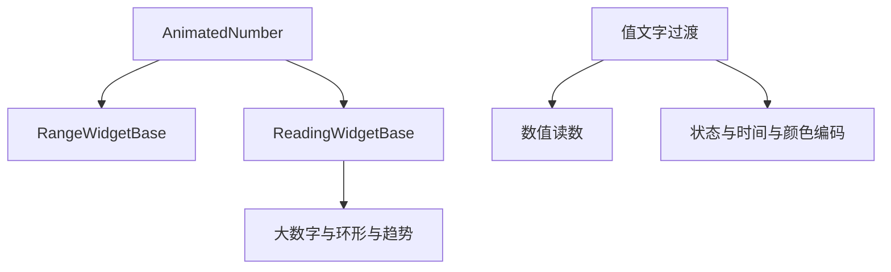
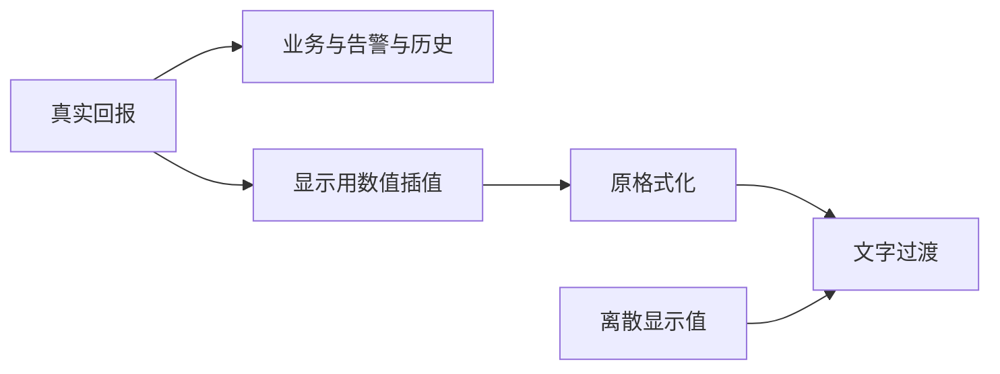

# 组件值动画统一计划

## Intent：最终目标

将值变化过渡从拖拽控件扩展到组件库其他动态读数，包含设备回报更新。保持真实值与显示动画分离。

## Data：可用证据

- RangeWidgetBase 已有连续帧数值插值；ReadingWidgetBase 仍直接输出真实读数。
- 大数字的紧凑格式绕过 reading，直接从 card.value 计算；需要一起接入显示值。
- 状态映射、阈值、ARIA、历史和差值依赖真实值，不能被动画中间值污染。
- 倒计时、动作次数、颜色编码及附属读数各自有不同的显示入口。

## Edges：边界与限制

- 抽取小型 AnimatedNumber，共享单帧循环；不新增全局动画服务或继承层。
- 用户补充要求滑块位置也有过渡：手柄、填充、拨盘角度与数字共用显示值。文字过渡只改变透明度，不改变布局或垂直位置；差值徽章使用 flex 居中。
- 大数字、环形、趋势的主读数采用数值插值和文字过渡；环形显示进度同步插值。
- 状态、HEX、计时、计数、附属读数仅做文字过渡，不把离散值或历史事件当连续数值。
- 不安全 bigint 保留原有精度；图表历史数据、真实告警、设备命令与计时规则不变。
- 静态标题、刻度、预置选项和输入中的文本不播放值动画。
- 不新增测试用例，不调用浏览器确认。

## Answer：交付与成功标准

共用数值动画与值文字过渡，覆盖各动态入口，构建和相关已有回归通过，并说明未实测的边界。

## 架构图

## 数据流图

