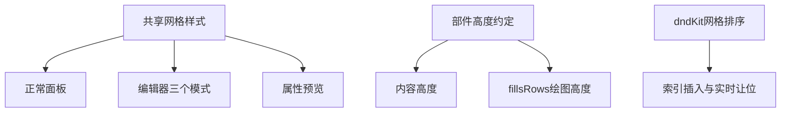
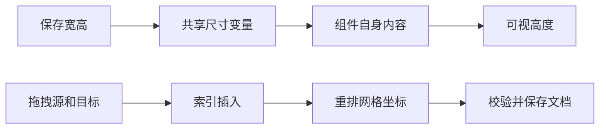

# 组件自适应高度同步计划

## Intent：最终目标

色温／色彩滑块标题与滑轨间距为 12px。以组件库页面的预设表现为标准，编辑、布局、预览、属性预览与部件目录遵循同一尺寸规则：只有占满整行且组件自身允许的部件按内容自适应，其他部件继续保留行高。

## Data：可用证据

- 正常组件面板整宽单元使用 min-height:0 和 contain:none；gradient 不使用 fills-rows，因而按内容计算高度。
- 编辑器 Gridster 为所有组件计算固定像素高度与坐标，无法表达逐项内容高度。仅取消卡片 height 会留下固定的空槽位。
- 属性页和添加目录也统一指定了 height，导致原本可自然收缩的组件被拉高。
- 用户补充要求参考 dnd-kit 的 grid 排序，替换当前 swap。dnd-kit 官方 DOM Sortable 支持可变尺寸网格、按索引插入及实时让位，适用于 Angular。
- dpad、dial、picker、level、levels、trend 已通过 fills-rows 约定获取所需绘图高度，无需新增组件白名单。

## Edges：边界与限制

- 保存协议与 grid.height 不变，不能把“2 行”偷改为“1 行”。
- 抽取既有 CSS 网格尺寸规则供各视图复用；半宽组件仍保持行高对齐，整宽组件由自身内容或 fills-rows 决定高度。
- 拖拽按目标索引插入，受影响部件依次让位；保存顺序重算网格坐标，保留宽高、绑定及隐藏部件。
- 使用 @dnd-kit/dom，关闭其乐观 DOM 排序，由 Angular 统一管理 DOM。拖动时只改变临时顺序，结束后提交文档一次，取消恢复原顺序。
- 用拖动前后实际坐标计算让位动画，包含因不同尺寸换行而位移、但索引未改变的组件；碰撞单元和卡片视觉动画分开。
- 不新增测试用例，不调用浏览器进行 UI 确认。

## Answer：交付与成功标准

1. gradient 标题到滑轨实际间距 12px，不与通用 gap 重复相加。
2. 编辑器三个模式使用相同 CSS 布局和组件渲染，不再使用固定高拖拽槽。
3. 属性页和目录只放开整宽外层高度，保留组件库已有 fills-rows 约定和半宽行高。
4. 保存、撤销、字段显隐、属性独立页保持原有流程。
5. 网格插入排序有让位动画，快速连续移动从当前可见位置衔接；遵循系统减少动态效果设置。
6. 构建、相关已有检查及差异检查通过，记录触摸验证限制。

## 架构图

## 数据流图

## 官方参考

- [dnd-kit DOM Sortable](https://dndkit.com/concepts/sortable/)
- [排序与交换策略的区别](https://dndkit.com/legacy/presets/sortable/overview/)
