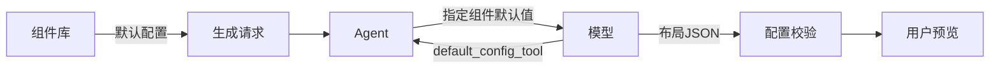
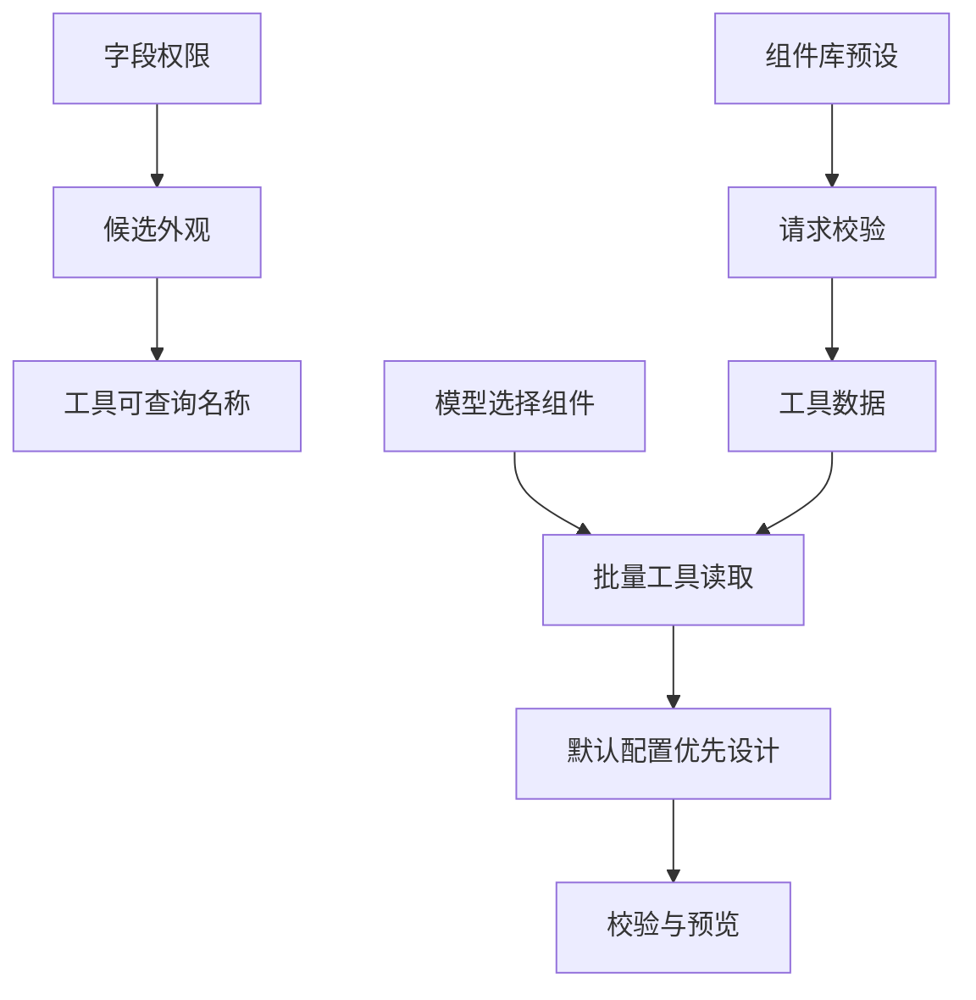

# 组件默认配置工具接入

## Intent：最终目标

提供真正的 `default_config_tool`，让模型按指定组件读取组件库默认配置。设计默认沿用组件库配置，仅按明确需求覆盖。

## Data：可用证据

- 前端 `presetForVariant` 返回各外观的正式预设；`toPageLayout` 已复用这些预设尺寸和 options。
- 现有模型适配器只接受文本结束，不处理 `toolUse`。
- 用户明确要求工具，取代此前“程序筛选、只调用一次模型”的选择。

## Edges：边界与限制

- 不复制一份默认值到后端：前端从组件库提供默认配置，后端校验后供工具读取。
- 工具仅能读取当前字段允许的组件外观，无文件、网络或设备操作权限。
- 一次批量工具读取后输出最终 JSON，最多两次模型请求；总超时仍为 180 秒，不恢复匹配/审查流程或自动重试。
- 首次工具选择阶段不强制 JSON 响应格式，最终输出阶段强制 JSON 且禁止继续调用工具。
- 不新增测试用例、不调用浏览器；保留工作区其他修改。

## Answer：交付格式与成功标准

工具签名：`default_config_tool({ components: ["level", "dial"] })`。

结果只返回请求的外观默认宽高、appearance、options 及允许尺寸。默认值源自组件库；前端与 Agent 协议同步，本地服务更新。

### 架构图

### 数据流图

## 执行与自我复核

- 已新增 `default-config-tool.ts`，注册 `default_config_tool`，支持一次批量查询指定组件外观，只返回被查询的配置。
- 前端从正式 `presetForVariant` 读取候选外观默认值，随请求提交。后端检查外观、尺寸、重复项、配置覆盖与选项数据形态。
- 模型消息初始仅包含字段候选和简短用途，不包含全量默认配置；工具查询后回传指定默认值。
- 模型适配器支持工具调用消息及结果回传；首轮指定工具并禁止并行调用，末轮禁止工具且要求JSON，最多两轮共享原180秒总时限。
- 提示词优先组件默认配置：默认appearance，省略不必要的icon、tone、extras，不为铺满网格拉伸组件，不主动重配色。宽高从工具默认值填写，未覆盖的options由前端继承。
- 前端与Agent类型检查通过，已有生成服务6项测试通过，两仓库差异空白检查通过；本地Agent构建重启成功。
- 自我复核：默认配置只有组件库一份权威来源；模型工具有明确只读边界和有限往返。与此前单次调用相比增加一次模型请求，这是用户明确选择工具后的行为变化，不能承诺加速。
- 未新增测试用例、未调用浏览器、未用真实模型验证工具选择与生成质量；类型检查和已有传输测试不等同于上游模型兼容性验证。

- 运行验证：Agent产物包含 default_config_tool 与 toolResult 支持，健康接口 HTTP 200、status=ok。
