# 自定义模式执行计划

## Intent：最终目标

提供可以随时切换的组件模式、自定义模式与调试模式。组件布局与自定义 HTML 各自保存，切换模式不覆盖另一份内容。AI 使用与应用预置组件同源的 HTML 原子组件，在空白 CSS Grid 模板中创建界面，也允许普通 HTML、CSS 和 JavaScript。

## Data：可用证据

- 当前组件来源：`device/v2/widgets`，21 种数据与控制外观，以及视频、天气组件。
- 组件共享 `theme/ui-theme.scss`、`widgets/_card.scss`、`widget-presets.ts`。
- V2 设备由 `DeviceV2Page` 管理连接、实时订阅、历史、指令校验；旧设备由 `LegacyPanelComponent` 适配。
- 现有 `Customizer` 是可信 URL 的 Penpal iframe，不适合直接运行 AI HTML。
- V2 UI 配置存储于服务端 JSONB；前后端均有字段白名单。旧设备布局通过独立面板接口保存。
- AI 的现有接口仅返回组件布局 JSON。显式传入 `mode: 'component' | 'custom'`，服务端分发为组件或 HTML 工作流；没有 mode 的旧请求维持组件协议。

## Edges：边界与限制

- 使用独立 iframe 的 `sandbox="allow-scripts"`，不开放同源访问；宿主只传面板数据与受限控制事件。
- 不复制一套组件样式；原子标签以现有 Angular 组件构建独立运行时。
- 预览不发送设备指令；正式运行继续使用原设备控制链。
- 组件文档和自定义文档共存；模式切换不得重写任何面板内容。
- 不添加测试用例、不调用浏览器进行 UI 确认。通过编译、已有检查及静态检查验证。
- 修改相邻服务端仓库的最小相关接口，保持现有组件 AI 流程独立。

## Answer：交付格式与成功标准

1. HTML 原子运行时、空白 Grid 模板与 AI 可用目录，使用同一组件模板、样式、主题和字体。
2. 自定义模式入口、HTML 编辑/预览/AI 生成/保存，以及三种模式的明确切换。
3. iframe 数据桥接和真实设备控制，模式往返与重新打开后仍保留两份内容。
4. 前后端配置验证与 HTML 生成接口；构建成功，记录已验证项和剩余限制。

## 架构图

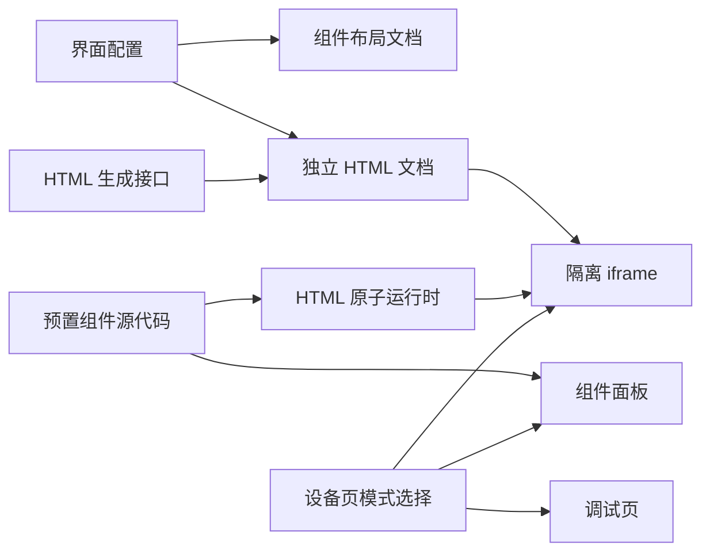

## 数据流图

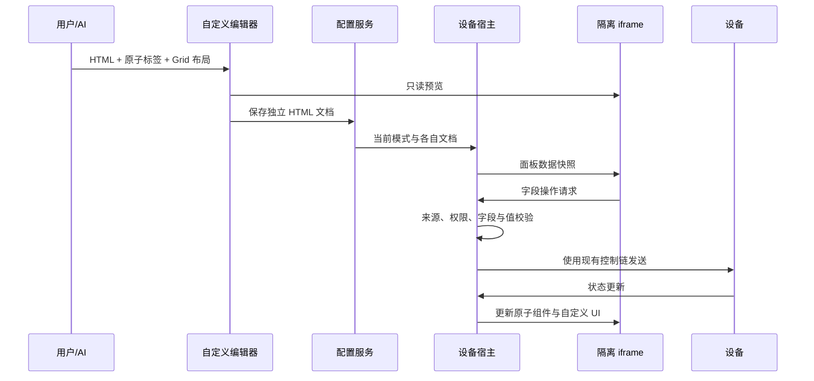

## 执行顺序

1. 明确存储及模式共存模型。
2. 构建复用现有组件的 HTML 原子运行时、模板与隔离桥。
3. 接入设备页和编辑器。
4. 扩展必要的服务端校验与 AI 接口。
5. 编译、检查并自我批判。

## 运行时 404 与页面卡顿修复计划

### Intent：最终目标

修复进入自定义配置页后资源持续 404、页面卡顿的问题；资源不可用时仅显示一次错误，不随设备状态更新自动重试。

### Data：可用证据

- 用户截图中 `/custom-panel-runtime/runtime.json` 持续 404，命令行直接请求同一路径也返回 404。
- 运行时文件已存在，但当前开发服务在新增 Angular assets 配置之前启动，没有提供新映射。
- `prepare()` 只在资源成功返回后记录 HTML；失败后的 `markForCheck()` 会让新 cards 输入再次触发相同 HTML 的加载。

### Edges：边界与限制

用户要求不打开浏览器诊断。本轮用源码、HTTP 请求和编译验证，不新增测试用例，不重启现有开发服务。

### Answer：交付与成功标准

1. 加载尝试开始时记录 HTML，只由文档变更或手动重试发起加载。
2. 原子产物输出到既有 `public` 资源根目录，去掉额外的 assets 映射，开发与生产复用同一路径。
3. 当前开发服务实际返回 200；返回内容与构建文件一致；构建和静态检查通过。

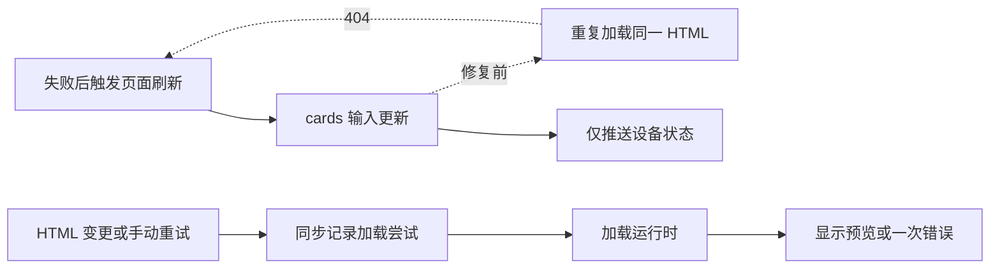

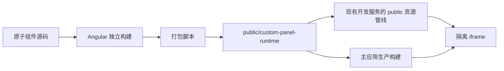

## 自定义页面视觉收敛计划

### Intent：最终目标

把自定义模式改成面向普通用户的 AI 生成页面，仅呈现风格选择、需求输入和效果预览，视觉对齐已有“AI 生成”页。

### Data：可用证据

- 用户截图明确指出介绍、原子接口、源码与导入导出造成视觉和操作负担。
- 现有 AI 页已有表单、提示建议、预览容器、生成遮罩与应用按钮样式。
- 添加部件使用按钮触发的 Ionic popover + radio 选择字段；自定义风格选择应复用该样式。

### Edges：边界与限制

- 移除用户界面的源码、原子说明、导入导出及闲置方法。
- 保留 HTML 作为内部文档，以及 `mode: custom` 的 AI 工作流。
- 不打开浏览器，不新增测试用例；不改变组件模式生成流程。
- 使用两个小型 SCSS 共享文件复用既有外观，不建立新的表单框架。

### Answer：交付与成功标准

自定义页只展示 AI 输入与预览，使用同款风格选择弹层、生成按钮、加载遮罩及应用按钮；未生成时显示空态，已有界面可继续调整；应用仍独立保存自定义文档。通过模板编译和静态检查。

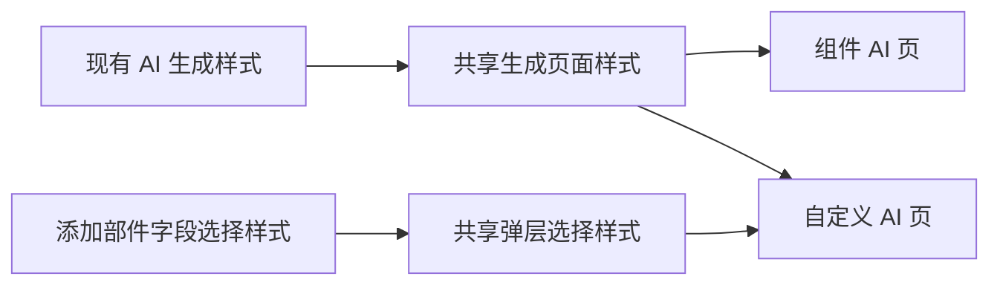

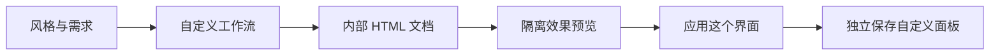

## AI 生成请求 400 修复计划

### Intent：最终目标

让本地正在运行的 AI 服务实际支持前端提交的 `mode: custom`，解决点击生成被请求校验拒绝的问题。

### Data：可用证据

用户截图中的载荷包含正确的 `mode: custom`、主题、字段、原子目录和 HTML。检查本地 Docker 内正在执行的 Agent bundle，确认既没有自定义工作流，也没有 component mode 校验；容器没有源码挂载，宿主机编译不会更新运行代码。

### Edges：边界与限制

不打开浏览器；仅更新开发环境的 Gateway 与 AI Agent，不重建数据库、Broker 或其他服务，不改动用户面板。

### Answer：交付与成功标准

重新构建并启动两个开发容器，确认健康状态与运行代码包含新协议，再通过服务端接口诊断确认自定义请求不再在参数校验阶段返回 400。

## 自定义设备页边距、高度与主题修复计划

### Intent：最终目标

正式设备页只保留一层与组件模式相同的内容边距，iframe 使用页头和安全区之外的全部高度，长内容由 iframe 文档滚动。自定义模式使用生成时的主题，隐藏设备页主题切换入口；编辑按钮直接进入当前界面的 AI 微调页。

### Data：可用证据

- 实际保存的 HTML 自己设置了 12–16px 的面板 padding，没有禁止滚动。
- V2 宿主另有 16px padding；iframe 固定为 `max(560px, 75dvh)`，没有使用宿主剩余高度。
- 旧设备宿主也有独立 padding，需要同样去除。
- 当前主题按钮只排除了旧 Customizer，且 iframe 读取宿主祖先主题，仍会受到个人主题偏好覆盖。
- 用户已确认 `content_main.js` 的 target origin 报错来自 Chrome 插件，明确要求忽略。
- 用户进一步要求边距与组件模式一致；组件模式为上方和两侧 16px、底部 32px、最大宽度 720px，当前 HTML 的窄屏规则降为 12px。
- 自定义 AI 编辑组件已经读取保存的 HTML 和主题，并把当前 HTML 作为生成请求的调整基础；设备页编辑按钮仍指向组件编辑路由。

### Edges：边界与限制

不打开浏览器，不修改用户已生成 HTML，不改变组件模式布局。iframe 保持隔离权限；不为插件报错修改通信协议。

### Answer：交付与成功标准

宿主仅负责页头和安全区，iframe 占满余下空间并单独滚动；运行时根面板与组件模式共用边距常量。自定义模式不显示或响应主题切换，使用文档主题；编辑按钮进入已带入当前界面的 AI 微调页面。通过构建、静态检查和已有主题/设备页回归。

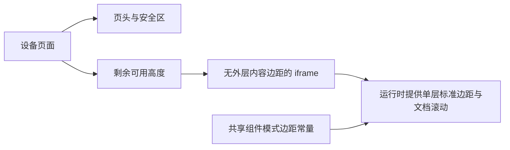

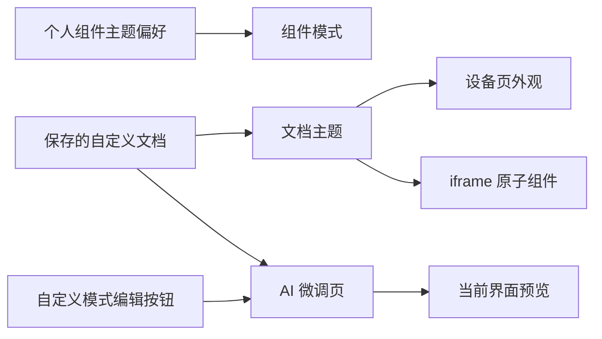

## 自定义效果预览边距修复计划

### Intent：最终目标

让 AI 微调页的效果预览与正式设备页使用同一层面板边距。

### Data：可用证据

用户截图中预览卡片边缘明显缩进。共享生成样式的 `.preview-canvas` 有 12px padding、`.preview-content` 另有 2px padding，内部 HTML 又使用运行时的 16px 边距；预览内容容器与 iframe 同时限制高度并允许滚动。

### Edges：边界与限制

只在自定义编辑组件中覆盖预览容器布局，保留共享的组件模式预览样式。设备信息栏保留自己的留白；面板内容只使用 iframe 内部边距与滚动。不打开浏览器，不新增测试。

### Answer：交付与成功标准

自定义预览外壳不再叠加内容 padding；设备栏与面板使用相同的水平边距常量，预览只由 iframe 滚动。通过应用构建与差异检查。

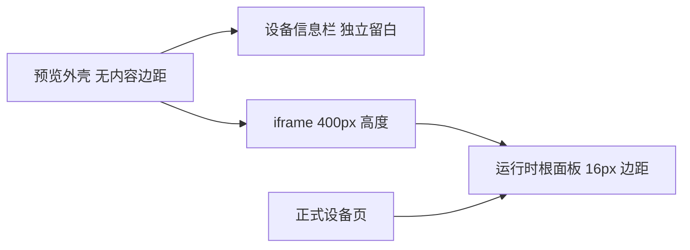

## 原子默认配置与控制台编辑返回修复计划

### Intent：最终目标

自定义 HTML 默认继承组件库预置，只有用户明确要求时才调整原子的外观和尺寸；从控制台进入编辑后，返回同一设备控制台。

### Data：可用证据

- 运行时已通过 `presetForVariant` 和 `WIDGET_PRESETS` 合并默认配置，但 AI 目录未标记默认预置，系统提示未要求优先默认。空白模板示例又显式写入不同于数字组件默认的宽度。
- 实际保存 HTML 为原子写入 `span`、`rows`、`options`，并用窄屏 CSS 统一覆盖跨列数；这些显式覆盖优先于默认配置。
- 运行时还展开了来源卡片的整个 widget，可能携带另一面板的 `appearance` 等视觉配置。
- 控制台编辑入口与设置入口共用 `/device-manager/:id/uic/custom`，返回 fallback 指向配置页。Ionic 按路径复用缓存视图，回到已有配置路径还可能裁掉后来的控制台历史；仅更改 fallback 不足以保证返回路径。

### Edges：边界与限制

不建立第二份默认配置，不强制把所有默认值写进 HTML，不覆盖用户已保存的显式调整。AI 仍可按用户明确要求调整组件。控制台与设置入口复用编辑组件但使用不同路径，保留已有离开守卫。不打开浏览器，不新增测试。

### Answer：交付与成功标准

目录从组件库同一常量标明 `defaultPreset`，生成规则默认省略外观和尺寸覆盖，模板示例只保留必要绑定；运行时从预置构造独立 widget。控制台编辑使用 `/device/:id/edit/custom` 并明确 navigateBack 到设备页，设置入口保持原逻辑。完成前后端构建、已有相关测试和本地 AI 服务更新。

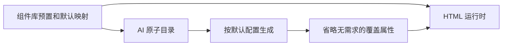

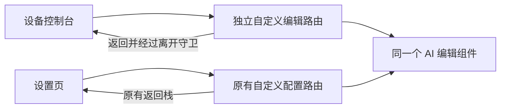

## 模式状态一致性、设置切换与顶部占位修复计划

### Intent：最终目标

自定义编辑返回后保持当前模式；在设备设置的配网区域下方提供组件/自定义模式切换。按用户后续反馈，将分段 tab 改为紧凑的“控制界面 + 当前模式”设置行，点击弹出选项；调查并移除重复的顶部占位和间距。

### Data：可用证据

- 用户设备云端 UI 配置仍为 `panelMode: custom`，自定义文档存在。模式变化发生在本地。
- 启动期间目录缓存先创建设备 A，库存刷新复制为 B，而并行的 UI 配置恢复仍写 A。控制台持有 A，返回时绑定 B，造成模式回退；编辑退出没有写入 normal。
- `DataService.applyDeviceInventory()` 克隆 `config` 是分叉点。保持共享配置身份即可覆盖恢复与保存两种异步场景。
- 设置页已有 V2 UI 配置保存和旧协议面板服务可复用。模式区不能放进“支持 Wi-Fi 配网”条件内，否则其他设备无法切换。
- 设备设置的自动占位同时带 12px margin 与父级 16px gap；控制台加载态同时拥有全局伪元素占位与自身顶部 padding。继续静态检查其他页面，按证据修正。
- 全量检查 50 个包含 header 的模板：资料、消息、文档正文和组件样式弹层重复提供外层顶部间距；文档状态的占位进入居中 flex；头像裁剪被普通 main 布局覆盖；分享领取的自动占位落在状态标题或 spinner 内部。其余页面未确认重复高度的保留。

### Edges：边界与限制

不通过返回时强制写 custom 掩盖数据分叉。保留两套已保存界面，不自动生成或改写 HTML；无自定义文档时进入创建流程，应用成功后才激活。保持共享设备只读。顶部修复不删除透明页头必需的高度与安全区，不打开浏览器、不新增测试。

### Answer：交付与成功标准

库存更新复用同一 UI 配置对象；模式设置行持久化选择并通知控制台，失败保留当前选择；已确认重复的顶部占位只留一份，满屏裁剪退出普通内容占位。通过应用构建、相关现有数据/设备/界面测试和静态检查，记录完整调查范围与剩余限制。

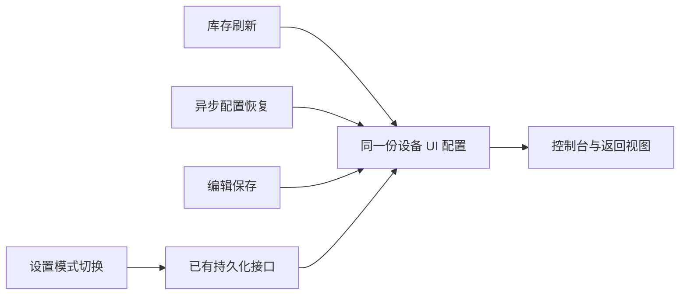

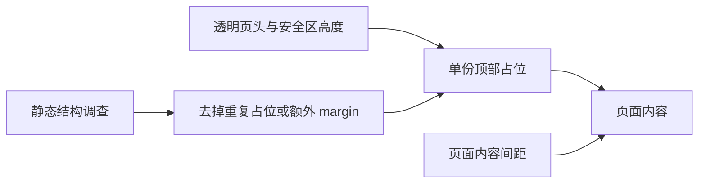
