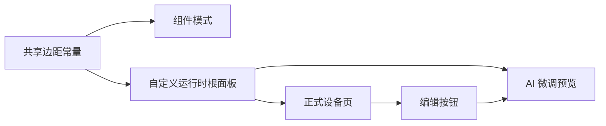
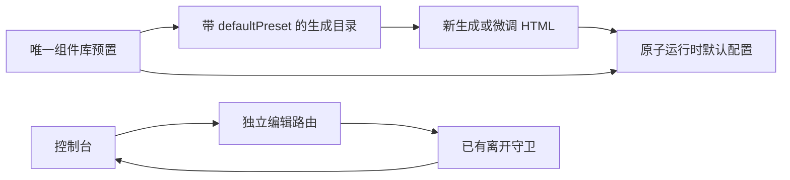
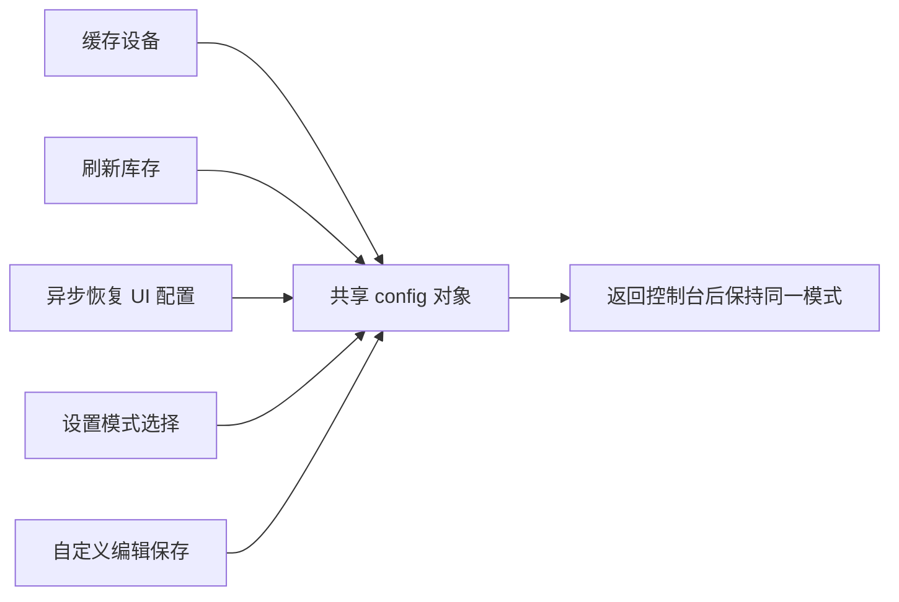

# 自定义模式执行记录

## Intent：最终目标

让组件模式与自定义模式共存：组件布局和 HTML 分别保存，模式切换只选择显示内容。调试模式退出后回到先前选择的面板。自定义 HTML 能使用与当前预置组件完全同源的原子组件，也能添加自己的 HTML、CSS 和 JavaScript。

根本问题是把“当前显示哪种界面”和“界面文档是什么”分开，而不是把 HTML 当作另一种组件布局 JSON。

## Data：可用证据与实现

### 两份文档与三种显示状态

- 组件文档继续走现有 `PageLayout` / 旧设备 `PanelDocument`。
- 自定义文档为 `customPanel: { version: 1, html, theme }`，HTML 上限 128 KiB。
- `panelMode` 为 `normal | custom`，保留面板选择；`component = TestDashboard` 表示临时进入调试模式。
- 旧设备的面板记录保留 `document`、`bindings`，新增可选 `customPanel`、`panelMode`，并允许 `view = custom`。
- V2 使用已有 UI 配置 JSONB 的合并更新；旧设备继续使用已有面板修订号进行并发校验，不需要数据库迁移。
- 组件模式的隐藏字段设置不会限制 V2 自定义界面的字段。

### 原子组件

21 种设备组件：磁贴、开关、滑动开关、按住控制、动作按钮、指令键盘、方向键、滑杆、渐变滑杆、旋钮、档位、步进器、定时、模式选择、文本输入、数值、趋势、圆环、状态、日志、颜色选择。

另包含视频与天气两个媒体组件。

- HTML 标签为 `blinker-tile`、`blinker-number` 等；`field` 绑定真实设备字段。
- `label`、`preset`、`options`、`span`、`rows`、`extra-keys` 提供标题、外观、布局和附属读数配置。
- 使用 Angular `createComponent` 注册 HTML 标签，直接引用 `device/v2/widgets` 的组件、模板、SCSS、图标与动画。
- 主题、字体和 Grid 都引用现有来源，没有维护第二套仿制样式。
- 原子说明从 `PAGE_WIDGET_VARIANTS`、选项约束和 `WIDGET_PRESETS` 导出，避免手写第二份目录。

构建产物：

| 产物 | 作用 |
| --- | --- |
| `www/custom-panel-runtime/runtime.json` | 独立脚本、共享样式及内嵌字体 |
| `www/custom-panel-runtime/atoms.json` | AI 与人工编写 HTML 时使用的原子目录 |
| `www/custom-panel-runtime/template.html` | 空白八栏 Grid 宿主模板 |

模板的 Grid、字体与原子运行时由应用注入，不是脱离应用就能连接设备的独立客户端。

### AI 接口按 mode 选择工作流

`POST /api/v1/interface/workflow` 显式接受：

| mode | 工作流 | 结果 |
| --- | --- | --- |
| `component` | 原有组件布局生成 | 校验后的布局 proposal |
| `custom` | 独立 HTML 工作流 | 完整 `{ html }` 文档 |
| 未提供 | 兼容原有组件客户端 | 维持组件工作流 |

组件微调接口继续使用同一组件协议；旧设备的 `/interface/generate` 接受 `mode: component`。

自定义请求提供需求、主题、字段元数据、原子目录、空白模板及当前 HTML。字段描述不包含实时读数、设备标识、凭据或旧协议指令绑定。HTML 中用户自己写入的内容会作为修改上下文传入 AI。

自定义工作流不执行 HTML，也不将未完成的模型输出推给 iframe。仅在模型正常完成且文档通过校验后返回 `complete` 事件，其 `mode` 为 `custom`。取消或失败保留编辑器当前草稿。

### 编辑与运行

- 界面配置页保留列表中的自动适配、AI 生成、自定义 HTML、手动编辑入口，以及独立的调试入口。按用户反馈移除上方重复的模式 Tab 和其下说明。
- 自定义页面仅展示风格选择、AI 需求输入和效果预览；源码、原子目录及模板只供内部生成流程使用。按后续用户要求移除导入导出、源码编辑与原子说明区域。
- 通过“应用这个界面”保存并切换到自定义模式；离开未应用的生成结果时提供确认。
- 自定义脚本监听 `blinker-ready` 后使用 `blinker.subscribe`、`blinker.setValue`、`blinker.invoke`。
- 原子操作与普通 HTML 脚本都通过同一消息边界，宿主从自己的字段列表重新查找字段，拒绝 iframe 提供的权限和绑定信息。
- 宿主校验动作类别、类型、范围、步长、枚举和长度，再走现有设备指令链；预览和已离开的设备页不能发送指令。

## Edges：边界与限制

1. iframe 使用 `sandbox="allow-scripts"`，没有 `allow-same-origin`，不向 HTML 提供宿主存储、身份凭据或直接设备通道。
2. CSP 允许内联脚本与样式，允许 HTTPS 图片、媒体和网络请求；禁止外部 JavaScript、外部 CSS、嵌套 iframe、表单提交和父页面访问。HTTPS 请求可用于自定义媒体与数据源，不能宣称 HTML 完全不能联网。
3. 数据与动作消息校验当前窗口、opaque origin 和每次渲染的独立通道；页面导航后旧文档不会继承设备访问。
4. 视频地址与天气数据由 HTML 作者提供，天气原子没有预置天气服务密钥；实时设备控制仍以设备当前连接与字段权限为准。
5. 原子运行时包含 Angular、HLS 和内嵌字体，未压缩资源约 3.2 MiB；应用按需加载并在当前进程内复用加载结果。未额外引入 UI 框架依赖。
6. 本次不调用浏览器进行 UI 确认，也不新增测试用例。未做真实模型、实体设备和移动端 WebView 的端到端验证。
7. 改动涉及两个仓库：`blinker-app` 与相邻的 `aily-blinker-services`。本地开发环境的 Gateway 与 AI Agent 已在后续 400 修复中同步更新；生产环境未部署。

## Answer：交付格式与验证结果

### 已完成检查

- 原子运行时构建通过；产物脚本语法解析通过，目录含 21 个设备原子和 2 个媒体原子，字体与空白模板打包存在。
- 主应用生产构建通过，三个自定义资源已复制到 `www/custom-panel-runtime`。
- AI Agent 类型检查与构建通过。
- Gateway 类型检查与构建通过。
- 前端使用仓库已有局部配置运行 46 项相关用例，全部通过；后续设备页可见性改动再运行 10 项设备页用例通过。
- Gateway 相关已有检查 22 项通过，1 项 PostgreSQL 集成检查按原有条件跳过。
- ESLint 和两个仓库的 `git diff --check` 通过。
- 仅更新两个已有断言，以反映新增 `mode`、`panelMode` 参数，没有添加测试用例。

### 已知仓库检查限制

常规前端测试配置会编译全部 spec，被已有 `ble-direct/session.spec.ts` 的两个无效导入阻断：`BleDirectFrameChannel` 与 `BleDirectProtocolError`。使用现有 `tools/interface-studio-preview/tsconfig.spec.json` 完成本次相关回归，没有修改无关 BLE 文件。

生产构建仍有多处组件样式预算警告与已有 Font Awesome 根路径样式告警；构建退出状态为成功。没有扩大本次范围调整全局预算。

### 自我批判

- “样式一致”的依据是复用同一组件模板、SCSS、主题、字体、图标及动画源码，不能等同于已经完成逐像素对比。本次依照要求没有浏览器视觉确认。
- 原子封装有独立的 HTML 属性适配层；其风险集中在配置、生命周期和消息边界，而不在另一套样式实现。适配层维持薄封装，原设备连接逻辑没有复制。
- 验证过程中补上了两个共存边界：组件隐藏字段不影响 V2 自定义模式；旧设备在重新打开调试模式后仍能恢复先前自定义面板。
- 配置结构、构建产物和已有回归已验证；真实 AI 返回、实体设备操作及 WebView 渲染仍需在发布环境验证，不能用编译成功代替这些结论。

## 架构与数据流

架构图及数据流图见同目录《自定义模式执行计划》。最终结构与计划一致，AI 使用显式 mode 在同一工作流入口分流。

## 运行时 404 与卡顿修复

### Intent：最终目标

进入自定义配置页能够加载原子运行时；即使加载失败，也不会因设备实时更新进入请求循环。

### Data：根因和处理

这次有两个相互放大的缺陷：

1. 资源构建成功不代表正在运行的开发服务已经采用新增 assets 映射。HTTP 实测原路径为 404，尽管 `dist` 和 `www` 均有文件。
2. 组件在成功加载后才更新 HTML 标记。失败时的刷新产生新 cards 输入，同一 HTML 被重复判定为需要加载，随后再次失败、刷新，造成请求与变更检测循环。

修复内容：

- `ngOnChanges` 仅在文档输入改变且 HTML 不同时准备 iframe；数据更新只推送状态。
- `prepare` 在任何异步等待之前记录本次 HTML。加载中或失败后，数据更新均不会重启该次加载；用户仍可主动重试。
- 生成文件改为写入 `public/custom-panel-runtime`，使用已有公共资源管线；移除额外 assets 映射，并将生成目录加入忽略列表。

### Edges：验证边界

用户明确要求不打开浏览器。未进行浏览器操作或 UI 验证，没有重启开发服务，没有新增测试用例。源码层面已移除循环触发条件；不能把命令行验证表述为已经观察到浏览器页面恢复流畅。

### Answer：结果

- 现有 `localhost:4200` 的 `runtime.json`、`atoms.json`、`template.html` 均返回 HTTP 200。
- HTTP 返回的运行时与本地打包文件 SHA-256 一致，脚本语法解析通过。
- ESLint、`git diff --check` 和应用开发构建通过。

### 自我批判

上一轮只检查了构建输出，没有验证正在运行的开发服务是否实际提供资源，导致漏掉 404。错误处理又把渲染输入更新当成了重试信号，放大为性能问题。此次分别修复资源交付和加载状态边界，没有用静默吞错或定时重试掩盖故障。

## 自定义页面视觉收敛

### Intent：最终目标

对齐现有“AI 生成”页面，让用户通过需求输入与效果预览完成自定义界面生成，不暴露实现细节。

### Data：实际改动

- 移除介绍文案、原子接口说明、字段列表、源码编辑、空白模板按钮，以及导入/导出功能和对应方法。
- 自定义页面保留风格选择、需求输入、建议词、生成按钮、效果预览和单个“应用这个界面”按钮。
- 风格选择改成“添加部件”同款按钮 + Ionic popover/radio，并共用 `_field-select.scss`。
- 两种 AI 页面共用 `_generation-workspace.scss`，统一表单留白、输入框、按钮、预览主题、空态与生成遮罩。
- 初次未生成时显示空态；已有界面支持继续调整。需求留空时使用所选风格的默认要求，与现有 AI 页一致。
- 预览 iframe 使用独立高度变量限制在预览区内，设备正式页面的 iframe 高度保持原设置。
- HTML、原子目录、空白模板仍作为 AI 工作流的内部数据，`mode: custom` 与独立保存机制保留。

### Edges：边界与限制

未打开浏览器，未进行视觉截图验证，未新增测试用例。本次仅调整自定义页面交互和共享样式，没有改动 AI 服务端协议。

### Answer：验证与自我审查

- 应用开发构建和模板编译通过。
- 涉及文件的 ESLint 与 `git diff --check` 通过。
- 自我审查：之前将开发工具式界面直接交给普通用户，暴露了源码、接口与文件操作，偏离了现有 AI 页的产品层次。此次通过移除这些操作并复用现有样式修正，而非继续增加装饰或新组件体系。
- 由于没有浏览器视觉确认，结论限定为布局结构、样式来源与编译检查一致，不声称已经完成像素级验收。

## 点击生成返回 400 的修复

### Intent：最终目标

使本地运行服务与新的 mode 协议一致，恢复自定义界面生成。

### Data：根因与处理

- 用户实际载荷已正确发送 `mode: custom`。
- 旧 Agent 容器创建于新工作流实现之前，没有源码挂载。读取运行中的 bundle，确认 `supportsCustomWorkflow` 与 `acceptsComponentMode` 都为 false。
- 宿主机构建通过没有更新 Docker 运行代码。旧 Agent 的严格请求结构不接受 mode/custom 字段，因而在生成前返回 400。
- 通过开发 Compose 重新构建 Gateway 与 AI Agent 镜像，再以 `--no-deps` 更新这两个容器。

### Edges：操作边界

没有打开浏览器，没有改动用户请求内容或面板数据，没有重建数据库、Redis、Broker 和 Controller。诊断调用使用应用实际打包的原子目录、空白模板和空字段列表，不包含用户设备数据，也不发送设备控制指令。

### Answer：运行结果与自我审查

- 两个容器均恢复 healthy。
- 新运行 bundle 已确认包含自定义工作流和 component mode 协议；Gateway 新请求体限制已生效。
- 从 Gateway 容器向实际 AI Agent 发出的真实自定义工作流调用返回 HTTP 200，先返回 `stage: html`，随后返回 `complete`、`mode: custom` 和 3061 字节 HTML，调用成功结束。
- 临时诊断只用于确认运行服务，没有新增测试用例。
- 自我审查：上一轮把“源码和构建已更新”与“本地服务已更新”分开交付，导致前端调用仍落在旧协议上。此次检查实际运行产物并完成服务端生成，避免再次仅依据编译结果判断可用。

## 自定义设备页与效果预览一致性修复

### Intent：最终目标

统一自定义模式的实际界面与效果预览边距，正确使用可用高度和滚动区域，锁定文档主题，并让编辑入口进入 AI 微调页。

### Data：根因与改动

- 实际 HTML 已有 12–16px 的 padding，设备宿主又添加 16px；旧 iframe 使用 `max(560px, 75dvh)`，既不能填满较高屏幕，也可能超出较小屏幕。
- 正式页面改为宿主仅保留页头与底部安全区，iframe 通过 flex 占满剩余高度，长内容由 iframe 文档滚动。
- 在已有 Grid 样式文件中共享上方/水平 16px、底部 32px、最大宽度 720px 三个常量；组件模式保持原数值，自定义运行时的 `body > .panel` 使用同一来源。空白模板不再重复声明边距。
- 自定义模式隐藏主题按钮和弹层，主题方法提前返回；设备页和 iframe 读取自定义文档主题，不受组件模式的个人主题偏好覆盖。
- 设备页编辑按钮根据当前模式选择路由；自定义模式进入 `/device-manager/:id/uic/custom`。现有编辑组件已自动载入保存的 HTML、主题和预览，并把当前 HTML 作为下一次 AI 调整的基础。
- 自定义预览移除外壳 12px 和内容容器 2px 的额外 padding，只保留 iframe 内部的单层标准边距。设备信息栏复用相同水平边距及设备页头高度变量。
- 预览外层取消独立的 440px 高度上限和滚动；iframe 维持 400px 预览窗口并独立滚动，避免两层滚动容器。

### Edges：边界与限制

未打开浏览器、未新增测试、未改写已保存的用户 HTML、未修改后端运行服务。Chrome 插件的 `content_main.js` 报错按用户确认忽略，iframe 隔离和通信校验保持原样。自定义预览样式覆盖仅位于该组件内，组件模式预览保持原样。

### Answer：验证与自我审查

- 自定义运行时构建通过；应用开发构建与模板编译通过，预览样式调整后再次构建通过。
- 已有设备页和主题测试共 14 项全部通过；相关 TypeScript/HTML 的 ESLint 与 `git diff --check` 通过。
- 本地开发服务的运行时请求返回 HTTP 200，与新构建文件的 SHA-256 一致；产物已包含 `body>.panel{width:100%;max-width:720px;margin:0 auto;padding:16px 16px 32px}`。
- 自我审查：最初仅去掉宿主边距，没有同时约束生成 HTML 的窄屏 12px 规则，不能确保与组件模式一致；复用 AI 页样式时，又遗漏了其预览外壳的两层留白。此次明确根面板是内容边距的唯一来源，正式页与预览复用同一运行时。
- 未作浏览器视觉验收；以上结论来自用户截图、实际 HTML、样式层级、构建及现有测试。运行时在当前浏览器会话内缓存，刷新页面后可读取新样式。

## 原子默认配置与控制台编辑返回修复

### Intent：最终目标

让自定义生成优先沿用组件库默认配置；从设备控制台进入自定义编辑后，返回同一控制台。

### Data：修复内容

- 运行时的默认继承本身已存在。主要缺口是生成目录没有明确默认项，系统提示允许自由设置原子属性，示例还写死非默认尺寸。因此 AI 产生的显式尺寸、样式及窄屏 CSS 覆盖了组件默认值。
- 导出既有 `DEFAULT_WIDGET_PRESETS` 映射，AI 目录新增 `defaultPreset`，直接引用组件库同一来源。没有复制一套默认值，也没有改变库内任何预置配置。
- 原子指南及服务端系统提示要求默认省略 `options/span/rows`，选择其他库预置时引用 `preset` id；只有用户明确要求时才输出差异项。模板示例删除显式尺寸。
- 微调保留无关配置；明确要求恢复默认时移除对应属性和 CSS 覆盖。运行时构造独立 widget，不再继承来源组件面板的 `appearance` 等视觉字段。
- 控制台编辑入口改为 `/device/:id/edit/custom`，通过 route data 标记返回控制台。返回按钮显式调用 `navigateBack`，仍由 Angular 路由守卫确认未保存修改。
- 设置入口保留 `/device-manager/:id/uic/custom` 和原返回方式；不同路径避免 Ionic 缓存视图和返回栈混用。

### Edges：边界与限制

未打开浏览器、未新增测试、未改写已有设备 HTML。生成约束作用于之后的生成/微调；旧文档中明确写入的覆盖配置继续生效，可通过“恢复组件库默认配置”的微调要求移除。没有调用真实模型作付费生成，也没有把静态检查当作生成质量或交互视觉验收。

### Answer：验证与自我审查

- 前端自定义运行时、应用开发构建及 AI Agent 类型检查和构建均通过。
- 现有前端设备页、生成流程和布局测试 50 项全部通过；现有服务端接口测试 22 项通过，1 项需要 PostgreSQL 的测试按原条件跳过。
- 涉及前端 TS/HTML 的 ESLint 及前后端 `git diff --check` 通过。
- 构建目录中的 21 个原子均能解析其 `defaultPreset`；目录为 15,548 字节，低于 64 KiB 请求限制。开发服务运行时 HTTP 200，文件与新构建哈希一致。
- 仅重新构建并更新本地 AI Agent 容器，已恢复 healthy；实际运行 bundle 已确认包含默认继承、默认映射与保留微调配置规则。
- 自我审查：复用原子组件实现不等于生成过程会尊重默认配置，需要同时提供明确的默认映射和覆盖规则。此前只把编辑按钮接入设置路由，忽略了 Ionic 路径缓存及页面返回语义；此次以独立路径区分入口角色，而非继续叠加 fallback。

## 模式状态一致性、设置切换与顶部占位修复

### Intent：最终目标

自定义编辑返回后保持模式；设备设置提供自然、紧凑的模式选择入口；自行调查并修正页面顶部重复留白。

### Data：状态根因与实现

- 只读检查用户设备云端记录，确认 `component: DeviceV2`、`panelMode: custom` 和自定义 HTML 均存在，没有发生服务器端模式切换。
- 启动时目录缓存先建立设备 A；库存请求和 UI 配置恢复并行。库存先返回则创建 B，并复制 A 当时的 config；UI 配置随后只写 A，控制台持有 A，编辑返回后重新绑定 B，表现为回到组件模式。
- 在 `DataService.applyDeviceInventory()` 中改为原位更新既有 config，保留这份共享 UI 状态的身份。设备目录元数据仍按原逻辑重建，异步恢复、当前页面与编辑保存都能读写同一份配置；没有在返回时强制改模式。
- 设置页配网区域下方新增“控制界面”设置行：左侧为入口名称，右侧显示当前模式，点击弹出组件模式/自定义模式单选列表。保存中显示进度并暂时禁用操作，只有保存成功才更新选择。
- V2 复用 UI 配置接口，旧协议复用面板服务。切换只更新当前模式，保留两份面板；没有自定义文档时进入生成页面，应用成功后才启用自定义模式。共享设备显示当前值但不允许修改。

### Data：顶部布局调查与修复

静态扫描 50 个包含 header 的模板，其中 45 个文件、46 处 header 命中透明标题规则；同时检查 TS 内联模板，没有发现额外标题页。只修改已确认的问题：

| 页面或区域 | 根因 | 最终处理 |
| --- | --- | --- |
| 设备设置 | 占位 margin 12px 与 flex gap 16px 相加 | 占位 gap 设为 0，保留页面的 16px 间距 |
| 自定义/AI 界面配置 | 显式占位后再附加 12px | 保留必要标题高度，移除附加 margin |
| 控制台加载态 | 自身顶部 padding 与全局伪元素都包含标题高度 | 标记由页面管理占位，避免自动再插一份 |
| 用户资料、消息页 | 容器顶部 24px 与全局占位间距叠加 | 只去掉容器顶部 padding，保留横向/底部留白 |
| 文档页 | 正文顶部 24px 叠加；状态页的占位参与居中 flex | 增加稳定外层承接标题占位；正文顶部 padding 归零 |
| 组件样式弹层 | 外层 padding 16px 与自动占位间距叠加 | 只去掉外层顶部 padding |
| 头像裁剪 | 满屏容器误中普通 main 布局及自动占位 | 使用自行布局的容器，保留深色背景和底部安全区，不额外预留顶部内容区 |
| 分享领取 | 自动占位被插进状态标题或 spinner | 用统一 main 容器承接占位，移除重复的 ion-padding 外壳 |

配网指南、工具页、图标选择页、组件布局编辑器及属性页、两类自定义控制台没有确认重复标题高度，保持原结构。Edge Hub 页另有全局 display 覆盖局部 grid 的问题，但不属于本次重复留白修复，未顺带改变其布局。

### Edges：边界与限制

未打开浏览器、未新增测试用例、未调用模型生成、未修改已保存 HTML 或后端服务。全局仍保留透明 header 必需的标题高度和安全区，只增加可由页面设置为 0 的占位间距变量。模式回退修复要在刷新后建立共享配置引用；已运行页面中旧的分叉对象不会被事后合并。

### Answer：验证与自我审查

- 应用开发构建及模板编译通过；涉及 TypeScript/HTML 的 ESLint 与 `git diff --check` 通过。
- 已有数据服务、用户服务、设备页、界面生成与编辑流程共 66 项测试通过。使用临时 tsconfig 限定现有用例，没有添加新测试。
- 自我审查：上一轮只修正返回路由，没有追踪目录更新与异步配置恢复之间的对象身份，遗漏了“导航正确但返回读取另一份配置”的问题。本次从共享状态来源修复，没有增加返回时的额外网络请求。
- 自我审查：最初的分段 tab 视觉比周围设置项更突出，用户反馈后改成单行入口与选择弹层；顶部调查也从个别页面扩展为完整模板扫描，避免继续让用户逐页指出问题。
- 未进行浏览器视觉验收；布局判断基于用户截图、模板结构、选择器优先级与编译检查，不宣称已完成交互视觉实测。

