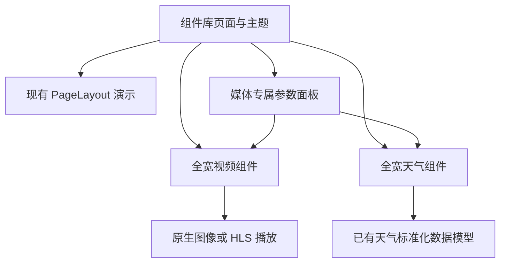
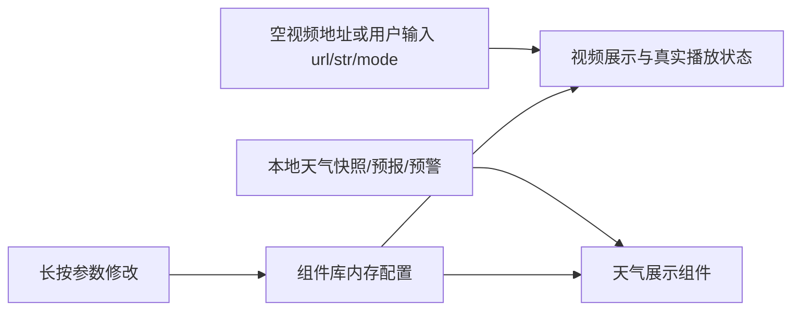

# 视频天气组件库新增计划

## Intent：最终目标

在组件库页面新增视频和天气组件。沿用旧数据格式，重新设计视觉与内部信息层级；两个组件固定全宽，支持当前自然、深色和电子主题，以及长按调整参数。

## Data：可用证据

- 组件库入口为 `component-preview.page`，目前通过共享 PageLayout 面板展示标量设备字段。
- 旧视频的数据字段为 `url`、`str: mjpg | hls`、`mode`；`mode === 0` 表示自动播放。已有 `hls.js` 依赖。
- 旧视频演示 URL 为空，仓库没有可播放的本地视频。演示应如实呈现空源状态，并允许输入地址播放。
- 天气已有 `WeatherSnapshot`、`WeatherForecastHour`、`WeatherAlert` 标准化模型；真实来源为第三方天气服务与设备位置，不是设备标量字段。
- 旧天气演示有杭州当前天气、未来三小时预报与一条雷电预警，可沿用数值与格式。
- 两个只读分析子任务分别确认了旧数据协议、组件库与正式面板之间的边界。

## Edges：边界与限制

- 本次接入组件库，不扩展固件协议、后端布局 schema、正式面板添加菜单或旧组件迁移。
- 视频、天气为独立展示组件，不伪造标量 endpoint，不复制旧组件样式。
- 天气演示使用本地 fixture，不请求定位、第三方 API 或用户密钥。
- 默认视频没有网络请求；用户输入视频 URL 后才加载对应媒体。空源和播放失败不能冒充播放成功。
- 不新增依赖或测试用例，不调用浏览器做 UI 验证。

## Answer：交付格式与成功标准

1. 视频采用全宽 16:9 画面、清晰的空源/加载/失败状态与播放控制；兼容 MJPEG、HLS。
2. 天气采用紧凑的横向城市与温度主视图，下方通过实况／逐小时预报切换；实况指标全部显示，预警可展开，不沿用旧轮播样式。
3. 两个组件加入库页计数，长按可调整各自参数；宽度固定全宽。
4. 编译及补丁检查通过；记录没有浏览器、真实天气服务与实际流媒体验收的限制。

### 架构图

### 数据流图

