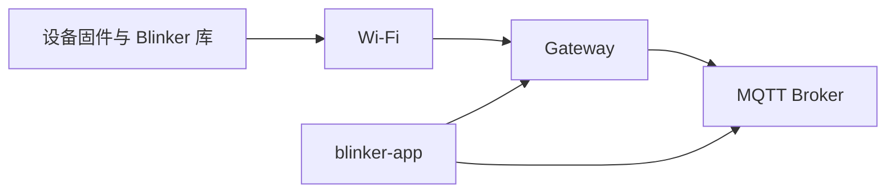
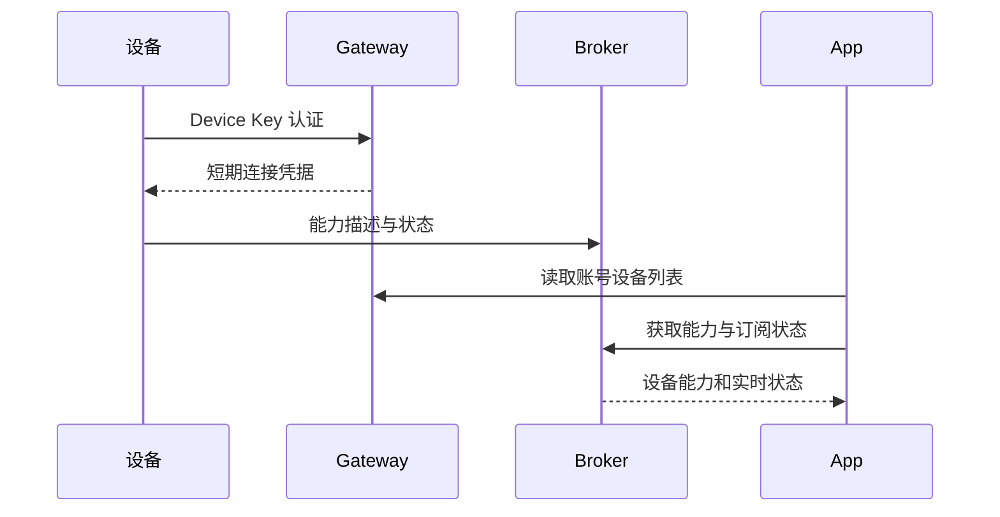

# 设备接入执行计划

## Intent：最终目标

使用 blinker-library 的现有例程，让目标设备通过用户提供的网络与 Device Key 接入 blinker-app 对应的服务。

## Data：可用证据

- 库中已有 WiFiQuickStart 和 Esp32S3InterfaceDemo。
- App 已支持 Device V2 设备列表、设备能力和状态同步。
- 本机存在 USB 串口和运行中的本地 Gateway；开发配置同时存在本地与远程入口，需要确认凭据归属。
- 工作区已有大量未提交变更，本任务保留这些变更。

## Edges：边界与限制

- 不在 App 中硬编码设备，不将凭据写入记录或受版本控制的源文件。
- 确认硬件和服务环境后才选择构建与烧录配置。
- 不生成测试用例，不使用浏览器确认 UI。
- 不擦除整片 Flash；在线、能力上报与 App UI 验证分别记录。

## Answer：交付格式与成功标准

优先复用例程及现有接入流程。以编译、烧录校验、设备认证、能力上报和连续状态更新为验证证据。若发现通用实现缺陷，仅修改直接相关代码。执行细节和自我复核另存记录。

## 架构图

## 数据流图

