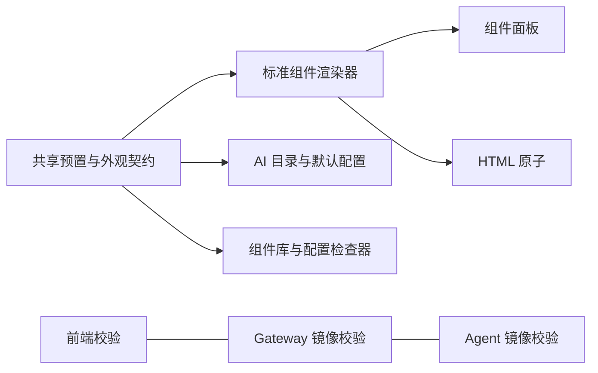
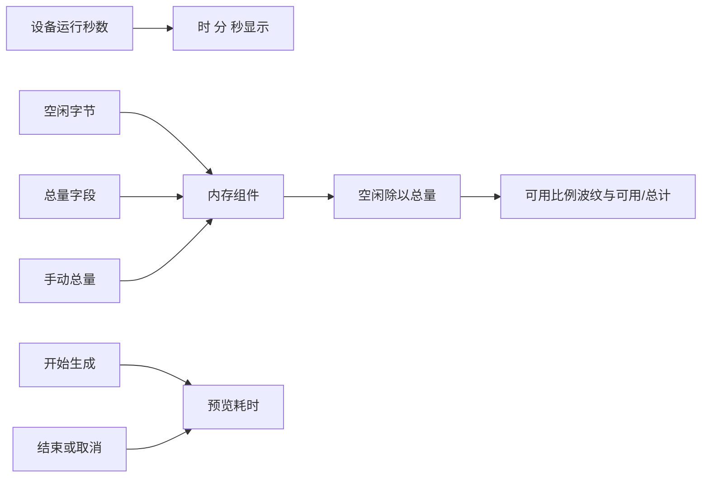

# 运行状态组件与生成体验执行计划

## Intent：最终目标

补齐运行时长、内存波纹两个标准组件，让普通面板与自定义 HTML 共用；AI 生成预览右侧显示本次耗时；恢复默认配置时同时重排不合理的组件组合。

## Data：可用证据

- 截图中的 tile 默认 2 行、level 默认 3 行，窄屏各占半宽，后面的 text 占整宽，因此左侧空位是这组几何尺寸与排序的结果，不是默认配置未加载。
- 组件库现有 timer 是可写倒计时，普通 number 的 duration 格式不足一小时只显示分秒，均不能代替固定时分秒运行状态组件。
- 现有 ring 是标题旁的小指示器，不是中央波纹内存仪表。
- 烧录前只读核查设备 Manifest：有 `uptimeSeconds`、`freeHeapBytes`，没有总内存/已用内存，也未声明单位或范围。不能从线协议数值上界推断物理内存。
- 前端、Gateway、AI Agent 各有外观/尺寸/字段兼容性校验；AI defaults 数量目前硬编码 21，需要随外观表派生。

## Edges：边界与限制

- 不改变已有组件的默认尺寸，不拉伸短卡片掩盖空位；生成规则通过选择合适的库预置、分组和排序解决。
- 运行时长读取设备上报秒数，固定显示时、分、秒，不用页面打开时长代替设备数据。
- 内存主字段表示空闲字节；总量来自唯一附属数值字段，或用户明确填写的 `options.max`。缺少总量时显示真实空闲值和未配置提示，不伪造容量。
- 沿用现有主题、卡片样式和数据订阅；不新增通用参数模型，不打开浏览器，不新增测试用例。
- 不自动改写已保存的 HTML；生成草稿尚未应用时也不应覆盖旧文档。

## Answer：交付与成功标准

1. 标准 `uptime` 与 `memory` 外观、预置、组件库展示、配置检查器和 HTML 原子均可用。
2. 前端、Gateway、Agent 同步接受新外观与内存总量绑定，组件模式 AI 不因 defaults 上限拒绝请求。
3. 两种 AI 生成页都在预览标题右侧实时显示 `Xm Ys`，结束/取消时停表，再次生成重新计时。
4. 自定义生成优先选择符合字段语义的库预置，再按默认几何尺寸安排布局；避免短卡/长卡并排后立即接全宽块造成明显空洞。
5. 通过构建、现有相关回归、静态检查，并更新本地实际运行的服务。

后续视觉调整按用户反馈收敛：组件库 RSSI 紧跟“空闲内存”并排；内存卡只显示可用与总计，波纹和百分比均表示可用比例；运行时长的数字与冒号共用同一行对齐，单位标签独占下一行。这些修改必须同步到自定义 HTML 运行时。

## 补充范围：固件总内存上报

用户补充“应该能获取总内存的，重新烧录即可”，因此继续核查本地固件工程与设备烧录配置。优先复用固件已有的总内存支持；若确实缺失，最小范围补充与 `freeHeapBytes` 相同内存区域的总量属性、读取及上报，并核对目标板与串口后执行适用的编译烧录流程。保留设备身份与配网配置，不从芯片型号推测容量。烧录后的成功标准是实际 Manifest 出现总量字段，且收到有效遥测值。

