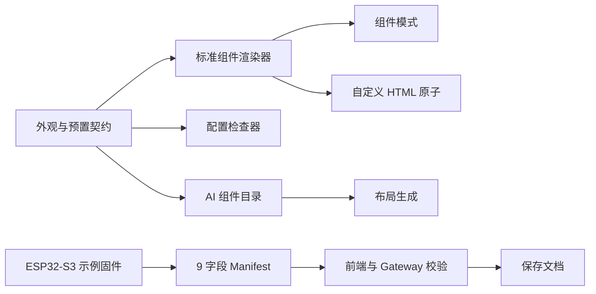
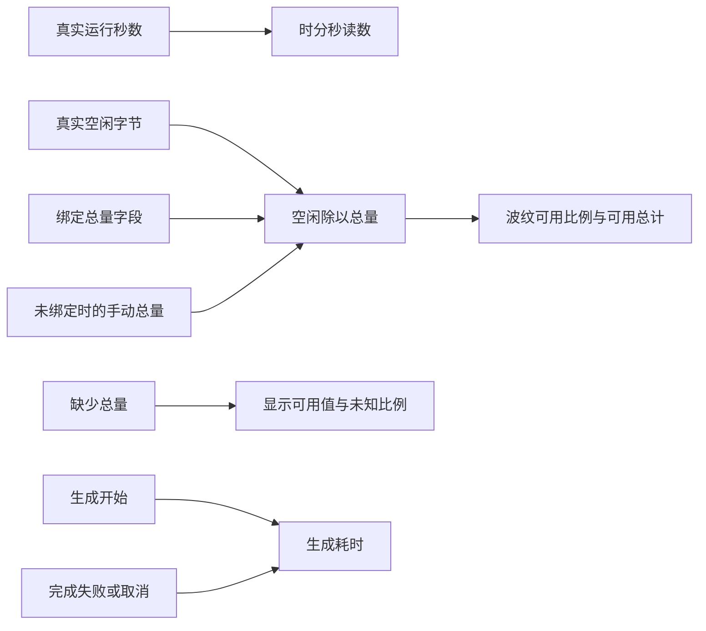

# 运行状态组件与生成体验执行记录

## Intent：最终目标

处理三个相连的需求：恢复组件库默认配置后重新组织布局；预览标题右侧显示本次生成耗时；补齐设备运行时长、内存波纹两个标准组件。

## Data：可用证据与根因

### 默认配置与布局是两个约束

截图中的短卡默认占两行，滑杆默认占三行，窄屏各占半宽；后面的文本输入占整宽。因此，删除尺寸覆盖后直接沿用旧排序，必然在短卡下留下空位。恢复默认配置不能仅删除属性，还要根据恢复后的实际尺寸重排。

已同步调整原子目录说明和自定义生成系统提示：优先选择与字段用途匹配的真实预置，默认继承预置；半宽组件优先同高配对，全宽块单独成行，允许调整分组和顺序。标题和普通分组默认跨整行，避免落入八栏网格的单个窄列。不改变既有预置尺寸来掩盖布局问题。

### 运行状态必须有真实数据来源

烧录前只读核查设备 Manifest，存在 `uptimeSeconds` 与 `freeHeapBytes`，没有总内存或已用内存字段。字段类型的数值上界不代表物理容量；后续已按用户要求补齐固件上报。

- `uptime`：绑定设备运行秒数，始终显示时、分、秒，累计小时不在 24 小时归零；未知或非法读数显示占位。
- `memory`：主字段绑定空闲字节，唯一附属字段绑定同一区域的总内存；没有总量字段时可手动填写 `options.max`。按用户最新要求，圆形波纹和百分比均表示可用比例，底部仅并列展示可用与总计。
- 未知总量、非法读数或空闲量超过总量时，不伪造比例。绑定总量字段后以该字段为准，不用手动值掩盖缺失遥测。

两种外观已接入普通渲染器、预置、组件库展示、配置检查器、自定义 HTML 原子以及前后端校验。组件模式 AI 的默认配置数量上限由外观表推导，不再固定为 21。

### 生成耗时独立于生成内容

普通组件生成与自定义生成共用轻量计时组件。生成开始时从 `0m 0s` 计时，完成、失败或取消时停表，再次生成重新开始。使用单调时钟计算经过时间，避免仅累加定时器次数导致漂移；退出时清理定时器。

### 后续视觉修正与自定义模式同步

- 组件库的 RSSI 移到“空闲内存”之后，两者同为 2×2，宽屏和窄屏均能同高并排；不改预置尺寸。
- 内存卡移除“已用”和底部重复的“可用”读数，水位及圆内数字改为 `空闲 / 总量`，圆内标注“可用”。未知总量仍保留必要提示。
- 运行时长改用两行 Grid：数字与冒号共享第一行、同一数字字体和行高，单位标签在第二行；移除冒号固定负边距，兼容普通与紧凑尺寸。
- 自定义模式的 `blinker-uptime`、`blinker-memory` 都通过同一个 `PageWidgetComponent` 渲染上述标准组件；原子目录已包含两者，最新修改也已重新打包进运行时。

## Edges：边界与限制

- 用户补充要求重新烧录后，按指定硬件上线 skill 最小修改固件并完成烧录；不直接写设备数据库，不自动覆盖已保存的 HTML。新原子和生成规则在刷新后可用，旧文档需要微调并应用才会改变。
- 运行时长随设备上报更新，不把页面打开时间当作设备运行时间。
- 当前设备烧录后已提供 `totalHeapBytes`，可以直接作为内存卡的总量字段；其他缺少总量的设备仍显示真实可用值和“总量未配置”。
- 波纹沿用主题颜色，支持关闭动画和系统减少动画偏好；没有另外引入图表库。
- 没有新增测试用例，没有打开浏览器。静态核查不能替代真实窄屏渲染确认。

## Answer：交付与验证

### 已完成验证

| 范围 | 结果 |
| --- | --- |
| 主应用开发构建 | 通过 |
| 自定义运行时构建与打包 | 通过，目录含 23 种组件原子 |
| 前端现有相关回归 | 50 项通过 |
| 相关 TypeScript、HTML 静态检查 | 通过 |
| Gateway、AI Agent 构建 | 通过 |
| 后端现有相关回归 | 23 项通过，1 项因 PostgreSQL 环境跳过 |
| 本地运行时资源 | HTTP 200，内容与本次打包产物一致 |
| 本地服务 | Gateway、AI Agent 已更新并健康运行 |

### 真实生成链路

实际请求暴露了另一个独立问题：DeepSeek 默认思考与强制 JSON 输出组合时，8K、16K 预算下均收到长度截断。诊断确认可用正文为 0 字节，因此不是 HTML 体积过大。Agent 中 `reasoning: false` 只是本地元数据，也不能关闭服务端默认思考。

对照诊断发现：显式关闭思考后约 5–7 秒可返回完整 HTML，但预置选择与布局重排仍不稳定；保留低强度思考、不在该规划请求中强制 JSON 模式后，40 秒返回完整 JSON，开始正确配对同高卡片并选用亮度的横向库预置。8K 规划预算仍出现过截断，因此最终仅自定义 HTML 规划允许 16K，其余请求保持 8K；结束后严格解析 JSON 对象与 `html` 字段。其他结构化回答保持 JSON 输出约束，并显式关闭 DeepSeek 的默认思考。没有切换模型，没有把截断结果送进预览。

最终运行中的实际工作流返回 `complete`，耗时 33 秒、HTML 2,573 字节。对实际结果作不执行脚本的 DOM 核查：8 个原子全部引用有效预置和真实字段，没有覆盖默认尺寸或 options；窄屏组成 6 行，同高半宽卡片均配对，内存总量绑定 `totalHeapBytes`。结果未自动写入用户已保存文档。

另外补齐原子目录的 `extraKeys` 上限，避免模型给不支持附属读数的动作卡添加该属性。默认预置恢复与布局重排的优先级进一步明确：允许选择其他兼容的库预置，继承其真实默认尺寸，避免误解为必须保留每个标签的 `defaultPreset`。

### 按指定 skill 完成硬件更新

使用 [blinker-hardware-online](../blinker-hardware-online/SKILL.md)。执行前核查当前串口与芯片，读取实际分区和 OTA 选择数据，并通过本地配置派生 locator 只读核对目标设备及有效密钥状态；没有输出凭据。

| 项目 | 实际结果 |
| --- | --- |
| 目标 | 本地 Gateway `192.168.1.108:17000`，设备 `test`，逻辑设备 `device_af74955a-c19a-467e-8b2b-ea11388b2df8` |
| 硬件 | `/dev/cu.usbserial-310`，ESP32-S3 QFN56 revision 0.2，实测 Flash 16 MB |
| 固件修改 | 相邻 `blinker-library/examples/Esp32S3InterfaceDemo/Esp32S3InterfaceDemo.ino`：声明、上报并注册 `totalHeapBytes` |
| 内存口径 | `ESP.getHeapSize()` 与 `ESP.getFreeHeap()` 都针对 `MALLOC_CAP_INTERNAL`，不混用 PSRAM 容量 |
| 字段稳定性 | 总量追加为 ID 9，原有 ID 1–8 保持不变 |
| 构建 | Aily Builder 1.2.17、ESP32 core 3.3.1；隔离在 Git 忽略目录，禁用远程构建缓存与上传 |
| 构建占用 | 程序 1,015,703 字节，静态内存 49,856 字节 |
| 分区与写入 | 板上分区与构建结果一致；OTA 数据与 SDK app0 选择一致，仅写 `0x10000` 应用区，未擦除整片 Flash、未写 NVS |
| 写入验证 | 1,015,856 字节固件写入成功，数据哈希验证通过 |
| 网络与云 | 串口诊断 `state=active`、`network=1`、`cloud=1`、`lastOperationError=0`，状态/事件传输错误均为 0 |
| Manifest | 9 字段，新 fingerprint；`totalHeapBytes` 为只读 uint32 属性 |
| 独立运行复核 | 关闭串口后，状态 revision 继续增长到 29，运行时长达到 140 秒，时间戳继续更新 |
| 实测内存快照 | 总量 351,788 字节，可用 246,428 字节；可用量随运行变化 |

Manifest revision 仍为 1 属于当前库的既有行为；新增字段使完整字段表 fingerprint 改变，Broker 已重新获取并更新能力，因此没有为此修改核心协议。

### 架构与数据流

### 自我批判

1. “恢复默认”并不等于“自动获得均衡布局”。本次同时调整了预置选择、排布规则和实际模型请求方式。只关闭思考虽然更快，却不足以满足布局要求，已根据对照结果修正；AI 仍存在不确定性，不能仅凭单次生成保证所有布局都没有空位。
2. 最初按当前 Manifest 判断缺少总量是正确的，但不能把它视为硬件能力限制。用户指出可重新烧录后，已核对 SDK，补充同一区域总量并实机验证。其他任意字段的区域一致性仍无法由现有元数据自动证明。
3. 波纹、固定时分秒使用现有卡片、主题和数据通道，没有新增通用抽象或另建数据订阅层。总量绑定复用附属字段模型，并收窄为一个数值属性。
4. 未执行浏览器确认，因此目前验证覆盖构建、契约、现有回归与运行服务，不宣称已经完成视觉验收。
