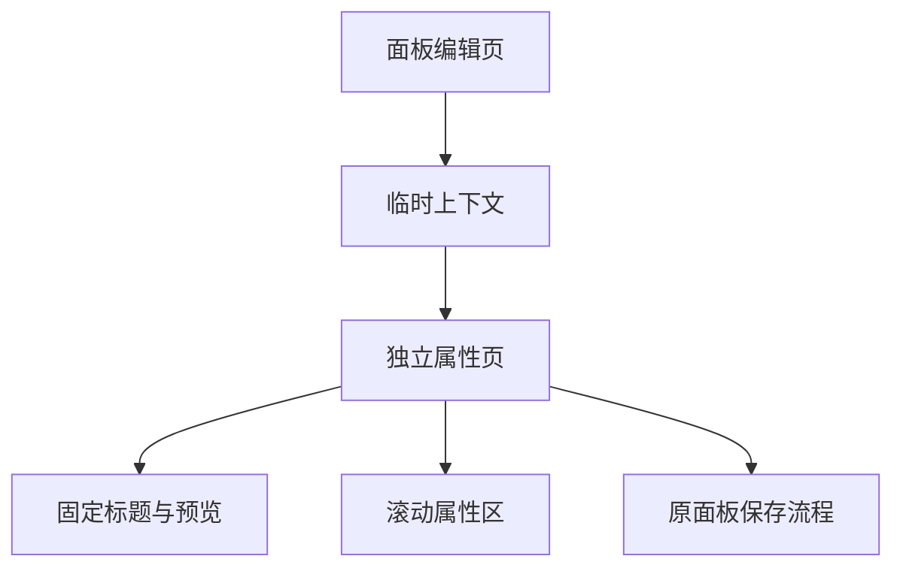
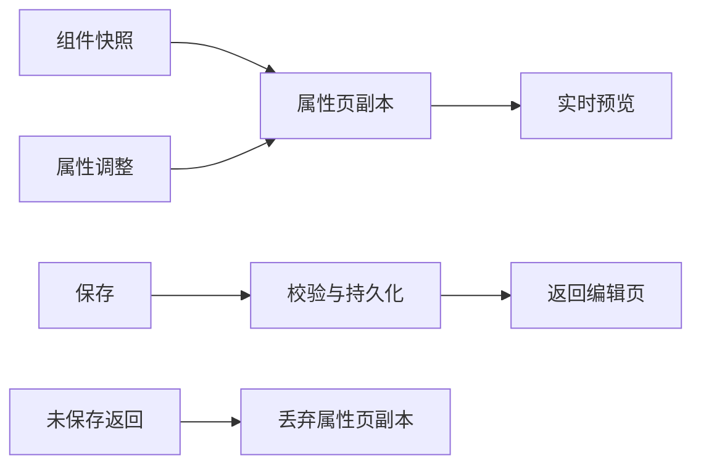

# 部件属性独立页面执行计划

## Intent：最终目标

继续完成昨日的独立部件属性页。顶部标题与预览固定，下方属性区滚动；属性页只修改本地副本，点击保存才提交，直接返回丢弃本次属性修改。

## Data：可用证据

- 当前工作区干净，昨日属性弹窗尚未替换，只有执行计划。
- PanelEditorPage 已有布局校验、版本控制、保存、撤销及未保存保护。
- 根 IonRouterOutlet 缓存面板编辑页，可通过小型临时上下文连接两个页面，无需复制持久化逻辑。
- 用户明确确认“返回时如未点击保存则放弃”。

## Edges：边界与限制

- 不改变固件和布局协议，不创建另一份设备控制状态。
- 保存属性复用整份面板保存流程；因此会一并提交当前编辑页已有的布局修改。
- 属性页没有保存时，不调用父页面修改方法。
- 进入属性页属于同一编辑流程；离开整个流程仍保护进入属性页前已有的面板修改。
- 属性路由直接打开或刷新时没有临时上下文，返回面板编辑页。
- 不新增测试用例，不调用浏览器做 UI 验证。

## Answer：交付与成功标准

独立路由、固定预览、独立滚动属性区、保存／丢弃语义、完整退出保护；构建与相关已有检查通过，并记录限制。

## 架构图

## 数据流图

