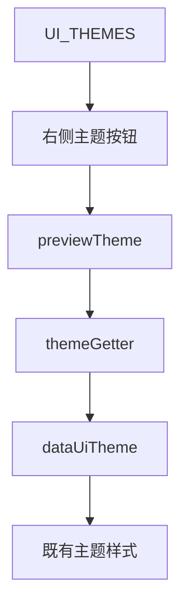
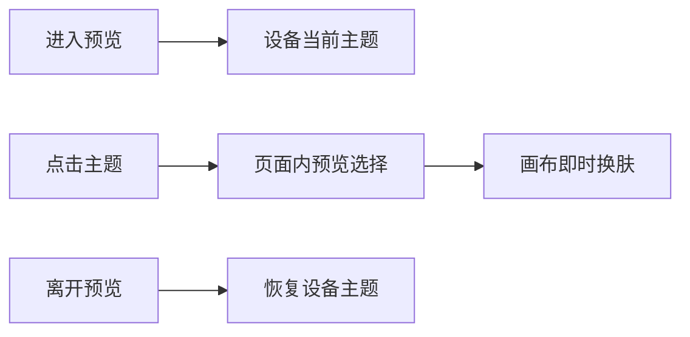

# 预览主题切换执行记录

## Intent：最终目标

预览模式下，在模式切换同一行右侧切换组件主题，并立即查看整张画布效果。

## Data：实施证据

- 复用 UI_THEMES 的自然、电子、暗夜三种主题及已有叶子、芯片、月亮图标。
- 仅在预览模式显示紧凑按钮组，具有主题名称、aria-pressed 和工具提示。
- 增加页面内 previewTheme，预览模式的主题 getter 优先读取该值，通过现有 data-ui-theme 和 CSS 变量更新画布。
- 预览工具栏禁用换行，使模式按钮和主题按钮保持同一行。

## Edges：边界与限制

- 主题切换用于当前页面预览，不调用布局提交或设备主题持久化，不产生 dirty 状态。
- 离开预览恢复设备原主题；同一编辑页再次进入预览保留已选择的预览主题。
- 不新增主题切换组件，不增加依赖、测试用例或浏览器 UI 检查。

## Answer：交付与验证

三主题按钮已加入预览工具栏右侧。最终本地构建通过，29 项现有回归通过。

## 架构图

## 数据流图

## 自我批判

主题按钮应复用现有主题定义，而不是再维护一份名称或颜色列表。预览主题与设备保存主题分开，避免一次查看效果意外更改设备。窄屏同排已通过尺寸约束处理，但未执行浏览器或真机视觉验证。
