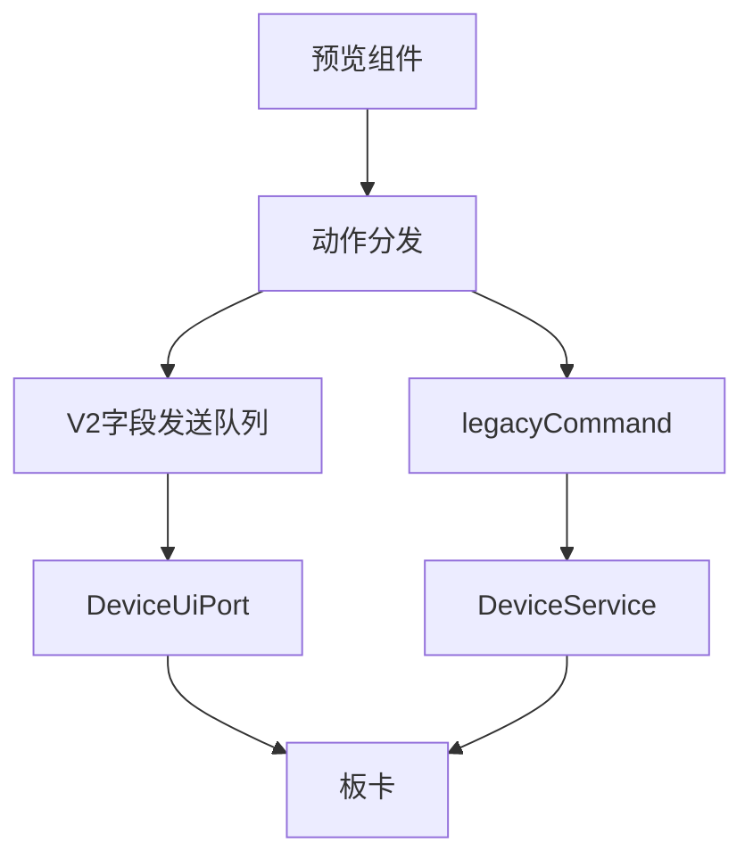
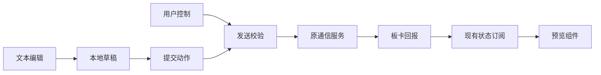

# 预览接入真实控制执行计划

## Intent：最终目标

编辑器预览模式的用户操作与设备组件控制中心一致，实际发送到板卡，由真实回报更新读数。添加部件后留在画布，不自动打开属性页。

## Data：可用证据

- 当前 previewAction 只写 previewValues，未发送命令，invoke 也未执行。
- 正常 V2 页面经 DeviceUiPort.sendCommand 分发，服务统一选择云端、LAN、BLE 等通道。
- 正常旧设备页面按 widgetId 取绑定，通过 legacyCommand 转换，再交给 DeviceService.sendData。
- 编辑器已有 watchState 和旧设备 subject 订阅，可以直接接收属性回报。
- 按住类部件的松开动作可能发生在上一条命令尚未返回时，需要保留每字段最新待发值。

## Edges：边界与限制

- 移除虚拟数值覆盖；文本 draft 仍是未提交输入，只有 commit 才发送。
- 控制检查沿用当前连接、Manifest、fresh state 和前台状态；不自行选择传输通道。
- 旧协议访客设备继续使用控制中心既有模拟行为，真实设备等待实际回报。
- 同字段发送串行化，保留后续释放动作；发送失败显示对应组件错误，不伪造设备执行结果。
- 不复制正常页面的完整遥测、布局加载或重连实现，不改变保存协议。
- 不新增测试用例、不调用浏览器、不主动向实际板卡发送验证命令。

## Answer：交付与成功标准

开关、数值范围、选项、文本提交和动作按钮经原有通信入口执行；设备回报刷新预览。添加部件后关闭部件库、留在画布。构建及现有回归通过，记录未进行硬件实测的边界。

## 架构图

## 数据流图

