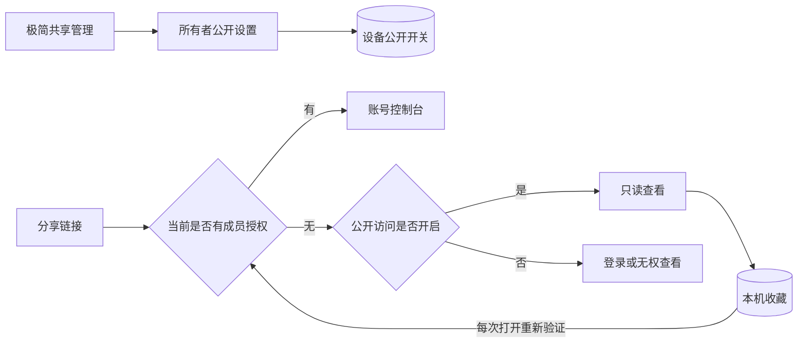
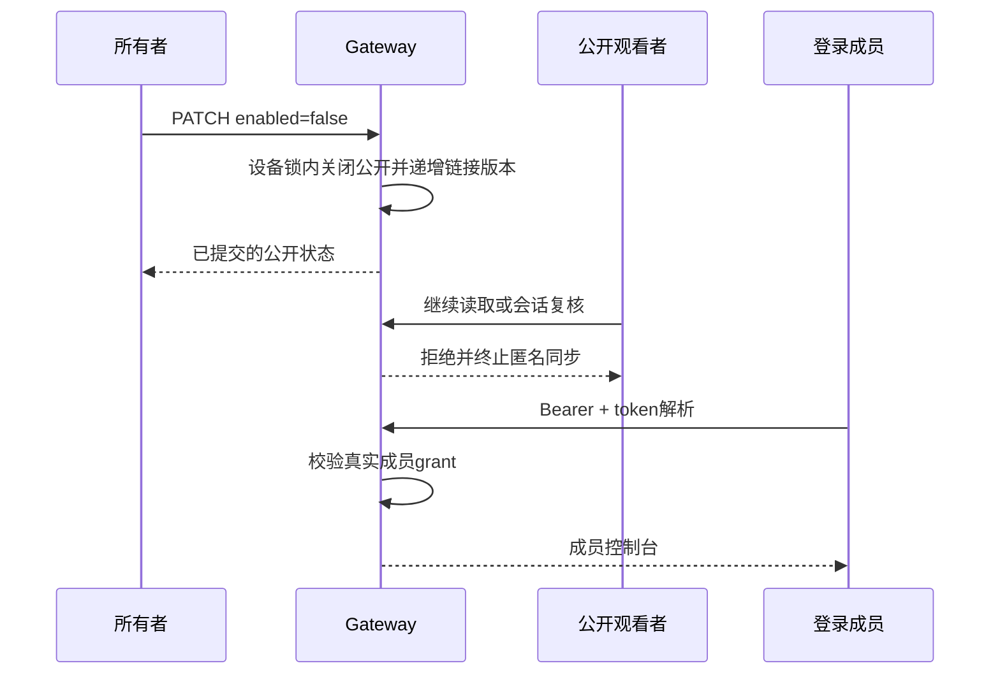

# 公开访问与共享管理执行记录

## Intent：最终目标

让共享管理可操作且极简：明确控制设备是否公开；公开访客能保存本机收藏；关闭后仅有效账号成员能继续访问。修复“正在读取”不结束的问题，且不恢复普通控制台的模式 Tab。

## Data：可用证据

- 用户确认公开访问用 switch 控制；未登录加入列表为本机收藏。
- 用户截图中的大设备卡、宣传段落、大块空状态及重复提示被明确要求移除。
- Angular 22 默认 OnPush，原共享页异步响应未调用 markForCheck。已在链接、成员和目录变化处补齐。
- 现有成员授权可独立于公开观看继续使用，匿名观看入口原来必须先打开公开会话，已调整为登录账号先验证成员身份。

## Edges：边界与限制

- 新设备公开访问默认关闭；迁移保留此前有效公开链接已授予的公开访问。
- 关闭公开不是作废链接，也不撤销账号成员；作废/轮换链接仍是独立操作。
- 观看会话按现有约 2 秒复核、最长 5 秒授权期限终止，不宣称瞬时跨实例撤销。
- 收藏只保存设备 ID、名称、分享 token、时间，不保存账号授权、配置、HTML、manifest 或实时状态。
- 本机收藏与账号目录分开，按 API 地址隔离，退出账号不删除；打开时重新验证服务端权限。
- 按用户要求未新增测试用例、未调用浏览器作 UI 验证，未向真实设备发送命令。

## Answer：交付格式与成功标准

交付最小范围的 App/Gateway 改动、迁移 042、接口白名单、执行记录。页面以实际操作为中心；公开关闭不能被旧会话、幂等重放或账号收藏绕过。

## 实现

### 公开访问

- `v2_logical_devices.console_public_enabled` 为独立设备字段，仅所有者可修改，不放进成员可编辑的 ui_config。
- `GET /api/v2/devices/:id/console-link` 返回 `{publicAccessEnabled, link}`。
- `PATCH /api/v2/devices/:id/console-public-access` 接受 `{enabled}`，只返回已提交开关状态。关闭不依赖 token 解密成功。
- 创建/更新公开链接在设备行锁内重新检查开关，检查发生在幂等结果返回之前。
- 关闭触发 link.version 递增；旧匿名会话失效，但 token 对设备的映射保留。
- 换主或设备归属变化关闭公开并作废旧链接；新所有者可替换旧 owner 的 link 行，不需要未知旧版本。

### 登录成员入口

- 新增 `POST /api/v2/console-links:resolve`，接收 token，使用账号 Bearer 鉴权。
- 解析有效链接后再次使用真实成员授权；不检查公开开关，不发匿名会话，不创建 grant。
- 登录页面先走成员解析，成功进入既有账号控制台；无授权者只有在公开开启时才能回退到公开查看。
- 公开关闭错误态提供登录入口；无成员权限的登录者仍不能读取。
- ServerInterceptor 为该精确路径保留 body.token，继续走账号认证与令牌刷新；不混用 ConsoleView 凭据。

### 本机收藏与页面

- 新 `PublicConsoleBookmarksService` 维护有限本机列表；存储通过 DeviceConsoleHost 适配，为未来子应用保留边界。
- 修改前重新读取持久化列表，同一实例写入串行化；写失败不会先显示成功。
- 公开查看成功后可使用右上角收藏加入列表。
- 登录页“设备共享”进入列表，未登录只显示本机设备；账号成员列表仍来自现有共享 API。
- 启动仅额外允许精确 `/share-manager` 根页面匿名访问，不开放设备共享设置路径。
- 共享管理主页面只保留设备名、公开访问、必要链接操作和成员；权限说明放到对应设置中。

## 架构图

## 数据流图

## 验证与自我批判

- App 本地构建通过，包含模板和样式检查；Gateway 构建通过。
- 前端现有 6 个文件、76 项检查通过，包含 HTTP 拦截器、V2 页面、配置页和状态适配。
- Gateway 现有 20 项共享相关检查通过，使用独立 PostgreSQL schema。
- 两仓库 diff 空白检查通过；本地 Gateway 重新构建并执行迁移 042。
- 现有检查没有覆盖完整的新开关与收藏 UI 流程，不把构建和旧测试当成真机端到端验收。
- 原“正在读取”问题说明只验证请求逻辑不足以证明异步渲染正确。本次明确补齐变更检测通知，没有用强行取消禁用或跳过读取来掩盖问题。
- 本机收藏不是共享成员；公开访问关闭后保留收藏名称并不代表仍有数据权限。服务端始终决定是否能继续读取。
- 本次不新增复杂发布系统、微服务、匿名账号或通用插件框架。
